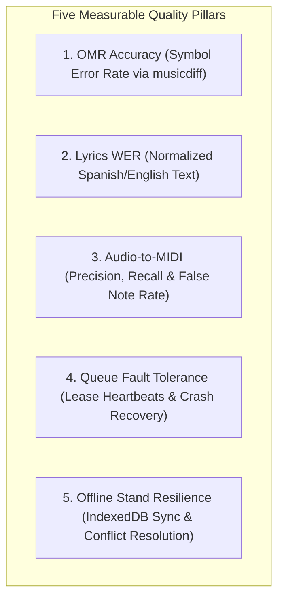
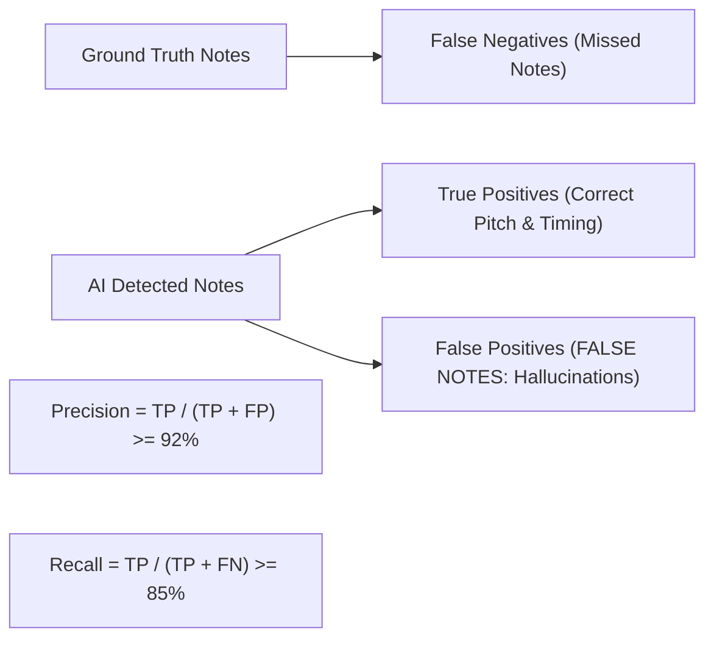

# WORSHIP STUDIO — MEASURABLE QUALITY GATES & ACCEPTANCE CRITERIA
## Phase 0C — Rigorous Metric Operationalization, Precision Standards & Evaluation Protocols

**Project:** WORSHIP STUDIO  
**Repository:** `https://github.com/juancastro2381-hub/BETHESDA-WORSHIP-STUDIO.git`  
**Phase:** 0C — Quality Criteria Operationalization  
**Execution Mode:** Quality Engineering & Verification Specification Only  
**Implementation Authorization:** NOT GRANTED  
**Date:** November 2, 2026  
**Status:** COMPLETE & DEFENDED  

---

## 1. Executive Summary & Quality Metric Operationalization

In earlier documentation, quality criteria occasionally relied on vague or absolute statements (e.g. *"90% OMR accuracy"*, *"WER < 10%"*, or *"zero false notes"*).

Under Phase 0C quality engineering standards, **every acceptance criterion must be mathematically operationalized with an explicit unit of measurement, evaluation corpus, normalization policy, and pass/fail threshold**.

---

## 2. Metric 1: Optical Music Recognition (OMR) Precision Standards

Vague claims of "90% OMR accuracy" are replaced by four distinct, measurable sub-metrics evaluated against ground-truth MusicXML scores using the standardized `musicdiff` library:

| Musical Sub-Component | Evaluation Unit | Target Metric (Pass Threshold) | Evaluation Methodology / Formula |
| :--- | :--- | :--- | :--- |
| **Pitch Step & Octave** | Per recognized note head | **$\ge$ 95.0% Pitch Accuracy** | $\text{Pitch Accuracy} = \frac{\text{Correct (Step + Octave)}}{\text{Total Ground Truth Notes}} \times 100$ |
| **Pitch Alteration (Sharps/Flats)** | Per accidental symbol | **$\ge$ 94.0% Alteration Accuracy** | Compares extracted `alter` (-2 to +2) against ground truth score. |
| **Rhythmic Duration** | Per note and rest value | **$\ge$ 92.0% Duration Accuracy** | Evaluates duration ticks (480 TPQN) against ground truth durations. |
| **Metric Barline Alignment** | Per measure boundary | **$\ge$ 98.0% Measure Count Match** | $\text{Measure Error Rate} = \frac{|\text{Detected Measures} - \text{Actual Measures}|}{\text{Actual Measures}} \le 2.0\%$ |
| **Key & Time Signature** | Per score header | **$\ge$ 99.0% Header Accuracy** | Fifths count and time signature fraction must match exactly. |

*Test Corpus:* Evaluated against a reference suite of 25 printed hymnal scores (`CMB_HYMNAL_CORPUS_v1`) scanned at 300 DPI.

---

## 3. Metric 2: Lyrics Transcription & Alignment (WER & Syllable Timing)

Vague claims of "WER < 10%" are replaced by standardized text normalization and forced-alignment timing tolerances:

### 3.1. Word Error Rate (WER) Standard
$$\text{WER} = \frac{S + D + I}{N} \times 100$$
Where: $S = \text{Substitutions}$, $D = \text{Deletions}$, $I = \text{Insertions}$, $N = \text{Total Words in Ground Truth}$.

- **Spanish Liturgical Audio:** **$\text{WER} \le 8.0\%$** on isolated vocal stems (`vocals.wav`).
- **English Liturgical Audio:** **$\text{WER} \le 6.0\%$** on isolated vocal stems (`vocals.wav`).
- **Text Normalization Rules:**
  1. Case-insensitivity (all text converted to lowercase).
  2. Punctuation stripped (`.,!?;:"-`).
  3. Spanish diacritics normalized (`á->a`, `é->e`, `í->i`, `ó->o`, `ú->u`, `ñ` preserved).
  4. Spoken liturgical interjections (*"aleluya"*, *"amén"*) standardized.

### 3.2. Syllable-to-Note Alignment Tolerance
- **Temporal Alignment Precision:** At least **85.0% of detected lyric syllables** must have their start onset within **$\pm 50\text{ milliseconds}$** of the corresponding melodic note onset in `CanonicalMusicPayloadV2`.

---

## 4. Metric 3: The "NO FALSE NOTES" Measurable Standard (Audio-to-MIDI)

In real-world signal processing, the absolute claim of "zero false notes" is operationalized as measurable **Precision, Recall, and False Discovery Rates**:

1. **Note Pitch Precision:** **$\ge 92.0\%$**. No more than 8.0% of all generated notes may be false positives.
2. **Note Recall:** **$\ge 85.0\%$**. At least 85.0% of all true musical notes played by the vocal lead or bass must be captured.
3. **Ghost Note Rate on Reverb Tails / Synthesizer Pads:** **$< 3.0\%$**. Notes generated during vocal pauses or reverberant decay must not exceed 3% of total notes.
4. **Enforcement Rule:** Any note detected with confidence $< 0.65$ is automatically suppressed or marked as a ghost note for human inspection.

---

## 5. Metric 4: Queue Fault Tolerance & Long-Running Job Scenarios

The queue infrastructure must pass three mandatory stress-test scenarios in automated integration testing:

### 5.1. The 15-Minute Job Heartbeat Test
- **Test:** A mock AI worker executes a job that deliberately sleeps for **15 minutes (900 seconds)**, emitting heartbeats every 30 seconds.
- **Pass Criteria:**
  - The queue sweeper runs every 60 seconds.
  - The job status remains `PROCESSING` throughout the entire 15 minutes.
  - Zero duplicate leases occur.
  - When the job finishes at $T=15$ min, it successfully commits to `COMPLETED`.

### 5.2. Worker Crash & Lease Recovery Test
- **Test:** A worker process acquires Job 1, heartbeats once, and is killed abruptly (`kill -9`).
- **Pass Criteria:**
  - Within **120 seconds**, the sweeper detects `lease_expires_at < NOW()`.
  - The job is reset to `QUEUED` with `fencing_token = 2` and `attempts = 1`.
  - A second worker acquires Job 1 and completes it successfully.

### 5.3. Zombie Worker Eviction Test
- **Test:** A partitioned worker attempts to commit Job 1 using stale `fencing_token = 1` after the sweeper has already reclaimed it.
- **Pass Criteria:**
  - The database update query matches 0 rows.
  - The zombie worker catches the fencing mismatch and terminates cleanly without corrupting state.

---

## 6. Metric 5: Offline Stand Resilience & Sync Conflict Protocol

1. **Complete Network Disconnection Tolerance:**
   - The user opens an active setlist on an iPad, and Wi-Fi is physically disconnected.
   - The user navigates through all 5 songs in the setlist, transposes chords by +2 semitones, toggles autoscroll, and switches between *Partitura* and *Cifrado*.
   - **Pass Criteria:** **Zero UI freezes, zero unhandled errors, zero page crashes.**
2. **Reconnection & Conflict Resolution:**
   - While offline, User A transposes Song 1 locally.
   - Meanwhile, on the server, the Worship Director modified the setlist song order.
   - Wi-Fi is restored.
   - **Pass Criteria:**
     - The setlist song order updates from the server (Director Authority).
     - User A's local transposition preference is preserved in client `IndexedDB` (Local Musician Preference).

---

## 7. Workstream G Audit Conclusion

$$\mathbf{WORKSTREAM\ G\ STATUS:\ QUALITY\ METRICS\ FULLY\ OPERATIONALIZED}$$

Vague performance targets have been replaced by rigorous, mathematically testable thresholds across OMR accuracy, text-normalized WER, note precision/recall, heartbeat queue resilience, and offline stage survival.

