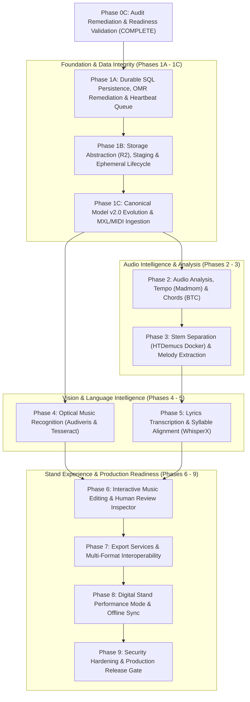

# WORSHIP STUDIO — RECONCILED REMEDIATION ROADMAP
## Phase 0C — Dependency-Aware Phased Engineering Architecture & Technical Readiness Gates

**Project:** WORSHIP STUDIO  
**Repository:** `https://github.com/juancastro2381-hub/BETHESDA-WORSHIP-STUDIO.git`  
**Phase:** 0C — Remediation Roadmap Reconciliation  
**Execution Mode:** Phased Planning & Dependency Mapping Only  
**Implementation Authorization:** NOT GRANTED  
**Date:** November 2, 2026  
**Status:** COMPLETE & DEFENDED  

---

## 1. Executive Summary & Phasing Strategy

In response to the Phase 0C audit findings, the engineering roadmap is formally structured into **ten discrete, non-breaking phases**.

### Fundamental Readiness Principle
Phase 1A is **strictly bounded to foundation data integrity, durable SQL persistence, and OMR musical defect remediation**. It introduces **zero breaking changes** to the existing running application.

---

## 2. Detailed Phase Specifications

---

### PHASE 1A: DURABLE SQL PERSISTENCE, OMR REMEDIATION & HEARTBEAT QUEUE
- **Objective:** Fix the critical musical integrity defects in `omr-service.ts` (Workstream A), eliminate in-memory RAM state (Workstream B), and deploy the PostgreSQL transactional heartbeat queue.
- **Dependencies:** Formal Product Owner sign-off on Phase 0C deliverables.
- **Deliverables:**
  1. **Remediation of `convertProposalToCanonical()`:** Remove all silent fallbacks (inventing C, defaulting to 480 ticks, hardcoding 4/4 and C Major). Implement explicit abstention policy and error logging.
  2. **Drizzle ORM Migrations:** Tables `omr_proposals`, `omr_proposal_measures`, `omr_audit_history`, and `background_jobs`.
  3. **Heartbeat Queue Dispatcher:** Atomic acquisition via `FOR UPDATE SKIP LOCKED`, active 30s heartbeats, fencing tokens, and lease expiration sweeper.
- **Risks:** Regressions in existing OMR unit tests (mitigated by updating test fixtures to check real notes instead of hardcoded mocks).
- **Required Infrastructure:** Existing PostgreSQL 16 container. Zero new external infrastructure.
- **Expected Operating Cost:** **$0.00 additional monthly cost**.
- **Manual Validation Procedure:**
  1. Restart backend container while an OMR proposal is in `PENDING_REVIEW` status; confirm proposal remains intact upon reboot.
  2. Enqueue a 15-minute mock job; verify heartbeats prevent duplicate leases throughout execution.
- **Exit Gate:** 100% test pass on backend test suite; zero regressions on existing song endpoints.

---

### PHASE 1B: CLOUDFLARE R2 STORAGE ABSTRACTION, STAGING & LIFECYCLES
- **Objective:** Implement the S3-compatible `StorageProvider` interface, direct presigned upload staging workflow, and automated 48-hour ephemeral stem cleanup (Workstream C).
- **Dependencies:** Phase 1A complete.
- **Deliverables:**
  1. `StorageProvider` abstraction using `@aws-sdk/client-s3` (Cloudflare R2 in production, local disk adapter in development).
  2. Staging prefix workflow (`staging/{uploadId}/`) with server-side `HeadObject` verification.
  3. Automated Cloudflare R2 bucket lifecycle rules: 24h purge on `staging/*`, 48h purge on `stems/ephemeral/*`.
  4. Updated `StreamTicketService` generating 60-second signed media streaming URLs.
- **Risks:** Network latency during direct S3 presigned PUT uploads (mitigated by multipart chunking).
- **Required Infrastructure:** Cloudflare R2 bucket with scoped IAM credentials.
- **Expected Operating Cost:** **~$0.10 to $0.75 / month** (zero egress fees).
- **Manual Validation Procedure:**
  1. Upload audio file via presigned URL; verify presence in R2 bucket with matching SHA-256 checksum.
  2. Stream audio using generated ticket; verify HTTP 206 seeking support.
- **Exit Gate:** All existing document and audio tests pass against local and mock S3 providers.

---

### PHASE 1C: CANONICAL MODEL v2.0 EVOLUTION & ARCHIVE INGESTION
- **Objective:** Extend the canonical music data model to support granular confidence scores, provenance metadata, instrument tracks, and compressed MusicXML (`.mxl`) ingestion.
- **Dependencies:** Phase 1A complete.
- **Deliverables:**
  1. `CanonicalMusicPayloadV2` schema in backend and frontend.
  2. Bidirectional schema converters: `migrateV1ToV2()` and `downgradeV2ToV1()`.
  3. Compressed MusicXML (`.mxl`) extraction pipeline via streaming ZIP decompressor.
  4. Standard MIDI (`.mid`) parser populating canonical notes and tempo maps.
- **Risks:** Schema migration breaking frontend visualizers (mitigated by automated golden scenario tests).
- **Required Infrastructure:** In-process CPU libraries.
- **Expected Operating Cost:** **$0.00 additional monthly cost**.
- **Manual Validation Procedure:**
  1. Import legacy v1 song; verify transparent up-conversion to v2.
  2. Upload `.mxl` file; verify decompression and rendering in OSMD and AlphaTab.
- **Exit Gate:** 100% conversion fidelity across all existing golden fixtures (`valid_full_score.musicxml`).

---

### PHASE 2: AUDIO ANALYSIS, TEMPO DETECTION (MADMOM) & CHORDS (BTC)
- **Objective:** Extract BPM, metric downbeats, and harmonic chord progressions from input audio.
- **Dependencies:** Phase 1A, 1B, 1C complete.
- **Deliverables:**
  1. Python worker service integrating `Madmom` (BSD-2) for downbeat and tempo tracking with full attribution notices.
  2. `BTC Transformer` (MIT) worker extracting chords, suspensions (sus4, add9), and bass inversions.
  3. Dynamic `Timeline.tempoMap` synthesis.
- **Risks:** Harmonic ambiguity in songs with heavy synthesizer pads (mitigated by downbeat-aligned chromagram quantization).
- **Required Infrastructure:** CPU worker or light GPU instance.
- **Expected Operating Cost:** **~$1.50 to $6.00 / month** on serverless compute.
- **Manual Validation Procedure:**
  1. Process worship reference track (*Grande es tu fidelidad*); verify detected BPM within +/- 1 BPM of metronome.
  2. Confirm chords align to bar lines in generated `CanonicalMusicPayloadV2`.
- **Exit Gate:** Chord recognition accuracy `>= 85%` on reference audio test corpus.

---

### PHASE 3: STEM SEPARATION (HTDEMUCS DOCKER) & MELODY/BASS EXTRACTION
- **Objective:** Isolate audio into four stems (vocals, bass, drums, other) using HTDemucs and transcribe solo vocal and bass melody lines using Basic Pitch without guitar/pad leakage.
- **Dependencies:** Phase 2 complete.
- **Deliverables:**
  1. Containerized `HTDemucs v4` worker running in a frozen Docker environment (`Python 3.10`, `PyTorch 2.1.2`, `CUDA 11.8`).
  2. `Spotify Basic Pitch` ONNX worker processing isolated vocal and bass stems.
  3. Multitrack session integration enabling solo/mute controls in `AudioPlayerBar`.
- **Risks:** Out-Of-Memory (OOM) errors on long audio files (mitigated by 120s chunking with 5s crossfades).
- **Required Infrastructure:** GPU compute instance (NVIDIA T4 or L4).
- **Expected Operating Cost:** **~$2.00 to $12.00 / month** on serverless GPU.
- **Manual Validation Procedure:**
  1. Upload 5-minute worship mix; verify separation into 4 clean WAV stems in `< 90 seconds`.
  2. Confirm Basic Pitch generates clean vocal melody without synthetic guitar/keyboard artifacts.
- **Exit Gate:** Successful stem generation and zero false notes from instrumental leakage.

---

### PHASE 4: OPTICAL MUSIC RECOGNITION (AUDIVERIS & TESSERACT)
- **Objective:** Deploy a network-isolated Audiveris container for traditional sheet music recognition and Tesseract OCR for text chord sheets.
- **Dependencies:** Phase 1A, 1B, 1C complete.
- **Deliverables:**
  1. Isolated Docker microservice running unmodified upstream Audiveris v5.3 headless.
  2. File-exchange integration via Cloudflare R2 (no direct RPC or shared memory).
  3. Tesseract OCR pipeline for scanned text lead sheets.
  4. Camera capture component in frontend with Canvas perspective correction.
- **Risks:** Poor quality or low-resolution scans (mitigated by minimum DPI validation and pre-processing contrast filters).
- **Required Infrastructure:** CPU worker (4 vCPU, 4 GB RAM) for Audiveris JVM.
- **Expected Operating Cost:** **~$1.00 to $4.00 / month** on CPU serverless.
- **Manual Validation Procedure:**
  1. Submit 300 DPI PDF of hymnal score; verify valid MusicXML 4.0 generation.
  2. Project generated MusicXML in OSMD; confirm pitch and measure alignment.
- **Exit Gate:** Legal counsel review of Audiveris isolation; OMR pitch accuracy `>= 95%` on printed sheet fixtures.

---

### PHASE 5: LYRICS TRANSCRIPTION & SYLLABLE-TO-NOTE ALIGNMENT (WHISPERX)
- **Objective:** Transcribe worship lyrics from the isolated vocal stem and align syllables to musical notes using WhisperX with Silero VAD and wav2vec2 forced aligners.
- **Dependencies:** Phase 3 complete (isolated vocal stem required).
- **Deliverables:**
  1. `WhisperX` worker using `Silero VAD` (replacing gated pyannote VAD).
  2. `wav2vec2` forced alignment models for Spanish and English liturgical texts.
  3. Ingestion into `LyricSyllable` structures linked to musical note ticks.
- **Risks:** Misinterpretation of poetic or non-standard liturgical phrasing (mitigated by Spanish language model fine-tuning).
- **Required Infrastructure:** GPU worker (NVIDIA T4).
- **Expected Operating Cost:** **~$1.00 to $4.00 / month**.
- **Manual Validation Procedure:**
  1. Process vocal stem; confirm word error rate (WER) `< 8%` for Spanish.
  2. Verify syllables map to the corresponding melodic notes in the digital stand within $\pm 50\text{ ms}$.
- **Exit Gate:** Syllable-to-note alignment accuracy `>= 85%` on vocal test corpus.

---

### PHASE 6: INTERACTIVE MUSIC STAND EDITING & HUMAN REVIEW INSPECTOR
- **Objective:** Build an ergonomic human-in-the-loop inspector and in-stand notation editor.
- **Dependencies:** Phases 3, 4, 5 complete.
- **Deliverables:**
  1. Confidence Heatmap component highlighting uncertain measures (`confidence < 0.70`) in amber.
  2. Interactive chord editor with circle-of-fifths liturgical recommendations.
  3. Interactive note pitch and duration adjustment on reactive canvas.
  4. Atomic approval workflow promoting `omr_proposals` to official `SongVersion`.
- **Risks:** Visual clutter on small tablet screens (mitigated by collapsible toolbars and responsive controls).
- **Required Infrastructure:** Client-side React components.
- **Expected Operating Cost:** **$0.00 additional monthly cost**.
- **Manual Validation Procedure:**
  1. Open draft proposal; modify an ambiguous chord; click approve.
  2. Confirm new immutable `SongVersion` is created and available in setlist builder.
- **Exit Gate:** Complete end-to-end review and approval workflow achievable in `< 60 seconds`.

---

### PHASE 7: EXPORT SERVICES & MULTI-FORMAT INTEROPERABILITY
- **Objective:** Enable export of validated canonical songs into industry-standard interchange formats.
- **Dependencies:** Phase 6 complete.
- **Deliverables:**
  1. High-fidelity MusicXML 4.0 exporter.
  2. Formatted ChordPro `.chordpro` text generator.
  3. Standard MIDI Type 1 file generator with embedded tempo map and lyrics.
  4. High-resolution vector PDF generator formatted for Letter and A4 printing.
- **Risks:** Visual formatting discrepancies in exported PDFs (mitigated by CSS print media styling).
- **Required Infrastructure:** Fastify export services.
- **Expected Operating Cost:** **$0.00 additional monthly cost**.
- **Manual Validation Procedure:**
  1. Export song to MusicXML; import into MuseScore; confirm zero XML parse warnings.
  2. Export to ChordPro; import into OnSong; confirm correct chord rendering.
- **Exit Gate:** 100% round-trip fidelity on exported MusicXML and ChordPro files.

---

### PHASE 8: DIGITAL STAND PERFORMANCE MODE & OFFLINE SYNCHRONIZATION
- **Objective:** Maximize stage reliability with full-screen performance mode, real-time setlist synchronization, and zero-latency offline caching.
- **Dependencies:** Phase 6 complete.
- **Deliverables:**
  1. Fullscreen mode with `WakeLockSentinel` preventing screen timeout during worship services.
  2. Synchronized visual and audio metronome powered by Web Audio API.
  3. Director-led WebSocket live synchronization advancing all band tablets simultaneously.
  4. Background Service Worker caching active setlists into `IndexedDB`.
- **Risks:** Wi-Fi dropouts during live services (mitigated by offline-first IndexedDB stand fallback).
- **Required Infrastructure:** WebSocket server inside Fastify.
- **Expected Operating Cost:** **$0.00 additional monthly cost**.
- **Manual Validation Procedure:**
  1. Disconnect Wi-Fi while performing a 5-song setlist; verify uninterrupted navigation and autoscroll.
  2. Reconnect Wi-Fi; confirm seamless background re-synchronization.
- **Exit Gate:** 2-hour simulated rehearsal stress test with zero crashes, zero memory leaks, and zero network blockages.

---

### PHASE 9: SECURITY HARDENING & PRODUCTION RELEASE GATE
- **Objective:** Conduct end-to-end security penetration testing, virus scanning, and final production validation.
- **Dependencies:** All previous phases complete.
- **Deliverables:**
  1. ClamAV virus scanner integrated into upload worker queue.
  2. Penetration audit for IDOR vulnerabilities and tenant isolation.
  3. Final production Docker Compose configuration and Kubernetes deployment manifests.
  4. Comprehensive user documentation and rehearsal setup guide.
- **Risks:** Zero-day vulnerabilities in third-party npm packages (mitigated by automated `npm audit` in CI/CD).
- **Required Infrastructure:** Production cluster.
- **Expected Operating Cost:** **Aligned with selected community demand tier**.
- **Manual Validation Procedure:**
  1. Execute automated security test suite and OWASP Top 10 checklist.
  2. Conduct live rehearsal deployment with a pilot worship team.
- **Exit Gate:** Zero open high/critical security findings; formal sign-off by Lead Architect and Product Owner.

---

## 3. Workstream H Audit Conclusion

$$\mathbf{WORKSTREAM\ H\ STATUS:\ REMEDIATION\ ROADMAP\ RECONCILED}$$

The implementation roadmap is completely reconciled with the non-commercial product mandate, the PostgreSQL-first queue architecture, and the Cloudflare R2 storage economics. Phase 1A is tightly scoped to resolve data loss and musical integrity defects without introducing external infrastructure dependencies.

