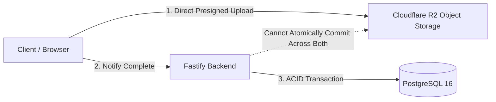
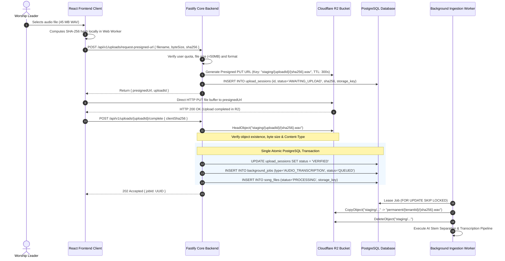
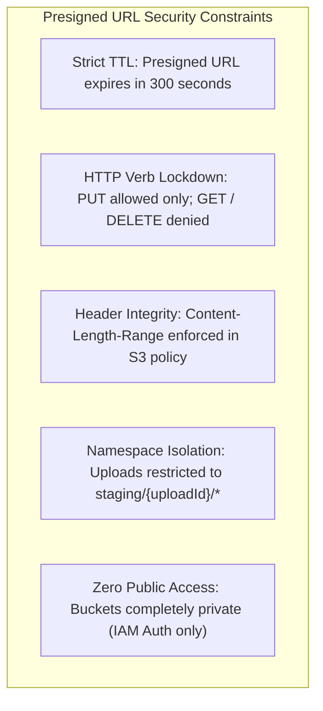
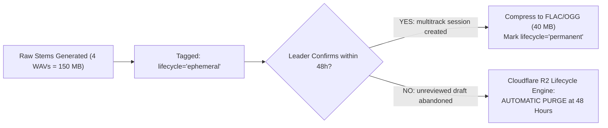

# WORSHIP STUDIO — CLOUDFLARE R2 & POSTGRESQL CONSISTENCY DESIGN
## Phase 0C — Distributed Transaction Strategy, Outbox Pattern & Failure Mode Reconciliation

**Project:** WORSHIP STUDIO  
**Repository:** `https://github.com/juancastro2381-hub/BETHESDA-WORSHIP-STUDIO.git`  
**Phase:** 0C — Storage Consistency Design  
**Execution Mode:** Systems Architecture & Distributed Consistency Specification Only  
**Implementation Authorization:** NOT GRANTED  
**Date:** November 2, 2026  
**Status:** COMPLETE & DEFENDED  

---

## 1. Executive Summary & The Dual-Write Problem

A fundamental distributed systems challenge in modern cloud architecture is that **PostgreSQL and Cloudflare R2 do not participate in a shared Two-Phase Commit (2PC) transaction**.

If an architecture naively assumes atomicity across both systems, inevitable failure modes arise:
1. **Orphan Objects in Storage:** The client uploads a 45 MB audio file to Cloudflare R2, but crashes before notifying PostgreSQL. R2 incurs storage costs for a file no database record references.
2. **Dangling Database References:** PostgreSQL records an uploaded song version, but network failure or quota exhaustion prevents the worker from retrieving the file from R2.
3. **Partial Multipart Uploads:** Upload is interrupted halfway; multipart fragments accumulate indefinitely in storage.

This document establishes a **Staged Upload Lifecycle, Transactional Outbox, and Automated Reconciliation Protocol** ensuring eventual consistency without claiming impossible distributed atomicity.

---

## 2. The Staged Ingestion Protocol & Two-Phase Upload Architecture

### 2.1. Key Principles of the Protocol
1. **Isolated Staging Namespace:** All user uploads enter the `staging/{uploadId}/` prefix in Cloudflare R2. Files in `staging/` are strictly non-authoritative and invisible to the application stand.
2. **Server-Side Object Verification:** The backend never trusts client completion reports. Fastify executes an S3 `HeadObject` command to verify that:
   - The object actually exists in R2.
   - The recorded `Content-Length` matches the authorized byte size.
   - The HTTP Content-Type conforms to accepted musical MIME types.
3. **Atomic Database Registration & Job Enqueueing:** The transition of `upload_sessions` to `VERIFIED`, the insertion into `song_files`, and the insertion into `background_jobs` occur within a **single local PostgreSQL transaction**. If the database fails, the job is not queued.
4. **Promotion to Permanent Storage by Worker:** Only when the worker successfully leases the job does it promote the file from `staging/` to `permanent/{tenantId}/{sha256}.wav`.

---

## 3. Comprehensive Failure-Mode Matrix & Self-Healing Reconciliation

The table below catalogs every possible distributed failure scenario and its deterministic recovery mechanism:

| Failure Mode ID | Point of Failure | System State | Automated Self-Healing Mechanism | Guarantee |
| :--- | :--- | :--- | :--- | :--- |
| **FM-01** | Client drops network during direct R2 PUT upload. | Incomplete multipart fragments or zero bytes in R2 staging. `upload_sessions` in `AWAITING_UPLOAD`. | **Cloudflare R2 Bucket Lifecycle Rule:** Objects under `staging/` older than 24 hours are automatically deleted by Cloudflare. | Zero orphan storage accumulation. |
| **FM-02** | Client completes R2 upload, but client crashes before calling `/complete`. | Valid object in `staging/`. Database row in `AWAITING_UPLOAD`. No job created. | 1. R2 24-hour lifecycle rule automatically purges the staged object. 2. Background DB sweeper marks `upload_sessions` older than 2 hours as `EXPIRED`. | No stranded database records; no storage waste. |
| **FM-03** | Client calls `/complete`, but Fastify `HeadObject` check to R2 fails (file missing). | Database record in `AWAITING_UPLOAD`. File not found in R2. | Fastify rejects request with `422 Unprocessable Entity` (`"Uploaded file verification failed in object storage"`). Transaction aborted. | Database never registers a missing file. |
| **FM-04** | Fastify verifies object, but PostgreSQL crashes during transaction commit. | Object in `staging/`. PostgreSQL rolled back. Client receives HTTP 500. | Client re-submits `/complete`. Staging object is verified again and database transaction succeeds on retry. If client never retries, FM-02 applies. | Idempotent completion workflow. |
| **FM-05** | Database commits successfully, but background worker crashes during processing. | Object in `permanent/` or `staging/`. `background_jobs` in `PROCESSING`. | Workstream B **Heartbeat Lease Protocol** reclaims expired lease after 2 minutes, re-enqueuing the job for another worker. | Zero lost processing jobs. |
| **FM-06** | Duplicate upload requests: Two worship leaders upload the exact same MP3 file. | Two upload sessions with identical `sourceSha256`. | Fastify checks `song_files` by `sourceSha256`. If already processed, Fastify bypasses AI compute and associates existing canonical payload directly. | Zero duplicate AI inference costs. |
| **FM-07** | Worker finishes AI transcription, but PostgreSQL crashes during proposal commit. | Stems written to R2 `stems/{proposalId}/`. Database write aborted. | Worker catches DB failure, raises retryable error. Fencing token preserves lease. Worker retries atomic proposal commit. | Consistency preserved across retries. |

---

## 4. Presigned URL Security & Bucket Isolation Rules

To prevent malicious exploitation, Cloudflare R2 presigned URLs must adhere to strict defensive controls:

1. **Short Time-To-Live (TTL):** Upload URLs expire after **300 seconds** (5 minutes). Download/streaming URLs expire after **60 seconds**.
2. **Method & Header Constraints:**
   - The presigned URL allows only HTTP `PUT`.
   - The AWS SDK presigning policy enforces `content-length-range` matching the declared byte size (`min: byteSize, max: byteSize`). Clients cannot upload a 5 GB ISO image using a presigned URL granted for a 5 MB score.
3. **Private Buckets & Origin Access:**
   - Cloudflare R2 buckets are completely private. Public read access is permanently disabled.
   - The digital music stand streams audio stems exclusively through short-lived signed URLs generated by `StreamTicketService`.

---

## 5. Storage Lifecycle Automation: The 48-Hour Ephemeral Rule

To maintain predictable operational costs under the non-commercial product model, automated Cloudflare R2 lifecycle rules must be configured:

1. **Prefix `staging/*`:** Lifecycle expiration rule = **1 Day (24 Hours)**.
2. **Prefix `stems/ephemeral/*`:** Lifecycle expiration rule = **2 Days (48 Hours)**.
3. **Prefix `permanent/*`:** No automated deletion. Backed up via daily snapshot to secondary regional bucket.

---

## 6. Workstream C Conclusion

$$\mathbf{WORKSTREAM\ C\ STATUS:\ CONSISTENCY\ STRATEGY\ FULLY\ SPECIFIED}$$

Distributed atomicity between PostgreSQL and Cloudflare R2 cannot be assumed. However, the **Staged Ingestion Protocol, Server-Side Verification, and Automated Lifecycle Purging** defined in this document eliminate orphan objects, prevent dangling references, and guarantee eventual consistency for Phase 1B implementation.

