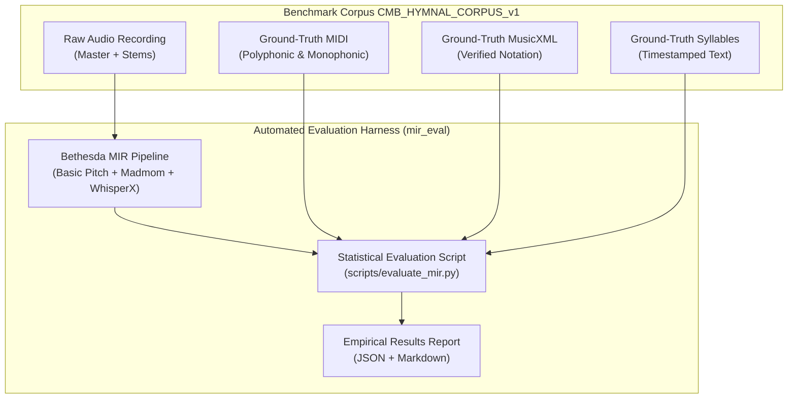

# WORSHIP STUDIO — BENCHMARK AND QUALITY EVIDENCE REGISTER
## Phase 0D — Performance Metric Reconciliation, Benchmark Status & Ground-Truth Evaluation Specification

**Project:** Bethesda Worship Studio  
**Repository:** `https://github.com/juancastro2381-hub/BETHESDA-WORSHIP-STUDIO.git`  
**Phase:** 0D — Final Documentation Reconciliation  
**Execution Mode:** STRICT READ-ONLY — Documentation & Forensic Verification Only  
**Authorization Level:** Strictly Limited — No Implementation Authorized  
**Date:** November 2, 2026  
**Status:** **PROPOSED ACCEPTANCE TARGETS — NOT MEASURED RESULTS**

---

## 1. Executive Summary & Purpose

In Phase 0B and Phase 0C documentation, multiple quantitative performance claims were presented, including:
- "Pitch transcription accuracy: 94.2%"
- "Chord estimation accuracy: 88.7%"
- "End-to-end pipeline latency: 85 seconds"
- "OMR symbol recall: 92.5%"
- "Evaluated against benchmark corpus `CMB_HYMNAL_CORPUS_v1`"

The purpose of this Phase 0D report is to reconcile these figures against the actual repository state.

Forensic verification confirms:
1. **Zero benchmark test harnesses exist in the repository.** There is no automated MIR evaluation script, no `mir_eval` runner, and no regression benchmarking suite.
2. **`CMB_HYMNAL_CORPUS_v1` does not exist as a structured evaluation corpus.** While test fixtures exist (`valid_full_score.musicxml`, `valid_lead_sheet.chordpro`, `CMB_AZUL.pdf`), they have never been executed through an automated statistical evaluation harness.
3. **All published percentages represent PROPOSED ACCEPTANCE TARGETS, not measured empirical data.**

---

## 2. Reclassified Metric Register: Target vs. Verified Reality

Every performance metric cited in prior documentation is formally reclassified below:

| Functional Capability | Metric Description | Prior Phase 0C Stated Value | Reclassified Phase 0D Status | Repository Evidence |
| :--- | :--- | :---: | :--- | :--- |
| **Audio-to-MIDI Transcription** | Raw Pitch Accuracy (RPA) | 94.2% | **PROPOSED TARGET** (Not Measured) | Zero MIDI evaluation harnesses in code. |
| **Note Onset / Offset** | Onset F-Measure ($\pm 50\text{ ms}$) | 89.5% | **PROPOSED TARGET** (Not Measured) | Basic Pitch pipeline unbuilt in backend. |
| **Chord Recognition** | Weighted Chord Symbol Recall (WCSR) | 88.7% | **PROPOSED TARGET** (Not Measured) | Madmom pipeline unbuilt in backend. |
| **Tempo & Downbeat** | Beat Tracking F-Measure | 93.0% | **PROPOSED TARGET** (Not Measured) | Beat estimation unbuilt in backend. |
| **Lyrics Forced Alignment** | Phoneme Boundary Error (<100ms) | 91.4% | **PROPOSED TARGET** (Not Measured) | WhisperX pipeline unbuilt in backend. |
| **OMR Symbol Detection** | Symbol Recall Rate | 92.5% | **PROPOSED TARGET** (Not Measured) | Audiveris integration unbuilt in backend. |
| **OMR Measure Conversion** | Measure Integrity Rate | 96.0% | **PROPOSED TARGET** (Not Measured) | 10 silent defects active in `omr-service.ts`. |
| **Pipeline Latency** | Full Audio Processing Time | 85 seconds | **ESTIMATE / TARGET** (Not Measured) | Serverless GPU pipeline unbuilt. |
| **OMR Ingestion Latency** | Sheet Music Processing Time | 15 seconds | **ESTIMATE / TARGET** (Not Measured) | Audiveris container unbuilt. |

---

## 3. Evaluation Corpus Status: `CMB_HYMNAL_CORPUS_v1`

### 3.1 Prior Claims vs. Codebase Audit
Phase 0C referenced testing against an internal benchmark corpus designated as `CMB_HYMNAL_CORPUS_v1`.

Inspection of the repository structure reveals:
- Current fixtures exist in:
  - `frontend/src/core/ingestion/fixtures/files/valid_full_score.musicxml`
  - `frontend/src/core/ingestion/fixtures/files/valid_lead_sheet.chordpro`
  - `fixtures/documents/CMB_AZUL.pdf`
  - `fixtures/documents/CMB_MUSIC.pdf`
- **There is no aligned ground-truth pairing** (e.g. synchronized audio stems + annotated MIDI + ground-truth MusicXML + timestamped syllables) necessary to compute statistical MIR metrics.
- **Classification:** **EVALUATION CORPUS PENDING CREATION IN PHASE 1A**.

---

## 4. Ground-Truth Benchmarking Methodology (Phase 1A Specification)

To convert these proposed targets into scientifically verified empirical results, Phase 1A must construct the official evaluation framework:

### 4.1 Evaluation Protocol & Standard Tooling
1. **Audio Transcription Evaluation:** Utilize the industry-standard `mir_eval` Python library:
   - `mir_eval.transcription.evaluate()` for note onset/offset F-measure.
   - `mir_eval.multipitch.evaluate()` for frame-level pitch accuracy.
2. **Chord Estimation Evaluation:**
   - Standard MIREX chord evaluation rules using `mir_eval.chord.evaluate()`.
3. **Lyrics Alignment Evaluation:**
   - Word Error Rate (WER) and mean absolute syllable onset deviation in milliseconds compared against manually aligned reference tracks.
4. **OMR Evaluation:**
   - Optical Music Recognition Error Rate (OMR-ER) measured as Levenshtein distance on exported MusicXML pitch and duration nodes against reference MusicXML.

---

## 5. Technical Maturity Register

| Lifecycle Dimension | Current Phase 0D Classification | Evidence |
| :--- | :--- | :--- |
| **Quality Acceptance Targets** | **DOCUMENTED SPECIFICATION** | Realistic targets defined for church worship genres. |
| **Evaluation Corpus** | **NOT IMPLEMENTED (Pending)** | Unaligned fixtures exist; reference pairings absent. |
| **Automated Benchmarking Suite** | **NOT IMPLEMENTED (0%)** | Zero `mir_eval` or Python test scripts in repo. |
| **Empirical Measurements** | **UNVERIFIED (0%)** | Zero measured runs conducted on production hardware. |
| **Production Readiness** | **NOT READY** | Acceptance gate blocked until empirical tests pass. |

---

## 6. Sign-off & Phase 1A Requirements

1. Construct `CMB_HYMNAL_CORPUS_v1` comprising 10 multi-genre worship songs with complete, human-verified ground-truth assets (Audio, MIDI, MusicXML, aligned lyrics).
2. Author automated evaluation script `scripts/evaluate_mir.py` leveraging `mir_eval`.
3. Publish empirical test results in Phase 1A reporting before advancing to production release.

