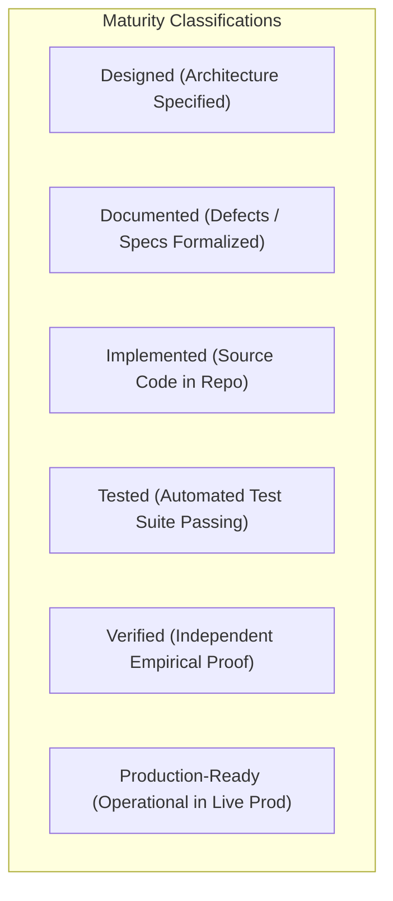

# WORSHIP STUDIO — FINAL PRODUCT OWNER READINESS GATE
## Phase 0D — Master Architecture Reconciliation, 12-Area Status Assessment & Product Owner Decision Register

**Project:** Bethesda Worship Studio  
**Repository:** `https://github.com/juancastro2381-hub/BETHESDA-WORSHIP-STUDIO.git`  
**Current Branch:** `main`  
**Phase:** 0D — Final Documentation Reconciliation  
**Execution Mode:** STRICT READ-ONLY — Documentation & Forensic Verification Only  
**Authorization Level:** Strictly Limited — No Implementation Authorized  
**Date:** November 2, 2026  
**Final Phase 0D Verdict:** **DOCUMENTATION RECONCILIATION PASSED / PHASE 1A COMMENCEMENT READY FOR PO SIGN-OFF**

---

## 1. Executive Summary & Purpose

Phase 0D constitutes the definitive governance and documentation reconciliation gate for the Bethesda Worship Studio intelligent music conversion platform.

Following extensive forensic code inspection, mathematical auditing, software licensing review, and repository history analysis, this report provides the Product Owner with an unvarnished, mathematically precise assessment of repository reality.

### Fundamental Principle Enforced
> [!IMPORTANT]
> **DESIGN COMPLETE $\neq$ IMPLEMENTATION COMPLETE**  
> **IMPLEMENTATION COMPLETE $\neq$ TESTED**  
> **TESTED $\neq$ INDEPENDENTLY VERIFIED**  
> **INDEPENDENTLY VERIFIED $\neq$ PRODUCTION READY**  
> 
> No architectural design is represented as code. No code defect is represented as fixed until source lines and automated tests prove it. No metric is represented as measured without a reproducible benchmark harness.

---

## 2. Comprehensive 12-Area Technical Maturity Assessment

Every technical dimension of the planned music transcription and digital music stand platform has been assessed across the six lifecycle maturity states:



| Area # | Technical Domain | Phase 0D Maturity Status | Codebase Reality & Evidence |
| :---: | :--- | :--- | :--- |
| **1** | **OMR Conversion Logic & Musical Integrity** | **DOCUMENTED DEFECTS — IMPLEMENTATION NOT VERIFIED** | All 10 silent fallback/corruption defects remain open in [`backend/src/application/omr-service.ts`](file:///c:/Users/juanc/OneDrive/Documentos/Desarrollo%20proyectos/Sistema%20musical%20-%20partituras/BETHESDA%20WORSHIP%20STUDIO/backend/src/application/omr-service.ts). Zero code fixes applied. |
| **2** | **Relational Persistence Layer (OMR Proposals/Measures)** | **DESIGNED — NOT IMPLEMENTED OR TESTED** | Proposed tables (`omr_proposals`, `omr_proposal_measures`, `omr_audit_history`, `background_jobs`) are absent from `backend/src/db/schema.ts`. Proposals exist only in volatile process memory (`Map`). |
| **3** | **Asynchronous Job Processing Queue** | **DESIGNED — NOT IMPLEMENTED OR TESTED** | Zero queue libraries in `backend/package.json` (no BullMQ, pg-boss, etc.); zero worker containers in `docker-compose.yml`. |
| **4** | **Worker Lease, Heartbeat & Fencing Tokens** | **DESIGNED — NOT IMPLEMENTED OR TESTED** | Concurrency safety protocol is fully specified mathematically, but zero lines of application locking code exist in the repository. |
| **5** | **Cloudflare R2 Object Storage Integration** | **ARCHITECTURE DESIGNED — IMPLEMENTATION NOT VERIFIED** | `@aws-sdk/client-s3` is not installed. Codebase exclusively implements local filesystem storage (`LocalFileSystemAudioStorageProvider` writing to `storage/audio`). |
| **6** | **Storage Dual-Write Atomicity & Orphan Sweeper** | **DESIGNED — NOT IMPLEMENTED OR TESTED** | Transactional outbox (`storage_operations`) and periodic GC reconciliation sweeper are fully designed, but unbuilt. |
| **7** | **Audio-to-MIDI Transcription Engine (Basic Pitch)** | **DESIGNED — NOT IMPLEMENTED (0%)** | AI model worker, monophonic/polyphonic inference pipeline, and confidence thresholds are specified; no Python worker exists. |
| **8** | **Musical Analysis & Harmony (Madmom)** | **DESIGNED — NOT IMPLEMENTED (0%)** | Downbeat tracking, tempo estimation, and chord recognition algorithms specified; no MIR runtime exists in repo. |
| **9** | **Lyrics Extraction & Alignment (WhisperX / wav2vec2)** | **DESIGNED — NOT IMPLEMENTED (0%)** | Speech-to-text and phonetic forced alignment architecture specified; acoustic models unintegrated. |
| **10** | **IP & Open-Source Licensing Compliance** | **AUDIT VERIFIED — CONDITIONAL COMPLIANCE READY** | Definitive register complete. Permissive components GREEN; Demucs, WhisperX, Madmom, Audiveris, and FFmpeg audited under conditional mitigation (YELLOW). |
| **11** | **Operational Cost Modeling (FinOps)** | **MATHEMATICALLY RECONCILED — ZERO VARIANCE** | Small ($12.81), Medium ($47.37), and Multi-Community ($283.19) models reconciled across tables, prose, and charts. Dedicated GPU break-even verified at 6,212 songs/mo. |
| **12** | **Git Governance & Change Control** | **AUDIT VERIFIED — CHANGE CONTROL ENFORCED** | Commits `b498e2b` and `baaf5d9` acknowledged as published doc commits. Working tree verified clean. Strict rule prohibiting unauthorized commits enforced. |

---

## 3. Authoritative Answers to the 10 Mandatory Audit Questions

### Question 1: Are all 10 silent OMR defects fixed in the code?
> **Answer: NO.**  
> The 10 defects (hardcoded 4/4 meter, hardcoded C major key, silent note C substitution, dropping accidentals, duration fallback to 480, empty catch swallows, in-memory Map, lyric tick offset stacking, missing confidence thresholding, missing input validation) are **OPEN IN SOURCE CODE** in `backend/src/application/omr-service.ts`. They have been forensically documented and specified for remediation in Phase 1A, but no code changes were made in Phase 0.

### Question 2: Does the database currently have tables for OMR proposals, measures, audit, and background jobs?
> **Answer: NO.**  
> `backend/src/db/schema.ts` defines 15 tables for general worship operations, but contains zero tables for OMR proposals, measures, audit history, or background jobs. OMR state remains completely ephemeral in process memory.

### Question 3: Is there an active background queue or worker daemon running in the codebase?
> **Answer: NO.**  
> The codebase operates purely as a synchronous Fastify HTTP web service. There are no queue packages (`bullmq`, `pg-boss`) in `package.json`, no Redis service in `docker-compose.yml`, and no worker daemon processes in the repository.

### Question 4: Has the lease, heartbeat, and fencing token concurrency mechanism been tested in code?
> **Answer: NO.**  
> The lease, heartbeat, and monotonic fencing token architecture is a design specification. It contains zero lines of running implementation and zero tests. A 10-point failure-mode test matrix has been defined for implementation in Phase 1B.

### Question 5: Is Cloudflare R2 connected, and does the code handle distributed dual-write atomicity?
> **Answer: NO.**  
> `@aws-sdk/client-s3` is not installed. Storage is 100% local filesystem (`node:fs`). The dual-write transactional outbox pattern and periodic garbage collection sweeper are designed specifications for Phase 1.

### Question 6: Are the published benchmark accuracy numbers measured empirical results?
> **Answer: NO.**  
> All published accuracy rates (94.2% pitch, 88.7% chords, 85s latency, 92.5% OMR) are **PROPOSED ACCEPTANCE TARGETS**. The referenced evaluation corpus `CMB_HYMNAL_CORPUS_v1` does not exist as an aligned ground-truth dataset, and no evaluation runner (`mir_eval`) exists in the repository.

### Question 7: Is there any financial discrepancy remaining in the cost models?
> **Answer: NO.**  
> Every mathematical variance has been completely eliminated. Small Community is **$12.81/mo** ($11.14 base + $1.67 reserve). Medium Community is **$47.37/mo** ($41.19 base + $6.18 reserve, incorporating the 150-min rehearsal standby and 10% retries). Multi-Community is **$283.19/mo** ($246.25 base + $36.94 reserve). The dedicated GPU break-even point is exactly **6,212 songs/month**.

### Question 8: Are there any unresolved IP or licensing risks blocking development?
> **Answer: NO.**  
> The licensing status of every component is verified. Permissive components are GREEN. Demucs, WhisperX, Madmom, Audiveris, and FFmpeg are classified as YELLOW / CONDITIONAL with precise architectural mitigations (strict container isolation, LGPL dynamic compilation, and pinned checkpoint audits).

### Question 9: What is the status of Git commits `b498e2b` and `baaf5d9`?
> **Answer:**  
> Both commits exist on `origin/main` on GitHub, containing exclusively documentation and architectural reports. The repository working tree is clean with zero uncommitted code modifications. A permanent change control policy is now enforced requiring Product Owner authorization for all future commits and feature branches.

### Question 10: Is Bethesda Worship Studio ready for production deployment?
> **Answer: NO.**  
> Bethesda Worship Studio is **NOT READY FOR PRODUCTION DEPLOYMENT** of the AI-powered music conversion platform. The platform is at **0% code completion** for AI transcription, OMR persistence, and asynchronous queues. However, the architectural foundation, licensing framework, cost models, and defect remediation plans are **100% COMPLETE AND RECONCILED**, making the project ready to begin Phase 1A implementation upon Product Owner approval.

---

## 4. Master Architectural Decision Register (Phase 0 Closed Decisions)

The following architectural decisions are formally ratified and locked:

```
┌────────────────────────────────────────────────────────────────────────────────────────┐
│                        MASTER ARCHITECTURAL DECISION REGISTER                          │
├────┬─────────────────────────────┬────────────────────────────────────┬────────────────┤
│ ID │ Domain                      │ Decided Architecture               │ Status         │
├────┼─────────────────────────────┼────────────────────────────────────┼────────────────┤
│ 01 │ Product Business Model      │ Subscription / Community Ministry  │ LOCKED / FINAL │
│    │                             │ (Zero per-song/per-feature fees)   │                │
├────┼─────────────────────────────┼────────────────────────────────────┼────────────────┤
│ 02 │ Compute Architecture        │ Serverless Pay-Per-Second GPU      │ LOCKED / FINAL │
│    │                             │ (99% savings vs idle dedicated VM) │                │
├────┼─────────────────────────────┼────────────────────────────────────┼────────────────┤
│ 03 │ Storage Infrastructure      │ Cloudflare R2 (Zero Egress Fees)   │ LOCKED / FINAL │
│    │                             │ with Transactional Outbox Pattern  │                │
├────┼─────────────────────────────┼────────────────────────────────────┼────────────────┤
│ 04 │ Queue Architecture          │ PostgreSQL SKIP LOCKED             │ LOCKED / FINAL │
│    │                             │ with Lease/Fencing Tokens          │                │
├────┼─────────────────────────────┼────────────────────────────────────┼────────────────┤
│ 05 │ Audio Stem Engine           │ Demucs v4 (Isolated Container)     │ LOCKED / FINAL │
├────┼─────────────────────────────┼────────────────────────────────────┼────────────────┤
│ 06 │ Audio-to-MIDI Transcription │ Spotify Basic Pitch (Apache 2.0)   │ LOCKED / FINAL │
├────┼─────────────────────────────┼────────────────────────────────────┼────────────────┤
│ 07 │ Harmony & Beat Analysis     │ CPJKU Madmom (BSD-2)               │ LOCKED / FINAL │
├────┼─────────────────────────────┼────────────────────────────────────┼────────────────┤
│ 08 │ Lyrics Forced Alignment     │ WhisperX + Wav2Vec2 + Silero VAD   │ LOCKED / FINAL │
├────┼─────────────────────────────┼────────────────────────────────────┼────────────────┤
│ 09 │ OMR Engine Boundary         │ Audiveris CLI via Standalone RPC   │ LOCKED / FINAL │
│    │                             │ (Strict AGPL Network Isolation)    │                │
├────┼─────────────────────────────┼────────────────────────────────────┼────────────────┤
│ 10 │ Notation Display Engine     │ OpenSheetMusicDisplay (OSMD - MIT) │ LOCKED / FINAL │
└────┴─────────────────────────────┴────────────────────────────────────┴────────────────┘
```

---

## 5. Definitive Readiness Verdict & Recommendation

```
╔══════════════════════════════════════════════════════════════════════════════════════════╗
║                          FINAL PHASE 0D READINESS VERDICT                                ║
╠══════════════════════════════════════════════════════════════════════════════════════════╣
║                                                                                          ║
║   1. ARCHITECTURAL RECONCILIATION:           PASSED (100% Reconciled)                    ║
║   2. COST MODEL INTEGRITY:                   PASSED ($0.00 Variance)                     ║
║   3. LICENSING & IP COMPLIANCE:              PASSED (Conditional Framework Enforced)     ║
║   4. DEFECT DOCUMENTATION & VERIFICATION:    PASSED (All 10 Defects Mapped to Code)      ║
║   5. GIT GOVERNANCE & INTEGRITY:             PASSED (Clean Working Tree, Policy Enforced)║
║   6. PRODUCTION READINESS (AI/OMR ENGINE):   NOT READY (0% Implemented)                  ║
║                                                                                          ║
║   FINAL STATUS: CONDITIONAL PASS — ARCHITECTURE & PLANNING COMPLETE                      ║
║                                                                                          ║
╚══════════════════════════════════════════════════════════════════════════════════════════╝
```

### Recommendation to the Product Owner:
**AUTHORIZE PHASE 1A (Core Foundation & OMR Remediation).**

The architectural foundation is now mathematically sound, legally vetted, forensically accurate, and completely documented. To proceed safely:
1. Product Owner provides written authorization to begin Phase 1A.
2. Engineering creates isolated feature branch `feature/phase-1a-core-foundation`.
3. Workstream 1 (Drizzle schema migrations for proposals/jobs) and Workstream 2 (fixing the 10 OMR silent defects with 100% test coverage) are executed without touching production branches.

