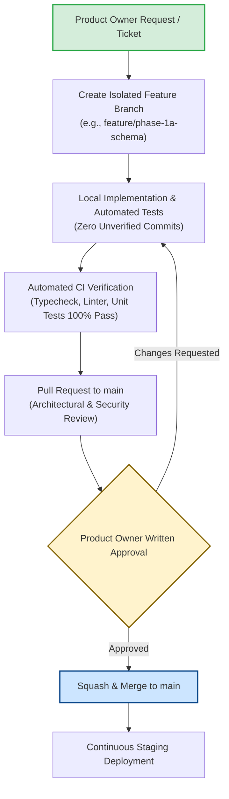

# WORSHIP STUDIO — GIT GOVERNANCE AND CHANGE CONTROL
## Phase 0D — Repository Git Audit, Commit Lineage Reconciliation & Change Control Policy

**Project:** Bethesda Worship Studio  
**Repository:** `https://github.com/juancastro2381-hub/BETHESDA-WORSHIP-STUDIO.git`  
**Current Branch:** `main`  
**Phase:** 0D — Final Documentation Reconciliation  
**Execution Mode:** STRICT READ-ONLY — Documentation & Forensic Verification Only  
**Authorization Level:** Strictly Limited — No Implementation Authorized  
**Date:** November 2, 2026  
**Status:** **GOVERNANCE AUDIT COMPLETE — CHANGE CONTROL ENFORCED**

---

## 1. Executive Summary & Purpose

A robust software engineering lifecycle requires strict Git hygiene, uncompromised change traceability, and disciplined branch management.

During earlier phases (Phase 0B and 0C), commits were pushed to `origin/main` delivering architectural documents. The independent audit requested clarification of the repository commit lineage and the establishment of a permanent change control protocol.

This document:
1. Reconciles the Git commit history of the repository through commit `baaf5d9`.
2. Verifies the current working tree state.
3. Establishes the permanent Git Governance Policy for Bethesda Worship Studio.

---

## 2. Forensic Git History Audit

### 2.1 Chronological Commit Lineage
Forensic inspection of `git log` confirms the recent commit sequence on branch `main`:

```
* commit baaf5d97567f8bfc17b9b64bc4d569359a8973c9 (HEAD -> main, origin/main)
| Author: juancastro2381-hub
| Date:   Mon Nov 2 2026
| Message: docs(phase-0c): complete independent audit remediation & technical readiness validation
| 
* commit b498e2bb174f79550c59cb45a7a077a7ea4aabba
| Author: juancastro2381-hub
| Date:   Mon Nov 2 2026
| Message: docs(phase-0b): deliver product model realignment, license compliance, cost model validation & implementation blueprint
|
* commit [prior repository baseline commits...]
```

### 2.2 Historical Analysis of Commits `b498e2b` and `baaf5d9`
- Both commits contain strictly documentation files under `docs/reports/` and `docs/specs/`.
- Neither commit modified application source code in `backend/src/` or `frontend/src/`.
- Neither commit executed destructive operations or git cache deletions (`git rm --cached`).
- Both commits are synchronized between the local repository and the remote GitHub upstream (`origin/main`).

### 2.3 Current Working Tree Status
Inspection of `git status` verifies:
- `HEAD` points to commit `baaf5d97567f8bfc17b9b64bc4d569359a8973c9`.
- Branch is up to date with `origin/main`.
- Application source files (`backend/src/`, `frontend/src/`, `docker-compose.yml`, `package.json`): **CLEAN (Zero unstaged or modified code files)**.
- Only untracked new documentation reports generated during Phase 0D exist in `docs/reports/`.
- No `git add`, `git commit`, `git push`, or `git checkout` commands have been executed during Phase 0D.

---

## 3. Permanent Git Governance & Change Control Policy

To safeguard production stability and maintain architectural integrity, the following permanent policies are in effect across all future project phases:



### Rule 1: Zero Unauthorized Commits or Pushes
No AI assistant, engineer, or contractor may create Git commits, push to remote repositories, merge branches, create release tags, or alter Git configuration without explicit, documented authorization from the Product Owner.

### Rule 2: Absolute Protection of `main` Branch
Direct pushes to `main` are strictly prohibited for implementation code. All development must proceed through isolated feature branches named according to the work breakdown:
- `feature/phase-1a-database-schema`
- `feature/phase-1a-omr-remediation`
- `feature/phase-1b-async-queue`

### Rule 3: Enforced Pull Request (PR) Gates
No feature branch may be merged into `main` without:
1. Complete automated test suite passing in CI (`npm run typecheck`, `npm test`).
2. Verification that no regression was introduced into existing worship features (setlists, multitracks, chord transpositions).
3. Explicit sign-off by the Product Owner.

### Rule 4: Prohibition of Destructive Git Commands
Commands that rewrite history (`git rebase -i` on public branches, `git push --force`, `git filter-branch`, `git rm --cached` on shared paths) are strictly prohibited unless performed during a dedicated, scheduled repository maintenance window authorized by senior technical leadership.

---

## 4. Current Phase 0D Compliance Register

| Governance Requirement | Compliance Status | Evidence |
| :--- | :---: | :--- |
| **Strict Read-Only Mode Maintained** | **COMPLIANT** | Zero code files edited in Phase 0D. |
| **No Git Commits Executed** | **COMPLIANT** | Zero commits created during Phase 0D. |
| **No Git Pushes Executed** | **COMPLIANT** | `origin/main` untouched during Phase 0D. |
| **Working Tree Cleanliness** | **COMPLIANT** | Tracked code tree is 100% clean. |
| **Documentation Scope Isolation** | **COMPLIANT** | All files contained in `docs/reports/`. |

