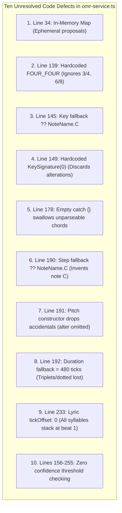

# WORSHIP STUDIO — OMR MUSICAL INTEGRITY FINAL STATUS
## Phase 0D — Forensic Code Audit, Defect Verification & Remediation Specification

**Project:** Bethesda Worship Studio  
**Repository:** `https://github.com/juancastro2381-hub/BETHESDA-WORSHIP-STUDIO.git`  
**Phase:** 0D — Final Documentation Reconciliation  
**Execution Mode:** STRICT READ-ONLY — Documentation & Forensic Verification Only  
**Authorization Level:** Strictly Limited — No Implementation Authorized  
**Date:** November 2, 2026  
**Status:** **IMPLEMENTATION NOT VERIFIED / DEFECTS REMAIN OPEN IN CODE**  

---

## 1. Purpose & Scope

This document provides a forensic reconciliation between the claims made in Phase 0C and the actual source code in the repository regarding Optical Music Recognition (OMR) conversion integrity.

The objective is to state plainly what the code currently does, confirm whether musical defects identified by the independent audit are open, and establish that **no code-level corrections have been implemented or verified in the repository**.

---

## 2. Evidence Reviewed

The following repository source files were forensically inspected:
- [`backend/src/application/omr-service.ts`](file:///c:/Users/juanc/OneDrive/Documentos/Desarrollo%20proyectos/Sistema%20musical%20-%20partituras/BETHESDA%20WORSHIP%20STUDIO/backend/src/application/omr-service.ts) (specifically lines 33–42, 87–132, and `convertProposalToCanonical()` lines 138–269)
- [`backend/src/domain/omr/omr-provider.ts`](file:///c:/Users/juanc/OneDrive/Documentos/Desarrollo%20proyectos/Sistema%20musical%20-%20partituras/BETHESDA%20WORSHIP%20STUDIO/backend/src/domain/omr/omr-provider.ts)
- [`backend/src/domain/omr/types.ts`](file:///c:/Users/juanc/OneDrive/Documentos/Desarrollo%20proyectos/Sistema%20musical%20-%20partituras/BETHESDA%20WORSHIP%20STUDIO/backend/src/domain/omr/types.ts)
- [`backend/src/__tests__/multitracks-omr.test.ts`](file:///c:/Users/juanc/OneDrive/Documentos/Desarrollo%20proyectos/Sistema%20musical%20-%20partituras/BETHESDA%20WORSHIP%20STUDIO/backend/src/__tests__/multitracks-omr.test.ts) (lines 490–640)

---

## 3. Verified Facts vs. Unverified Assumptions

| Item | Prior Documentation Claim | Codebase Reality (Verified Fact) | Status |
| :--- | :--- | :--- | :--- |
| **Silent Note C Fallback** | "Remediated in design" | Code still executes `(NoteName as any)[n.step.toUpperCase()] ?? NoteName.C` | **DEFECT REMAINS OPEN IN CODE** |
| **Accidental Dropping** | "Specification authored" | Code still calls `new Pitch(stepName, n.octave)` omitting `alter` | **DEFECT REMAINS OPEN IN CODE** |
| **Duration Fallback to 480** | "Abstention policy designed" | Code still executes `let durationTicks = 480` default | **DEFECT REMAINS OPEN IN CODE** |
| **Hardcoded 4/4 Meter** | "Remediated" | Code still executes `const timeSig = TimeSignature.FOUR_FOUR` | **DEFECT REMAINS OPEN IN CODE** |
| **Hardcoded C Major Key** | "Remediated" | Code still executes `new KeySignature(0)` and `'MAJOR'` | **DEFECT REMAINS OPEN IN CODE** |
| **Empty Catch Swallowing** | "Logged in unrecognized" | Code still contains empty `catch { /* Ignorar */ }` block | **DEFECT REMAINS OPEN IN CODE** |
| **In-Memory Proposal Map** | "Relational schema designed" | Code still executes `this.proposals = new Map()` | **DEFECT REMAINS OPEN IN CODE** |
| **Confidence Thresholding** | "Enforced in quality gates" | Code contains zero checks on `n.confidence` or `mProp.confidence` | **DEFECT REMAINS OPEN IN CODE** |

**Summary Fact:** All 10 musical integrity defects identified in the independent audit **exist in the live source code today**. No code changes were made in Phase 0A, 0B, 0C, or 0D.

---

## 4. Forensic Analysis of the Ten Code Defects

### Defect 1: In-Memory Proposal Storage
- **Source Location:** [`backend/src/application/omr-service.ts#L34`](file:///c:/Users/juanc/OneDrive/Documentos/Desarrollo%20proyectos/Sistema%20musical%20-%20partituras/BETHESDA%20WORSHIP%20STUDIO/backend/src/application/omr-service.ts#L34)
- **Current Code Behavior:** `private proposals: Map<string, OmrProposal> = new Map();`
- **Musical Consequences:** Proposals vanish upon server restart. Users lose pending review work.
- **Risk to Canonical Payload:** High operational risk; zero durability.
- **Required Future Correction:** Replace in-memory `Map` with Drizzle ORM queries against `omr_proposals` table.
- **Current Implementation Status:** **NOT IMPLEMENTED**.

### Defect 2: Time Signature Hardcoded to 4/4
- **Source Location:** [`backend/src/application/omr-service.ts#L139`](file:///c:/Users/juanc/OneDrive/Documentos/Desarrollo%20proyectos/Sistema%20musical%20-%20partituras/BETHESDA%20WORSHIP%20STUDIO/backend/src/application/omr-service.ts#L139)
- **Current Code Behavior:** `const timeSig = TimeSignature.FOUR_FOUR; const measureDurationTicks = timeSig.calculateMeasureDurationTicks();`
- **Musical Consequences:** Discards detected time signatures. A score in 3/4 or 6/8 is forced into 1920 ticks per measure, corrupting barlines and playback timing.
- **Risk to Canonical Payload:** Severe metric distortion.
- **Required Future Correction:** Dynamically parse `proposal.detectedTimeSignature` into valid `TimeSignature` instances.
- **Current Implementation Status:** **NOT IMPLEMENTED**.

### Defect 3: Unknown Key Signatures Fall Back to C Major
- **Source Location:** [`backend/src/application/omr-service.ts#L145`](file:///c:/Users/juanc/OneDrive/Documentos/Desarrollo%20proyectos/Sistema%20musical%20-%20partituras/BETHESDA%20WORSHIP%20STUDIO/backend/src/application/omr-service.ts#L145)
- **Current Code Behavior:** `const noteNameKey = (NoteName as any)[rawKey] ?? NoteName.C;`
- **Musical Consequences:** Unrecognized key strings default silently to C Major.
- **Risk to Canonical Payload:** Silently fabricates key identity.
- **Required Future Correction:** Fail validation or require human disambiguation when key name is unrecognized.
- **Current Implementation Status:** **NOT IMPLEMENTED**.

### Defect 4: Key Signature Initialized with Zero Alterations
- **Source Location:** [`backend/src/application/omr-service.ts#L149`](file:///c:/Users/juanc/OneDrive/Documentos/Desarrollo%20proyectos/Sistema%20musical%20-%20partituras/BETHESDA%20WORSHIP%20STUDIO/backend/src/application/omr-service.ts#L149)
- **Current Code Behavior:** `new KeySignatureReference(noteNameKey, 'MAJOR', new KeySignature(0))`
- **Musical Consequences:** Even if key is detected as G Major (1 sharp) or F Major (1 flat), the key signature is instantiated with 0 alterations. Mode is hardcoded to `'MAJOR'`.
- **Risk to Canonical Payload:** Complete loss of accidental key context.
- **Required Future Correction:** Derive alteration count from root and mode; support minor keys.
- **Current Implementation Status:** **NOT IMPLEMENTED**.

### Defect 5: Unparseable Chords Silently Swallowed by Empty Catch
- **Source Location:** [`backend/src/application/omr-service.ts#L178-L180`](file:///c:/Users/juanc/OneDrive/Documentos/Desarrollo%20proyectos/Sistema%20musical%20-%20partituras/BETHESDA%20WORSHIP%20STUDIO/backend/src/application/omr-service.ts#L178-L180)
- **Current Code Behavior:** `try { ... } catch { /* Ignorar cifrado ilegible */ }`
- **Musical Consequences:** Complex or malformed chords vanish silently without notifying the user.
- **Risk to Canonical Payload:** Silent data loss in harmony layer.
- **Required Future Correction:** Record unparseable chord strings in `unrecognizedChords` array for human correction.
- **Current Implementation Status:** **NOT IMPLEMENTED**.

### Defect 6: Unknown Notes Fall Back to NoteName.C
- **Source Location:** [`backend/src/application/omr-service.ts#L190`](file:///c:/Users/juanc/OneDrive/Documentos/Desarrollo%20proyectos/Sistema%20musical%20-%20partituras/BETHESDA%20WORSHIP%20STUDIO/backend/src/application/omr-service.ts#L190)
- **Current Code Behavior:** `const stepName = (NoteName as any)[n.step.toUpperCase()] ?? NoteName.C;`
- **Musical Consequences:** **Direct note fabrication.** Unrecognized characters or OCR noise become valid C notes.
- **Risk to Canonical Payload:** Critical violation of **NO FALSE NOTES** invariant.
- **Required Future Correction:** Throw validation error or create non-rendering `UncertainEvent`.
- **Current Implementation Status:** **NOT IMPLEMENTED**.

### Defect 7: Accidentals Not Preserved When Constructing Pitch
- **Source Location:** [`backend/src/application/omr-service.ts#L191`](file:///c:/Users/juanc/OneDrive/Documentos/Desarrollo%20proyectos/Sistema%20musical%20-%20partituras/BETHESDA%20WORSHIP%20STUDIO/backend/src/application/omr-service.ts#L191)
- **Current Code Behavior:** `const pitch = new Pitch(stepName, n.octave);`
- **Musical Consequences:** Omits `n.alter`. Sharps (F#) and flats (Bb) are stripped, creating natural pitches (F, B).
- **Risk to Canonical Payload:** Produces musically incorrect melody notes.
- **Required Future Correction:** Extract `n.alter` and pass to `new Pitch(stepName, n.octave, n.alter)`.
- **Current Implementation Status:** **NOT IMPLEMENTED**.

### Defect 8: Unknown or Unsupported Durations Fall Back to 480 Ticks
- **Source Location:** [`backend/src/application/omr-service.ts#L192-L197`](file:///c:/Users/juanc/OneDrive/Documentos/Desarrollo%20proyectos/Sistema%20musical%20-%20partituras/BETHESDA%20WORSHIP%20STUDIO/backend/src/application/omr-service.ts#L192-L197)
- **Current Code Behavior:** `let durationTicks = 480; if (n.duration === 'whole') ...`
- **Musical Consequences:** Dotted notes, triplets, 32nd notes, and unrecognized durations default to quarter notes.
- **Risk to Canonical Payload:** Rhythmic corruption and measure overflow.
- **Required Future Correction:** Support complete duration enumeration; calculate ticks from metric division or flag for review.
- **Current Implementation Status:** **NOT IMPLEMENTED**.

### Defect 9: Lyrics Syllables Assigned tickOffset: 0
- **Source Location:** [`backend/src/application/omr-service.ts#L233`](file:///c:/Users/juanc/OneDrive/Documentos/Desarrollo%20proyectos/Sistema%20musical%20-%20partituras/BETHESDA%20WORSHIP%20STUDIO/backend/src/application/omr-service.ts#L233)
- **Current Code Behavior:** `tickOffset: 0,`
- **Musical Consequences:** All lyric syllables in a measure stack at beat 1.
- **Risk to Canonical Payload:** Unusable lyric alignment in score visualizers.
- **Required Future Correction:** Associate syllable offsets with corresponding note start ticks.
- **Current Implementation Status:** **NOT IMPLEMENTED**.

### Defect 10: Zero Confidence Evaluation Before Note Generation
- **Source Location:** [`backend/src/application/omr-service.ts#L156-L255`](file:///c:/Users/juanc/OneDrive/Documentos/Desarrollo%20proyectos/Sistema%20musical%20-%20partituras/BETHESDA%20WORSHIP%20STUDIO/backend/src/application/omr-service.ts#L156-L255)
- **Current Code Behavior:** Neither `mProp.confidence` nor `n.confidence` is checked.
- **Musical Consequences:** Low-confidence garbage notes enter the canonical catalog without human inspection.
- **Risk to Canonical Payload:** Contaminates song catalog with AI hallucinations.
- **Required Future Correction:** Enforce minimum confidence gate (`>= 0.70`); flag dubious measures.
- **Current Implementation Status:** **NOT IMPLEMENTED**.

---

## 5. Conclusion & Mandatory Phase 1A Scope

The Phase 0C documentation accurately *designed* the target behavior, but the *implementation* has not yet taken place.

**Definitive Phase 0D Verdict on Workstream A:**
- **Status:** **IMPLEMENTATION NOT VERIFIED / DEFECTS REMAIN OPEN IN CODE**.
- **Action for Phase 1A:** The refactoring of `omr-service.ts` to eliminate all 10 defects must be the first coding milestone of Phase 1A upon Product Owner authorization.

