# WORSHIP STUDIO — PERSISTENCE AND QUEUE FINAL STATUS
## Phase 0D — Forensic Audit, Schema Analysis & Reliability Verification Register

**Project:** Bethesda Worship Studio  
**Repository:** `https://github.com/juancastro2381-hub/BETHESDA-WORSHIP-STUDIO.git`  
**Phase:** 0D — Final Documentation Reconciliation  
**Execution Mode:** STRICT READ-ONLY — Documentation & Forensic Verification Only  
**Authorization Level:** Strictly Limited — No Implementation Authorized  
**Date:** November 2, 2026  
**Status:** **DESIGNED — NOT IMPLEMENTED OR TESTED**

---

## 1. Executive Summary & Purpose

In previous planning documents (Phase 0B and Phase 0C), an asynchronous queue processing architecture and relational persistence layer were designed to handle Optical Music Recognition (OMR) and Audio Transcription tasks.

The purpose of this Phase 0D report is to reconcile those architectural designs with the physical reality of the repository. This report states unequivocally:
1. **The relational persistence tables for OMR proposals, measures, and audit records DO NOT EXIST in the codebase.**
2. **The asynchronous background queue, worker daemons, and task scheduling mechanisms DO NOT EXIST in the codebase.**
3. **The lease, heartbeat, and fencing token concurrency controls ARE UNTESTED SPECIFICATIONS, not running software.**

No persistence or queue code was implemented or modified in Phase 0A, 0B, 0C, or 0D.

---

## 2. Forensic Codebase Audit: Database Schema

### 2.1 Inspection of `backend/src/db/schema.ts`
Forensic inspection of [`backend/src/db/schema.ts`](file:///c:/Users/juanc/OneDrive/Documentos/Desarrollo%20proyectos/Sistema%20musical%20-%20partituras/BETHESDA%20WORSHIP%20STUDIO/backend/src/db/schema.ts) reveals that the database defines exactly 15 tables supporting core church worship features (authentication, songs, versions, setlists, multitracks):

```typescript
// Verified existing tables in backend/src/db/schema.ts:
export const users = pgTable('users', ...);
export const refreshTokens = pgTable('refresh_tokens', ...);
export const passwordResetTokens = pgTable('password_reset_tokens', ...);
export const userInvitations = pgTable('user_invitations', ...);
export const auditLogs = pgTable('audit_logs', ...);
export const songs = pgTable('songs', ...);
export const songVersions = pgTable('song_versions', ...);
export const songSources = pgTable('song_sources', ...);
export const songMetadata = pgTable('song_metadata', ...);
export const setlists = pgTable('setlists', ...);
export const setlistItems = pgTable('setlist_items', ...);
export const userViewPreferences = pgTable('user_view_preferences', ...);
export const audioAssets = pgTable('audio_assets', ...);
export const multitrackSessions = pgTable('multitrack_sessions', ...);
export const multitrackTracks = pgTable('multitrack_tracks', ...);
```

### 2.2 Forensic Verification of Proposed OMR and Queue Tables
The four tables proposed in Phase 0B/0C documentation were searched across all schema files, migration scripts, and Drizzle definitions:

| Proposed Table Name | Present in `schema.ts`? | Present in `migrations/`? | Actual Status in Codebase |
| :--- | :---: | :---: | :--- |
| `omr_proposals` | **NO** | **NO** | **NOT IMPLEMENTED (Design Only)** |
| `omr_proposal_measures` | **NO** | **NO** | **NOT IMPLEMENTED (Design Only)** |
| `omr_audit_history` | **NO** | **NO** | **NOT IMPLEMENTED (Design Only)** |
| `background_jobs` | **NO** | **NO** | **NOT IMPLEMENTED (Design Only)** |

**Forensic Finding:** Optical Music Recognition proposals remain stored exclusively in transient Node.js process memory via `private proposals: Map<string, OMRProposal> = new Map()` in [`backend/src/application/omr-service.ts`](file:///c:/Users/juanc/OneDrive/Documentos/Desarrollo%20proyectos/Sistema%20musical%20-%20partituras/BETHESDA%20WORSHIP%20STUDIO/backend/src/application/omr-service.ts#L34). A server restart, container redeployment, or uncaught exception immediately destroys all active OMR proposals and user edits.

---

## 3. Forensic Codebase Audit: Queue & Worker Infrastructure

### 3.1 Inspection of `backend/package.json`
Inspection of dependencies in [`backend/package.json`](file:///c:/Users/juanc/OneDrive/Documentos/Desarrollo%20proyectos/Sistema%20musical%20-%20partituras/BETHESDA%20WORSHIP%20STUDIO/backend/package.json) confirms:
- **No Redis driver:** Neither `ioredis` nor `redis` is listed.
- **No Redis queue framework:** `bullmq` is not installed.
- **No PostgreSQL queue framework:** Neither `pg-boss` nor `graphile-worker` is installed.
- **No generic worker manager:** No background job scheduler or worker loop library exists.

### 3.2 Inspection of `docker-compose.yml`
Inspection of [`docker-compose.yml`](file:///c:/Users/juanc/OneDrive/Documentos/Desarrollo%20proyectos/Sistema%20musical%20-%20partituras/BETHESDA%20WORSHIP%20STUDIO/docker-compose.yml) shows:
- The only running service is `postgres` (`postgres:16-alpine`).
- There is **no Redis container**.
- There is **no worker container** or background processing service.

### 3.3 Application Background Processing State
- The backend runs as a single Fastify HTTP service (`src/server.ts`).
- There are no background worker scripts or child processes spawned for queue processing.
- All requests are processed synchronously within HTTP request lifecycles.

---

## 4. Heartbeat, Lease & Fencing Token Protocol Status

Phase 0B and 0C specified an ACID-compliant PostgreSQL job queue utilizing `SKIP LOCKED`, worker leases, periodic heartbeats, and monotonic fencing tokens to prevent double-execution by zombie workers.

### 4.1 Implementation Status
- **Database Columns:** Columns such as `lease_token`, `lease_expires_at`, `heartbeat_at`, `fencing_token`, `locked_by`, and `attempt_count` **do not exist** anywhere in `schema.ts`.
- **Query Logic:** The SQL query pattern `SELECT id FROM background_jobs WHERE status = 'PENDING' FOR UPDATE SKIP LOCKED LIMIT 1` is not present in any repository file.
- **Heartbeat Daemon:** No heartbeat loop, interval timer, or lease-renewal mechanism exists in the codebase.
- **Fencing Token Guard:** No database constraints or application validation layers verify monotonic fencing tokens on job completion.

### 4.2 Status Classification
> [!IMPORTANT]
> **Status: DESIGNED — NOT IMPLEMENTED OR TESTED.**  
> The lease and fencing token protocol is a mathematically sound architectural proposal, but it has zero lines of implementation in Bethesda Worship Studio. It must be treated as an unbuilt specification for Phase 1A.

---

## 5. Mandatory Failure-Mode Test Matrix (10 Required Verification Tests)

Before any queue or persistence implementation can be accepted into a staging or production release, the following 10 failure-mode tests must be implemented as automated integration tests and verified to pass under high concurrency:

| Test ID | Failure Mode Scenario | Injection / Simulation Method | Required System Behavior | Acceptance Criteria |
| :--- | :--- | :--- | :--- | :--- |
| **TEST-Q-01** | **Abrupt Worker Crash (SIGKILL)** | Send `SIGKILL` to worker container at 50% job progress. | Lease must expire; second worker claims job after lease timeout. | Job status reverts to `PENDING` with incremented `attempt_count`; no deadlock or orphaned locks. |
| **TEST-Q-02** | **Extended Node.js / JVM GC Pause** | Freeze worker thread for 45s (exceeding 30s lease) via `v8.stop()` or debugger pause. | Lease expires; Job assigned to Worker B. Worker A unpauses and attempts write. | Worker A write is **rejected via monotonic fencing token mismatch**; Worker B completes write cleanly without corruption. |
| **TEST-Q-03** | **Network Partition (Worker Isolation)** | Sever TCP connection between worker and PostgreSQL mid-transaction. | Heartbeat fails; worker detects disconnection and aborts local execution. | Job is reclaimed by healthy worker once lease expires; partitioned worker discards intermediate artifacts. |
| **TEST-Q-04** | **High-Concurrency Race Condition** | 50 concurrent workers poll single `PENDING` job simultaneously. | PostgreSQL `FOR UPDATE SKIP LOCKED` isolates the row to exactly one transaction. | Exactly one worker acquires lease; remaining 49 workers receive empty set or proceed to next job; zero duplicate assignments. |
| **TEST-Q-05** | **Poison Pill Payload Handling** | Submit corrupt / malformed MusicXML / audio file designed to trigger fatal unhandled exception. | Exception is caught, logged in `error_details`, job attempts incremented. | Upon reaching `max_retries` (e.g., 3), job moves to `DEAD_LETTER` status; queue processing continues uninterrupted. |
| **TEST-Q-06** | **Retry Ceiling & Alert Dispatch** | Simulate transient downstream API timeout across 3 successive attempts. | Exponential backoff applied (30s, 60s, 120s); retry limit enforced. | After 3rd failure, job status transitions to `FAILED`; dead-letter alert emitted; no infinite retry loop. |
| **TEST-Q-07** | **Graceful Shutdown (SIGTERM)** | Send `SIGTERM` while worker is processing an active transcription. | Worker ceases accepting new jobs, finishes in-flight chunk, updates checkpoint or completes within grace period. | Clean exit with exit code 0; job marked completed if within grace window, or lease released cleanly. |
| **TEST-Q-08** | **Database Failover Mid-Transaction** | Force PostgreSQL primary failover during `omr_proposals` measure insertion. | Drizzle / pg client handles connection termination; transaction rolls back. | Zero partial measures stored; job lease expires and retries cleanly against new primary. |
| **TEST-Q-09** | **Stale Worker Eviction Daemon** | Simulate worker terminated without closing connection (zombie process). | Scheduled reaper job queries `lease_expires_at < NOW() AND status = 'PROCESSING'`. | Reaper resets status to `PENDING`, logs warning, and increments attempt count without manual operator intervention. |
| **TEST-Q-10** | **Queue Saturation & Backpressure** | Inject 1,000 rapid job requests exceeding worker pool capacity. | Admission controller checks queue depth; enforces per-user rate limit. | API responds with `429 Too Many Requests` or queues up to capacity limit without memory exhaustion or degradation of active jobs. |

---

## 6. Technical Maturity Register

```mermaid
flowchart LR
    A["Architecture Design\n(Complete)"] --> B["Relational Schema DDL\n(NOT IMPLEMENTED)"]
    B --> C["Queue Daemon / Worker\n(NOT IMPLEMENTED)"]
    C --> D["Integration Test Suite\n(NOT TESTED)"]
    D --> E["Independent Verification\n(UNVERIFIED)"]
    E --> F["Production Ready\n(NOT READY)"]

    style A fill:#d4edda,stroke:#28a745,stroke-width:2px;
    style B fill:#f8d7da,stroke:#dc3545,stroke-width:2px;
    style C fill:#f8d7da,stroke:#dc3545,stroke-width:2px;
    style D fill:#f8d7da,stroke:#dc3545,stroke-width:2px;
    style E fill:#f8d7da,stroke:#dc3545,stroke-width:2px;
    style F fill:#f8d7da,stroke:#dc3545,stroke-width:2px;
```



| Lifecycle Dimension | Current Phase 0D Classification | Evidence |
| :--- | :--- | :--- |
| **Architecture Specification** | **DESIGN COMPLETE** | Specified in Phase 0B and Phase 0C reports. |
| **Schema & Database Migrations** | **NOT IMPLEMENTED (0%)** | Zero tables in `backend/src/db/schema.ts`. |
| **Queue Worker Implementation** | **NOT IMPLEMENTED (0%)** | Zero queue libraries in `package.json`; no workers. |
| **Lease & Fencing Token Protocol** | **NOT IMPLEMENTED (0%)** | Zero concurrency locks in application code. |
| **Automated Concurrency Tests** | **NOT TESTED (0%)** | None of the 10 failure-mode tests exist in code. |
| **Independent Production Audit** | **UNVERIFIED** | Code must exist before audit verification is possible. |
| **Production Readiness** | **NOT READY** | Strictly blocked from production deployment. |

---

## 7. Sign-off & Phase 1A Requirements

1. **Schema Delivery:** Phase 1A must deliver Drizzle schema migrations for `background_jobs`, `omr_proposals`, `omr_proposal_measures`, and `omr_audit_history`.
2. **PostgreSQL-Native Queue:** Implement the `FOR UPDATE SKIP LOCKED` worker daemon in TypeScript with heartbeat ping and monotonic fencing tokens.
3. **Automated Testing:** All 10 tests in the failure-mode matrix must be committed and passing in CI before any live music transcription is handled via asynchronous jobs.

