# WORSHIP STUDIO — REMEDIATION ROADMAP
## Phase 0D — 10-Phase Engineering Master Plan, Phase 1A Detailed Work Breakdown & Gating Protocol

**Project:** Bethesda Worship Studio  
**Repository:** `https://github.com/juancastro2381-hub/BETHESDA-WORSHIP-STUDIO.git`  
**Phase:** 0D — Final Documentation Reconciliation  
**Execution Mode:** STRICT READ-ONLY — Documentation & Forensic Verification Only  
**Authorization Level:** Strictly Limited — No Implementation Authorized  
**Date:** November 2, 2026  
**Status:** **PHASE 0 COMPLETE — PHASE 1A IMPLEMENTATION GATED (PENDING APPROVAL)**

---

## 1. Executive Summary & Purpose

The transition of Bethesda Worship Studio from a prototype digital sheet-music viewer into a professional, AI-powered transcription and digital music stand platform requires a disciplined, phase-gated engineering execution plan.

This document establishes the official 10-phase engineering roadmap. It enforces strict separation between documentation/planning (Phase 0) and software implementation (Phases 1 through 4).

> [!IMPORTANT]
> **Phase 1A Implementation Authorization is NOT GRANTED.**  
> Phase 0D closes all architectural reconciliation and documentation audits. No code modifications, migrations, or dependency additions may occur until the Product Owner explicitly authorizes Phase 1A.

---

## 2. 10-Phase Master Engineering Roadmap

```mermaid
flowchart TD
    P0["Phase 0: Architecture & Audit\n(COMPLETE - Phase 0D)"] --> G0{"PO Approval Gate"}
    G0 -->|"Authorized"| P1A["Phase 1A: Core Foundation & OMR Remediation\n(Relational Schema, Fix 10 Defects, Tests)"]
    P1A --> P1B["Phase 1B: Async Queue & Storage Engine\n(PostgreSQL SKIP LOCKED, Worker, R2 Outbox)"]
    P1B --> P2A["Phase 2A: Audio Pipeline & Stems\n(Audio Ingestion, Demucs Worker, Staging)"]
    P2A --> P2B["Phase 2B: Audio-to-MIDI Transcription\n(Basic Pitch, Polyphonic Note Detection)"]
    P2B --> P2C["Phase 2C: Musical Analysis & Harmony\n(Madmom Beat Tracking, Chord Estimation)"]
    P2C --> P3A["Phase 3A: Lyrics Alignment\n(WhisperX, Phoneme Sync, Syllable Mapping)"]
    P3A --> P3B["Phase 3B: Multi-Format Music Generation\n(MusicXML, ChordPro, Tablature Exporters)"]
    P3B --> P4A["Phase 4A: Digital Music Stand & UI\n(OSMD Rendering, Transposition, Autoscroll)"]
    P4A --> P4B["Phase 4B: Production Hardening\n(Security, FinOps Limits, Community Release)"]

    style P0 fill:#d4edda,stroke:#28a745,stroke-width:2px;
    style G0 fill:#fff3cd,stroke:#856404,stroke-width:2px;
    style P1A fill:#e2e3e5,stroke:#383d41,stroke-width:2px;
    style P1B fill:#e2e3e5,stroke:#383d41,stroke-width:2px;
    style P2A fill:#e2e3e5,stroke:#383d41,stroke-width:2px;
    style P2B fill:#e2e3e5,stroke:#383d41,stroke-width:2px;
    style P2C fill:#e2e3e5,stroke:#383d41,stroke-width:2px;
    style P3A fill:#e2e3e5,stroke:#383d41,stroke-width:2px;
    style P3B fill:#e2e3e5,stroke:#383d41,stroke-width:2px;
    style P4A fill:#e2e3e5,stroke:#383d41,stroke-width:2px;
    style P4B fill:#e2e3e5,stroke:#383d41,stroke-width:2px;
```



### Roadmap Phase Summary

| Phase | Designation | Primary Objective | Gate / Prerequisite |
| :---: | :--- | :--- | :--- |
| **0** | **Architecture & Audit** | Complete forensic audit, reconcile all documentation, eliminate cost variances, document all defects. | **COMPLETE (Phase 0D)** |
| **1A** | **Core Foundation & OMR Remediation** | Implement Drizzle schema for proposals/jobs; fix all 10 silent defects in `omr-service.ts`; add unit test suite. | Product Owner Authorization |
| **1B** | **Async Queue & Storage Engine** | Implement `FOR UPDATE SKIP LOCKED` worker daemon, leasing/fencing tokens, and R2 outbox reconciler. | Phase 1A CI 100% Passing |
| **2A** | **Audio Pipeline & Stems** | Containerized Demucs stem separation microservice, audio upload endpoints, temporary staging bucket. | Phase 1B Complete |
| **2B** | **Audio-to-MIDI Transcription** | Basic Pitch worker integration, monophonic vocal/bass & polyphonic keyboard transcription. | Phase 2A Complete |
| **2C** | **Musical Analysis & Harmony** | Madmom beat/downbeat tracking, tempo map calculation, chord recognition and key detection. | Phase 2B Complete |
| **3A** | **Lyrics Extraction & Alignment** | WhisperX speech-to-text, phoneme-level forced alignment, syllable-to-note binding in MusicXML. | Phase 2C Complete |
| **3B** | **Multi-Format Generation** | Sheet music (MusicXML), Lead Sheets (ChordPro), Lyrics Only, and Guitar/Bass Tablature exporters. | Phase 3A Complete |
| **3C / 4A** | **Digital Music Stand & UI** | OSMD notation rendering, live pitch transposition, capo calculator, continuous autoscroll. | Phase 3B Complete |
| **4B** | **Hardening & Launch** | FinOps rate limiters, multi-tenant RBAC enforcement, Sentry observability, church production deployment. | Complete Test Suite Passing |

---

## 3. Phase 1A: Detailed Work Breakdown Structure (WBS)

Phase 1A is the initial software implementation phase. It focuses strictly on remediating known defects and establishing database integrity before introducing complex AI models.

### 3.1 Workstream 1: Database Persistence Layer
- **Target File:** `backend/src/db/schema.ts`
- **Actions:**
  1. Add `background_jobs` table (status, lease_token, lease_expires_at, fencing_token, attempts, error_details).
  2. Add `omr_proposals` table (song_id, status, confidence, raw_payload, created_at).
  3. Add `omr_proposal_measures` table (measure_number, time_signature, key_signature, note_count, measure_confidence).
  4. Add `omr_audit_history` table (user_id, action, delta_json, timestamp).
  5. Generate and execute Drizzle migration script (`drizzle-kit generate`).

### 3.2 Workstream 2: OMR Service Remediation (Fixing the 10 Code Defects)
- **Target File:** `backend/src/application/omr-service.ts`
- **Actions:**
  1. Replace in-memory `Map` with relational database queries (`Drizzle ORM`).
  2. Parse and preserve non-4/4 meters (3/4, 6/8, 12/8); reject or flag unparseable time signatures instead of defaulting to 4/4.
  3. Parse explicit tonalities; remove `?? NoteName.C` fallback; throw validation errors on unrecognized keys.
  4. Retain accidental alterations in `KeySignature` and pitch creation (`new Pitch(stepName, n.octave, n.alter)`).
  5. Remove empty `catch {}` block; log unrecognized chord symbols and flag measure for human review.
  6. Eliminate artificial `NoteName.C` injection; abort conversion if pitch step is undefined.
  7. Implement musical duration calculation; flag unrecognized durations instead of forcing 480 ticks.
  8. Calculate accurate syllable `tickOffset` and duration; eliminate stacking all syllables at `tickOffset: 0`.
  9. Enforce confidence thresholding; reject proposals with symbol confidence $< 0.70$ or measure confidence $< 0.80$.
  10. Implement comprehensive input validation using Zod schemas for all OMR provider payloads.

### 3.3 Workstream 3: Automated Test Suite & CI Integration
- **Target Files:** `backend/src/__tests__/omr-service-remediation.test.ts`
- **Actions:**
  1. Test: Non-4/4 time signature preservation (3/4, 6/8, 5/4).
  2. Test: Sharp/flat accidental preservation (F#4, Bb3, C#5).
  3. Test: Unrecognized pitch step throws validation exception.
  4. Test: Unparseable chord symbol is recorded in audit log without dropping measure.
  5. Test: Confidence abstention policy triggers when confidence is below threshold.
  6. Test: Relational persistence round-trip (save proposal -> reload -> verify exact match).

---

## 4. Gating Protocol & Entry Criteria for Phase 1A

```
┌──────────────────────────────────────────────────────────────────┐
│                   PHASE 1A READINESS GATE                        │
├────────────────────────────────────────┬─────────────────────────┤
│ Verification Requirement               │ Status                  │
├────────────────────────────────────────┼─────────────────────────┤
│ Phase 0D Documentation Delivered       │ VERIFIED                │
│ All 10 OMR Defects Documented          │ VERIFIED                │
│ Persistence & Queue Reality Confirmed  │ VERIFIED                │
│ Cost Discrepancies Reconciled to $0.00 │ VERIFIED                │
│ License Register Audited               │ VERIFIED                │
│ Working Tree Clean (No Stray Commits)  │ VERIFIED                │
│ Product Owner Explicit Authorization   │ PENDING PO SIGN-OFF     │
└────────────────────────────────────────┴─────────────────────────┘
```

**Entry Rule:** No engineer or agent may write code or run `npm install` for Phase 1A until the Product Owner provides written authorization.

