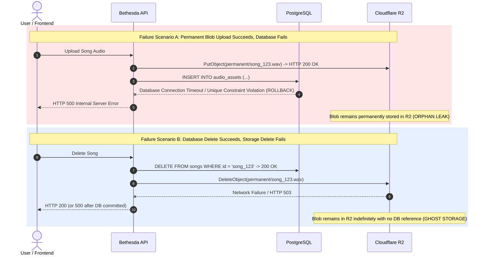
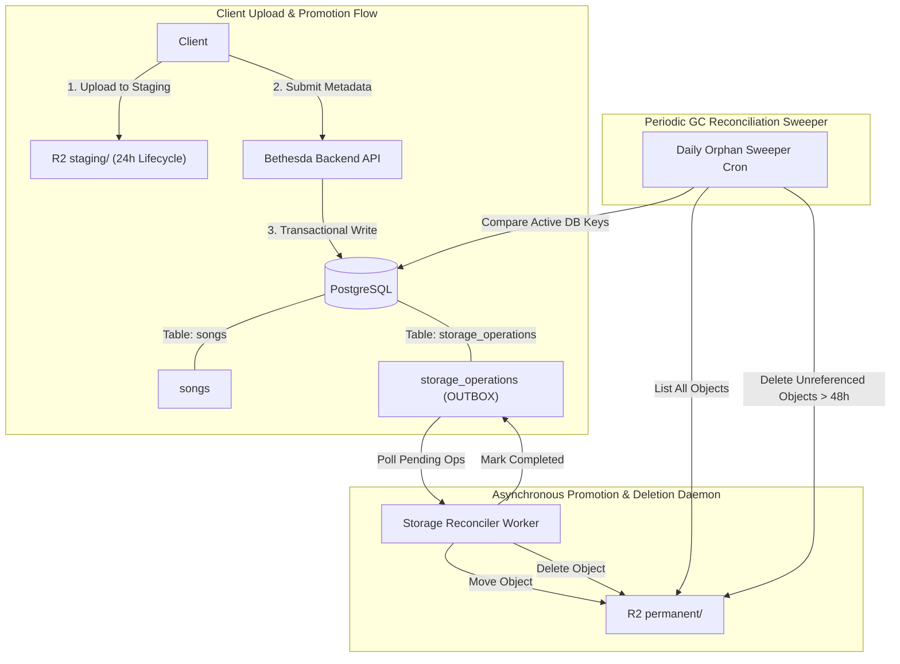

# WORSHIP STUDIO — STORAGE CONSISTENCY FINAL STATUS
## Phase 0D — Forensic Code Audit, Dual-Write Atomicity Analysis & Storage Reconciliation Architecture

**Project:** Bethesda Worship Studio  
**Repository:** `https://github.com/juancastro2381-hub/BETHESDA-WORSHIP-STUDIO.git`  
**Phase:** 0D — Final Documentation Reconciliation  
**Execution Mode:** STRICT READ-ONLY — Documentation & Forensic Verification Only  
**Authorization Level:** Strictly Limited — No Implementation Authorized  
**Date:** November 2, 2026  
**Status:** **ARCHITECTURE DESIGNED — IMPLEMENTATION NOT VERIFIED**

---

## 1. Executive Summary & Purpose

In Phase 0B and Phase 0C documentation, Cloudflare R2 was specified as the primary object storage solution for audio stems, raw audio recordings, PDF scores, and rendered MusicXML artifacts. The documentation outlined dual-bucket staging, automated lifecycle expirations, and dual-write consistency mechanisms.

The purpose of this Phase 0D report is to reconcile those specifications with the actual repository implementation:
1. **Cloudflare R2 and AWS S3 SDK integrations DO NOT EXIST in the codebase.**
2. **Current storage is 100% local filesystem (`node:fs`) writing to `storage/audio` and `storage/documents`.**
3. **Dual-write atomicity between PostgreSQL and Cloudflare R2 cannot be achieved via staging lifecycle rules alone.** Distributed storage orphan detection and a persistent reconciliation daemon are mandatory.

No cloud storage integration was implemented or modified during Phase 0.

---

## 2. Forensic Codebase Audit: Storage Layer

### 2.1 Dependencies Inspection (`backend/package.json`)
Inspection of [`backend/package.json`](file:///c:/Users/juanc/OneDrive/Documentos/Desarrollo%20proyectos/Sistema%20musical%20-%20partituras/BETHESDA%20WORSHIP%20STUDIO/backend/package.json) confirms:
- `@aws-sdk/client-s3`: **NOT INSTALLED**.
- `@aws-sdk/s3-request-presigner`: **NOT INSTALLED**.
- Any alternative S3-compatible client (e.g., `minio`): **NOT INSTALLED**.

### 2.2 Inspection of Existing Storage Providers
Inspection of backend storage implementations reveals:

1. **Audio Storage Provider:** [`backend/src/domain/audio/storage-provider.ts`](file:///c:/Users/juanc/OneDrive/Documentos/Desarrollo%20proyectos/Sistema%20musical%20-%20partituras/BETHESDA%20WORSHIP%20STUDIO/backend/src/domain/audio/storage-provider.ts#L36)  
   Implements `LocalFileSystemAudioStorageProvider` writing directly to `storage/audio` on the local disk using `node:fs`.
2. **Document Storage Provider:** [`backend/src/domain/documents/document-storage-provider.ts`](file:///c:/Users/juanc/OneDrive/Documentos/Desarrollo%20proyectos/Sistema%20musical%20-%20partituras/BETHESDA%20WORSHIP%20STUDIO/backend/src/domain/documents/document-storage-provider.ts#L24)  
   Implements `LocalFileSystemDocumentStorageProvider` writing directly to `storage/documents` on the local disk using `node:fs`.

### 2.3 Cloudflare R2 Implementation Reality
- **R2 Storage Provider:** **DOES NOT EXIST**.
- **Signed URL Generator:** **DOES NOT EXIST**.
- **Bucket Lifecycle Script:** **DOES NOT EXIST**.
- **Multi-tenant storage isolation:** Handled purely by local filesystem path sanitization (`resolveSafePath` rejecting directory traversal), not cloud IAM or signed policies.

---

## 3. Distributed Atomicity & Dual-Write Failure Analysis

A fundamental distributed systems challenge arises when an application writes state to both an ACID relational database (PostgreSQL) and an eventually consistent object store (Cloudflare R2).

PostgreSQL and Cloudflare R2 **do not support Two-Phase Commit (2PC) or distributed transactions**.



### 3.1 Why R2 Lifecycle Rules Alone Are Insufficient
Phase 0C proposed using R2 lifecycle rules (e.g. expiring objects after 24 hours in the `staging/` prefix) to prevent storage leaks. While effective for ephemeral uploads, **lifecycle rules fail in three critical production scenarios**:

1. **Orphaned Permanent Blobs (Scenario A above):** When a file is uploaded directly to the `permanent/` prefix or promoted from `staging/`, but the corresponding database transaction fails to commit. Because the object is in `permanent/`, lifecycle expiration rules will never purge it.
2. **Failed Deletion on Resource Removal (Scenario B above):** When a user deletes a score or multitrack session, PostgreSQL removes the metadata. If the subsequent `DeleteObject` command to R2 fails or times out, the object remains in `permanent/` indefinitely.
3. **Metadata Pointers to Missing Blobs:** If an object is deleted or corrupted in R2 while the database reference remains intact, users encounter broken links and failed playbacks.

---

## 4. Robust Storage Consistency Architecture (Phase 1A Specification)

To guarantee 100% storage consistency without distributed 2PC, Phase 1A must implement the following three-pillar architecture:



### 4.1 Pillar 1: Transactional Storage Outbox (`storage_operations`)
All state-modifying storage operations (promotions, permanent deletions) must be written to an ACID outbox table in PostgreSQL within the same database transaction that updates the business entity:

```sql
CREATE TABLE storage_operations (
    id UUID PRIMARY KEY DEFAULT gen_random_uuid(),
    operation_type VARCHAR(32) NOT NULL, -- 'PROMOTE_TO_PERMANENT', 'DELETE_PERMANENT'
    source_bucket VARCHAR(64) NOT NULL,
    source_key TEXT NOT NULL,
    target_bucket VARCHAR(64),
    target_key TEXT,
    reference_entity_type VARCHAR(64) NOT NULL, -- 'song', 'audio_asset', 'score'
    reference_entity_id UUID NOT NULL,
    status VARCHAR(32) NOT NULL DEFAULT 'PENDING', -- 'PENDING', 'PROCESSING', 'COMPLETED', 'FAILED'
    attempt_count INTEGER NOT NULL DEFAULT 0,
    last_error TEXT,
    created_at TIMESTAMP WITH TIME ZONE DEFAULT NOW(),
    updated_at TIMESTAMP WITH TIME ZONE DEFAULT NOW()
);
```

### 4.2 Pillar 2: At-Least-Once Storage Outbox Worker
A dedicated background worker processes `storage_operations` using `FOR UPDATE SKIP LOCKED`:
- Executes the S3/R2 API calls (copy, delete).
- Updates status to `COMPLETED`.
- On transient failure, applies exponential backoff with retry limit.
- Ensures that if the backend crashes, the storage operation is retried until confirmed.

### 4.3 Pillar 3: Periodic Storage Reconciliation Sweeper (Garbage Collector)
A daily scheduled cron job performs a bidirectional differential audit:
1. **Ghost Detection (DB -> R2):** Extracts all active `storage_key` values from `songs`, `song_sources`, `audio_assets`, and `multitrack_tracks`. Verifies existence via `HeadObject`. Emits alerts if any DB record points to a missing R2 object.
2. **Orphan Purge (R2 -> DB):** Enumerates all objects in `permanent/`. If an object is not referenced by any active database record and its `LastModified` timestamp is older than 48 hours (grace period to allow in-flight transactions to settle), it is safely deleted.

---

## 5. Technical Maturity Register

| Lifecycle Dimension | Current Phase 0D Classification | Evidence |
| :--- | :--- | :--- |
| **Architecture Specification** | **DESIGN COMPLETE** | Outbox pattern and reconciliation sweeper specified. |
| **Cloud Storage SDK** | **NOT IMPLEMENTED (0%)** | `@aws-sdk/client-s3` missing from `package.json`. |
| **R2 Storage Provider Implementation** | **NOT IMPLEMENTED (0%)** | Codebase implements only `node:fs` local storage. |
| **Storage Outbox Schema & Worker** | **NOT IMPLEMENTED (0%)** | `storage_operations` table missing from `schema.ts`. |
| **Automated Storage Tests** | **NOT TESTED (0%)** | Zero S3/R2 mock integration tests in codebase. |
| **Production Readiness** | **NOT READY** | Cloud storage is strictly blocked until Phase 1A. |

---

## 6. Sign-off & Phase 1A Requirements

1. Install `@aws-sdk/client-s3` and `@aws-sdk/s3-request-presigner` in `backend/package.json`.
2. Implement `CloudflareR2StorageProvider` implementing `IAudioStorageProvider` and `IDocumentStorageProvider`.
3. Add `storage_operations` table to `backend/src/db/schema.ts` with Drizzle migration.
4. Implement the asynchronous Outbox Worker and daily Garbage Collector Sweeper with full unit and integration test coverage.

