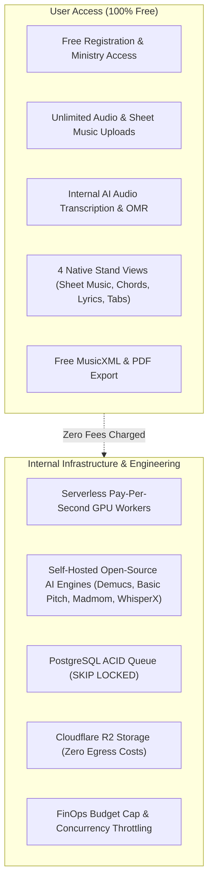
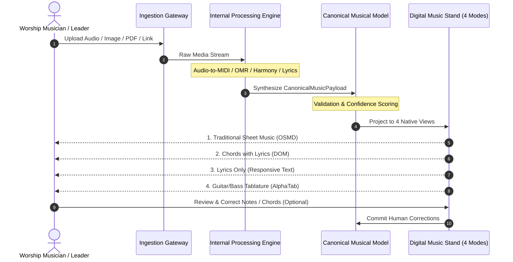

# WORSHIP STUDIO — PRODUCT OWNER MASTER DECISION
## Internal Music Transcription, Conversion & Digital Music Stand Integration

**Project:** Bethesda Worship Studio  
**Repository:** `https://github.com/juancastro2381-hub/BETHESDA-WORSHIP-STUDIO.git`  
**Directive:** Master Product Scope Clarification  
**Execution Mode:** STRICT READ-ONLY — Architectural Reconciliation & Documentation Only  
**Implementation Authorization:** NOT GRANTED  
**Date:** November 2, 2026  
**Status:** **RATIFIED MASTER PRODUCT DIRECTIVE**

---

## 1. Executive Summary & Definitive Product Vision

The Product Owner has issued a definitive master directive establishing the permanent scope, architecture, and user philosophy of Bethesda Worship Studio:

> [!IMPORTANT]
> **MASTER PRODUCT OWNER PRINCIPLE:**  
> **Users provide the musical source material. WORSHIP STUDIO processes it internally and generates the musical representations required by its own digital music stand. Users never need to purchase an external music conversion application or pay WORSHIP STUDIO to use these features.**

WORSHIP STUDIO is not a passive digital music stand that merely displays externally generated MusicXML scores. It is an **integrated, self-owned music recognition, transcription, conversion, arrangement, and visualization platform**.

### Core Tenets of the Master Directive
1. **Internal Processing Independence:** Users must not depend on commercial, paid third-party applications (such as SongScription, Flat.io, Sibelius, MuseScore Pro, or proprietary APIs) to transcribe or convert songs into MusicXML before utilizing WORSHIP STUDIO.
2. **Zero-Cost User Access:** All functionality is free for every user. No subscriptions, no per-song processing fees, no per-minute transcription fees, no conversion credits, and no paywalls for exporting MusicXML or accessing the digital stand.
3. **Multi-Modal Source Ingestion:** The platform natively ingests Audio (MP3, WAV, FLAC, M4A), Sheet Music Images (JPG, PNG), PDF documents (Vector and Scanned), External Video/Audio links (YouTube, social platforms, direct streams), and existing musical files (MusicXML, ChordPro, MIDI).
4. **Unified Canonical Core:** All ingested and transcribed materials converge into a single internal musical truth (`CanonicalMusicPayload`), which simultaneously powers four native presentation views in the digital music stand.
5. **Interactive Quality Control:** Professional transcription requires human-in-the-loop validation. An interactive correction workflow allows worship leaders and musicians to inspect, correct, and certify generated scores.

---

## 2. Zero-Cost Access & Internal Operating Model

The platform operates under a strictly non-monetized model for end users:

- **No Paywalls:** No feature gates, credit limits, or tiered accounts.
- **Controlled Operating Costs:** Handled internally through serverless compute, event-driven worker pools, asynchronous queuing, and self-hosted open-source models.

---

## 3. High-Level Processing & Representation Lifecycle

---

## 4. Current State vs. Target Directive Matrix

To maintain rigorous architectural discipline, this directive explicitly categorizes the current state of each capability in the repository:

| Capability Area | Current Repository State | Master Directive Requirement | Maturity Status |
| :--- | :--- | :--- | :--- |
| **Audio-to-MIDI Transcription** | None in codebase | Internal serverless Basic Pitch pipeline | **DESIGNED (0% Implemented)** |
| **Stem Separation** | Multitrack audio mixer UI exists; no backend splitter | Internal Demucs containerized worker | **DESIGNED (0% Implemented)** |
| **Optical Music Recognition (OMR)** | Prototype in `omr-service.ts` with 10 open defects | Internal Audiveris container with zero silent fallbacks | **DOCUMENTED DEFECTS (Open in Code)** |
| **Chord & Key Analysis** | Client-side ChordPro parser | Internal Madmom harmonic & beat analysis engine | **DESIGNED (0% Implemented)** |
| **Lyrics Forced Alignment** | Static text parsing | WhisperX + wav2vec2 phoneme synchronization | **DESIGNED (0% Implemented)** |
| **Canonical Music Model** | `CanonicalMusicPayload` v1.0.0 exists in frontend | Versioned v2.0.0 evolution with confidence & provenance | **PARTIALLY IMPLEMENTED (v1.0.0 exists)** |
| **Mode 1: Traditional Sheet Music** | OSMD adapter exists in `osmd-adapter.ts` | Dynamic projection from canonical model | **PARTIALLY IMPLEMENTED** |
| **Mode 2: Chords with Lyrics** | LeadSheet DOM adapter exists | Dynamic transposition & capo calculation | **IMPLEMENTED (v1)** |
| **Mode 3: Lyrics Only** | Basic text render | Responsive autoscroll liturgy view | **PARTIALLY IMPLEMENTED** |
| **Mode 4: Instrument Tablature** | `TablatureCalculator` exists; AlphaTab adapter drafted | Multi-instrument ergonomic optimizer | **PARTIALLY IMPLEMENTED** |
| **Internal MusicXML Generator** | Ingestion parser exists; no internal generator | Bidirectional round-trip MusicXML exporter | **DESIGNED (0% Implemented)** |
| **Correction & Review Workflow** | In-memory ephemeral proposals | Relational audit history, confidence heatmap, UI editor | **DESIGNED (0% Implemented)** |

---

## 5. Architectural Commitment & Next Steps

This document serves as the constitutional mandate for Bethesda Worship Studio. All subsequent architectural specifications and implementation roadmaps derive their requirements directly from this directive.

Engineering implementation remains strictly blocked pending explicit Product Owner approval of the Phase 1A work breakdown.

