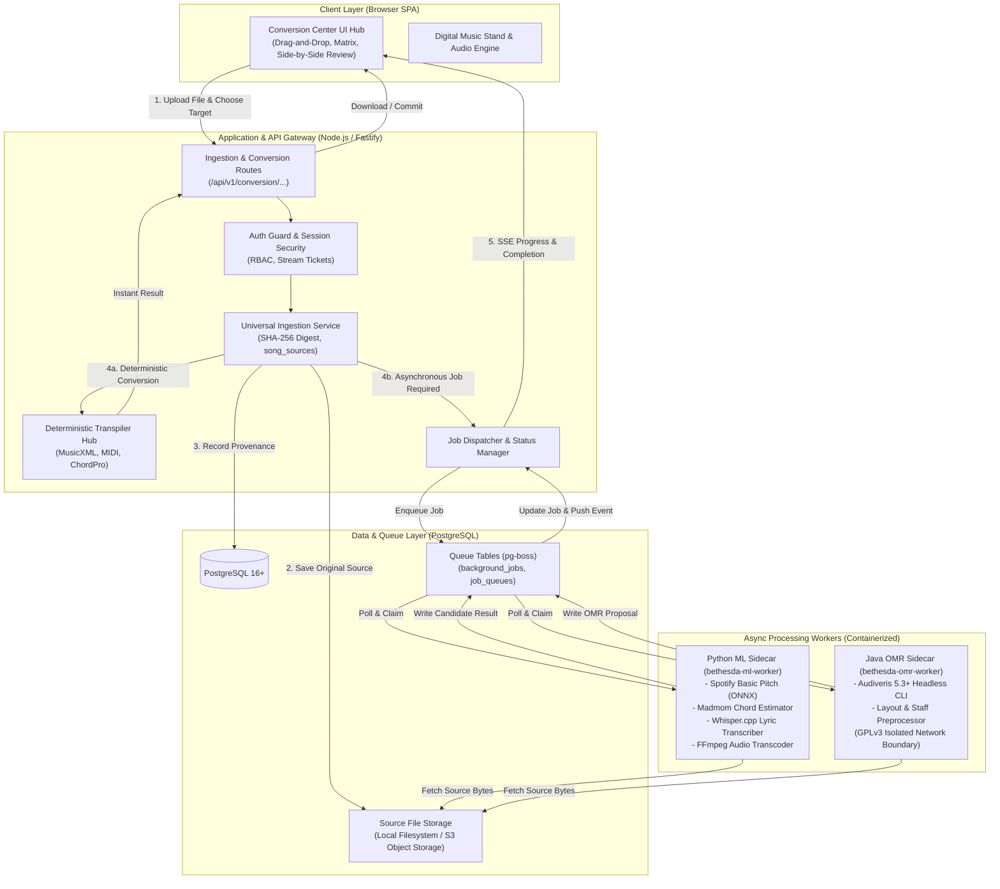
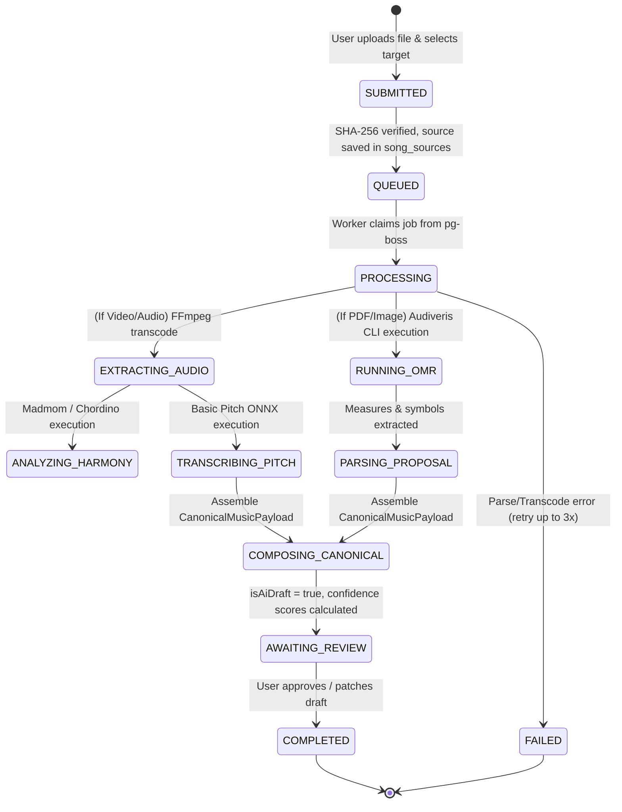
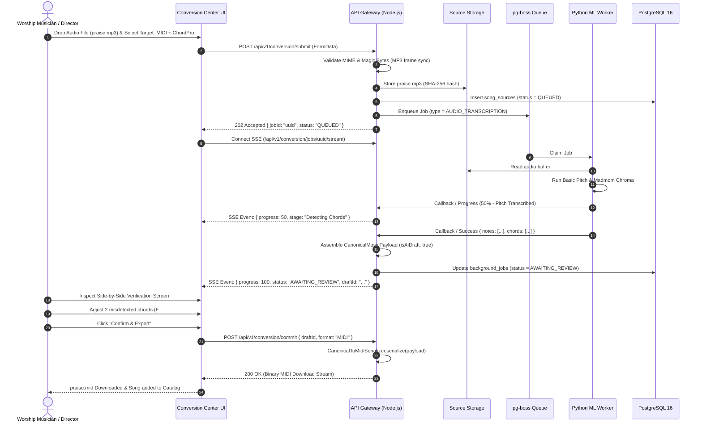

# CC_04: TARGET ARCHITECTURE
## BETHESDA WORSHIP STUDIO — CONVERSION CENTER TECHNICAL AUDIT

- **Project:** Bethesda Worship Studio
- **Document ID:** `CC-04-TARGET-ARCHITECTURE`
- **Audit Date:** November 2026
- **Status:** Complete Technical Architectural Specification
- **Repository Branch:** `feature/phase-1a-core-foundation`
- **Base Commit:** `51fef932b082df82bd31d643983a271c155eb4e2`
- **Execution Mode:** Read-Only Architectural Design & System Modeling

---

## 1. Core Architectural Directives

The Bethesda Musical File Conversion Center is designed as a first-class subsystem of Bethesda Worship Studio, adhering to five non-negotiable principles:

1. **Permanently Free Platform for Authenticated Users:**
   No billing tiers, no credit tokens, no feature paywalls, and zero external per-minute API dependencies. All conversions are executed on self-hosted or user-provided compute.
2. **Zero-Fabrication Musical Invariant:**
   The conversion pipeline must never synthesize missing notes, meter, tempos, or chords to satisfy a file format schema. Incomplete detections must be stored with explicit confidence scores, and unmetered or partial music must retain honest provenance.
3. **Hub-and-Spoke Conversion Topology:**
   Rather than building $N \times (N-1)$ point-to-point converters, all musical translations pivot through `CanonicalMusicPayload` as the central universal representation.
4. **Asynchronous Task Decoupling:**
   Heavyweight probabilistic operations (OMR, audio transcription, stem separation) are dispatched to background workers with real-time SSE (Server-Sent Events) or WebSocket progress updates. Synchronous deterministic operations (MusicXML <-> MIDI <-> ChordPro transpilation) execute sub-second in-process.
5. **Strict Container Sandboxing:**
   Foreign binary utilities (FFmpeg, Audiveris, Whisper.cpp) execute in non-root, isolated sidecar containers with explicit memory and CPU quotas.

---

## 2. System Architecture Overview



---

## 3. Hub-and-Spoke Conversion Topology

Instead of implementing 30+ separate ad-hoc translators between every pair of formats, the system establishes `CanonicalMusicPayload` as the central musical clearinghouse:

```mermaid
graph TD
    classDef canonical fill:#1e293b,stroke:#38bdf8,stroke-width:3px,color:#f8fafc;
    classDef input fill:#0f172a,stroke:#a855f7,stroke-width:2px,color:#f8fafc;
    classDef output fill:#0f172a,stroke:#22c55e,stroke-width:2px,color:#f8fafc;
    classDef blocked fill:#450a0a,stroke:#ef4444,stroke-width:2px,color:#fca5a5;

    CANONICAL["CanonicalMusicPayload<br/>(Universal Normalized Music Model)"]:::canonical

    %% Inbound Ingestion Adapters
    IN_MXL["MusicXML 4.0"]:::input -->|MusicXmlImporter| CANONICAL
    IN_MID["MIDI File"]:::input -->|MidiParser / IngestionAdapter| CANONICAL
    IN_CP["ChordPro"]:::input -->|ChordProImporter| CANONICAL
    IN_NOTES["Written Notes JSON"]:::input -->|WrittenNotesAdapter| CANONICAL
    IN_PDF_OMR["PDF Score (OMR)"]:::input -->|Audiveris -> OMR Proposal| CANONICAL
    IN_IMG_OMR["Image Score (OMR)"]:::input -->|Audiveris -> OMR Proposal| CANONICAL
    IN_AUDIO_PITCH["Audio Recording"]:::input -->|Basic Pitch -> MIDI| CANONICAL
    IN_PDF_CHORD["Cancionero PDF"]:::input -->|PdfTextExtractor -> ChordSheetConverter| CANONICAL

    %% Outbound Serialization Exporters
    CANONICAL -->|CanonicalToMusicXmlSerializer| OUT_MXL["MusicXML 4.0 (.musicxml)"]:::output
    CANONICAL -->|CanonicalToMidiSerializer| OUT_MID["Standard MIDI (.mid)"]:::output
    CANONICAL -->|CanonicalToChordProSerializer| OUT_CP["ChordPro (.chordpro)"]:::output
    CANONICAL -->|CanonicalToVerovioPdfSerializer| OUT_PDF["Engraved PDF Score"]:::output
    CANONICAL -->|WebAudio / SoundFont Synth| OUT_AUDIO["Rendered Audio (.wav/.mp3)"]:::output
    CANONICAL -->|ExtractLyrics| OUT_TXT["Lyrics Only (.txt)"]:::output
    CANONICAL -->|GenerateVoicings| OUT_TAB["Guitar Tab & Voicings"]:::output

    %% Strict Zero-Fabrication Blocks
    IN_CP -.->|🚫 BLOCKED: Zero Notes in Origin| OUT_MXL
    IN_PDF_CHORD -.->|🚫 BLOCKED: Zero Notes in Origin| OUT_MXL
```



### Invariant Validation Rules:
1. **The Incompleteness Flag (`isVisualOnly` / `isChordChart`):** If a `CanonicalMusicPayload` originated from ChordPro or a text-only cancionero, its `measures` contain harmony tags and lyric syllables, but zero melodic note events.
2. **Blocked Serialization Gate:** The `CanonicalToMusicXmlSerializer` explicitly checks whether melodic voices exist. If total note count is 0, it rejects exportation to full sheet music with code `CANNOT_FABRICATE_NOTES`.

---

## 4. Asynchronous Queue Architecture (pg-boss vs BullMQ)

For the background worker pipeline, two architectures were evaluated:

| Criterion | Redis + BullMQ | PostgreSQL + pg-boss |
| :--- | :--- | :--- |
| **Infrastructure Overhead** | Requires separate Redis instance, sentinel/cluster management, memory sizing. | **Zero new infrastructure.** Utilizes existing PostgreSQL database with `pg-boss` extension tables. |
| **Transaction Atomicity** | Non-atomic across Redis and Postgres (two-phase commit issues). | **100% ACID atomic.** Ingesting a source file, creating an audit log, and queuing the conversion job occur in a single database transaction. |
| **Operational Simplicity** | Two databases to backup, monitor, and scale. | Single database connection string and backup regime. |
| **Throughput Capacity** | 10,000+ jobs/sec (overkill for musical conversion). | 500–2,000 jobs/sec (more than sufficient for church/studio workloads). |
| **Persistence Guarantee** | In-memory with append-only file persistence. | PostgreSQL WAL and multi-AZ durability out-of-the-box. |
| **Verdict** | Overengineered for Bethesda's zero-cost self-hosted footprint. | **RECOMMENDED.** pg-boss provides enterprise-grade job scheduling with zero operational friction. |

### Job State Lifecycle (State Diagram):



---

## 5. Component Breakdown & Module Specifications

### 5.1. Backend Conversion Center Core (`backend/src/domain/conversion/`)

```
backend/src/domain/conversion/
├── conversion-orchestrator.ts        # Main facade coordinating conversions
├── conversion-types.ts               # Input/Output options, progress, diagnostics
├── exporters/
│   ├── canonical-to-musicxml.ts     # Deterministic MusicXML 4.0 XML builder
│   ├── canonical-to-midi.ts         # Binary MIDI Type 0/1 delta-time serializer
│   ├── canonical-to-chordpro.ts     # Syllable-aligned ChordPro writer
│   └── canonical-to-lyrics.ts       # Clean lyric extractor with section tags
├── evaluators/
│   └── conversion-feasibility.ts     # Validates input vs requested output
└── workers/
    ├── ml-worker-client.ts          # HTTP/RPC client for Python ML sidecar
    └── omr-worker-client.ts         # HTTP/RPC client for Java Audiveris sidecar
```

#### Detailed Exporter Specifications:
1. **`CanonicalToMusicXmlSerializer`:**
   - Traverses `payload.measures` and ordered voices.
   - Converts canonical pitch (`step`, `octave`, `alter`) to `<pitch><step>C</step><octave>4</octave></pitch>`.
   - Converts 480 TPQN ticks to MusicXML `<duration>` relative to `<divisions>`.
   - Embeds `<harmony>` elements with chord kind and root for harmonic accompaniment.
   - Emits well-formed MusicXML 4.0 with XML declaration and DTD.
2. **`CanonicalToMidiSerializer`:**
   - Computes microsecond-per-quarter-note from `payload.tempoMap`.
   - Converts canonical tick positions to variable-length delta times.
   - Writes standard MIDI Header Chunk (`MThd`, format 1, PPQ 480).
   - Writes Track Chunks (`MTrk`) per voice with `NoteOn` (velocity 64–100) and `NoteOff`.
3. **`CanonicalToChordProSerializer`:**
   - Emits metadata directives: `{title: ...}`, `{artist: ...}`, `{key: ...}`, `{tempo: ...}`.
   - Inspects `measure.chords` and `measure.lyrics`.
   - Places `[Chord]` bracket immediately preceding the associated syllable text.

---

### 5.2. Worker Sidecar Services

#### 1. `bethesda-ml-worker` (Python 3.11 / FastAPI / ONNX Runtime)
- **Base Image:** `python:3.11-slim-bookworm` (Debian-based, non-root user).
- **Installed Packages:** `onnxruntime`, `basic-pitch`, `madmom`, `numpy`, `scipy`, `ffmpeg`.
- **Endpoints:**
  - `POST /transcribe-audio`: Receives audio buffer -> Basic Pitch ONNX inference -> returns MIDI note events JSON.
  - `POST /extract-chords`: Receives audio buffer -> Madmom beat/chroma analysis -> returns chord progression with timestamps.
  - `POST /transcribe-lyrics`: Runs embedded `whisper.cpp` binary -> returns word-timed lyric text.
  - `POST /separate-stems`: Optional Demucs v4 execution -> returns stem file paths.

#### 2. `bethesda-omr-worker` (Java 17 / Audiveris CLI)
- **Base Image:** `eclipse-temurin:17-jre-jammy`
- **Installed Packages:** Audiveris v5.3+ headless, `tesseract-ocr` (for lyric text recognition).
- **Execution Model:**
  - Fastify worker service accepts PDF/Image bytes.
  - Runs Audiveris CLI in batch headless mode:
    ```bash
    audiveris -batch -export -output /tmp/out /tmp/in/score.pdf
    ```
  - Parses generated MusicXML, calculates bounding box confidences, returns structured `OmrProposalJSON`.

---

## 6. End-to-End Ingestion & Conversion Sequence



---

## 7. Zero-Fabrication Contract Compliance

| Source Data Available | Permitted Conversion Outputs | Prohibited Conversion Outputs (Hard Gate) |
| :--- | :--- | :--- |
| **Only Chords & Lyrics** (Cancionero / ChordPro) | ChordPro, Chord Sheet PDF, Lyrics Only, Guitar Voicings | **Traditional Sheet Music (MusicXML / Notes)**<br>❌ Reason: Melodic pitches and durations do not exist. |
| **Audio Recording** (Worship band mix) | MIDI Draft, ChordPro Draft, Stem Audio, Lyrics Draft | **Direct Unreviewed Canonical Song**<br>❌ Reason: Must be flagged as `isAiDraft: true` and require human verification. |
| **Scanned Score** (Low-resolution / Degraded) | OMR Proposal with flagged `unrecognizedRegions` | **Silent Infilling with C Major / 4/4 / Quarter Notes**<br>❌ Reason: Ambiguous regions must remain blank or require user input. |
| **Monophonic Lead Sheet** (Melody only) | Single-voice MusicXML, MIDI Melody, Lead Sheet PDF | **Fabricated Multi-Part SATB Choral Harmony**<br>❌ Reason: Countermelodies cannot be invented without explicit arrangement tools. |

