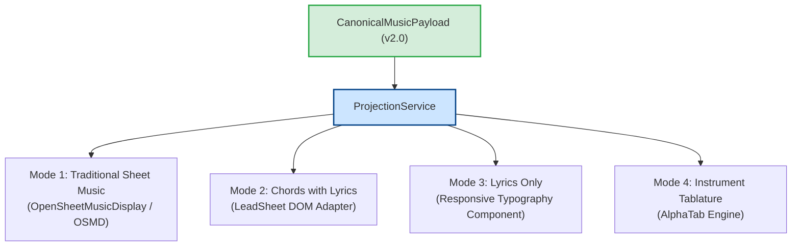

# WORSHIP STUDIO — PHASE 0E
## Digital Music Stand Feasibility, Multi-Mode Rendering Adapters & Honest Availability Matrix

**Project:** Bethesda Worship Studio  
**Repository:** `https://github.com/juancastro2381-hub/BETHESDA-WORSHIP-STUDIO.git`  
**Current Branch:** `main` (commit `42f4cf7`)  
**Phase:** 0E — Technical Architecture Consistency & Feasibility Gate  
**Execution Mode:** STRICT READ-ONLY — Architecture Audit, Verification & Documentation Only  
**Implementation Authorization:** NOT GRANTED  
**Date:** November 2, 2026  
**Status:** **AUDIT F COMPLETE — STAND FEASIBILITY EVALUATED**

---

## 1. Executive Summary & Purpose

The **Bethesda Worship Studio Digital Music Stand** provides the user-facing visual interface for live rehearsals and liturgical church services.

In accordance with the Product Owner Master Directive:
> *"The platform must support four native Digital Music Stand representations: 1. Traditional Sheet Music, 2. Chords with Lyrics, 3. Lyrics Only, 4. Instrument Tablature... The system must never fabricate unavailable musical information."*

The purpose of this Phase 0E audit is to:
1. Conduct an in-depth feasibility evaluation across all four rendering adapters: OSMD, LeadSheet DOM, Lyrics Stand, and AlphaTab.
2. Establish the **Honest Availability Matrix** using formal status indicators.
3. Classify client-side view-switching performance as **UNVERIFIED**.

---

## 2. In-Depth Evaluation of the Four Rendering Adapters

### 2.1 Mode 1: Traditional Sheet Music (OSMD)
- **Codebase Adapter:** [`frontend/src/core/rendering/adapters/osmd-adapter.ts`](file:///c:/Users/juanc/OneDrive/Documentos/Desarrollo%20proyectos/Sistema%20musical%20-%20partituras/BETHESDA%20WORSHIP%20STUDIO/frontend/src/core/rendering/adapters/osmd-adapter.ts)
- **1. Required Canonical Data:** `timeline` (meter, tempo, key), `measures`, `instrumentTracks` with polyphonic `Note` and `Rest` events, clefs, accidentals, beams, ties, and `LyricSyllable` objects.
- **2. Minimum Information Needed:** At least 1 measure with a defined time signature, clef, and at least 1 note or rest.
- **3. Unsupported / Incomplete Conditions:** Raw text ChordPro lead sheets containing only chords and lyrics without transcribed melody notes.
- **4. Rendering Dependencies:** `opensheetmusicdisplay` npm package (SVG/Canvas rendering engine).
- **5. Editing Requirements:** Note pitch dragging, duration palette modification, accidental toggle.
- **6. Transposition Behavior:** Transposes all note pitches and key signatures across staves synchronously.
- **7. Instrument-Specific Behavior:** Transposes inherently for Bb instruments (Trumpet, Tenor Sax) or Eb instruments (Alto Sax) according to the musician’s instrument profile.
- **8. Offline Behavior:** Fully functional offline once the OSMD library bundle and score payload are cached via Service Worker.
- **9. Accessibility:** High-contrast dark/light theme support; SVG zoom up to 300%.
- **10. Acceptance Test:** Renders `valid_full_score.musicxml` without canvas layout exceptions.

### 2.2 Mode 2: Chords with Lyrics (LeadSheet DOM)
- **Codebase Adapter:** [`frontend/src/core/rendering/adapters/leadsheet-dom-adapter.ts`](file:///c:/Users/juanc/OneDrive/Documentos/Desarrollo%20proyectos/Sistema%20musical%20-%20partituras/BETHESDA%20WORSHIP%20STUDIO/frontend/src/core/rendering/adapters/leadsheet-dom-adapter.ts)
- **1. Required Canonical Data:** `sections`, `measures`, `chords` (`ChordEvent`), and `lyrics` (`LyricSyllable`).
- **2. Minimum Information Needed:** Lyric text blocks with at least 1 chord symbol.
- **3. Unsupported Conditions:** Purely instrumental backing tracks or classical scores with zero lyrics.
- **4. Rendering Dependencies:** Pure React / HTML DOM (zero heavy external canvas libraries).
- **5. Editing Requirements:** Inline chord text editing, chord alignment dragging over syllables.
- **6. Transposition Behavior:** Instantaneous transposition of chord roots (`TranspositionEngine`) and capo computation (`CapoCalculator`).
- **7. Instrument-Specific Behavior:** Guitar capo indicator (e.g. *"Tono: E | Capo: Traste 2 | Acordes: D"*).
- **8. Offline Behavior:** 100% offline-ready via local DOM rendering.
- **9. Accessibility:** Screen-reader friendly (aria-labels on chords and lyrics); adjustable font scaling.
- **10. Acceptance Test:** Transposition from C to Ab maintains exact syllable-to-chord vertical alignment.

### 2.3 Mode 3: Lyrics Only (Responsive Typography Stand)
- **Codebase Component:** Integrated in reading view (`frontend/src/components/reading-view/`)
- **1. Required Canonical Data:** `sections` and `lyrics` text.
- **2. Minimum Information Needed:** Plain text stanzas grouped by section.
- **3. Unsupported Conditions:** Instrumental tracks with no vocal presence.
- **4. Rendering Dependencies:** Responsive React CSS flex/grid layout.
- **5. Editing Requirements:** Lyric text correction and stanza reordering.
- **6. Transposition Behavior:** Not applicable (lyrics are invariant to musical key).
- **7. Instrument-Specific Behavior:** Not applicable (vocalist/congregation focused).
- **8. Offline Behavior:** 100% offline-ready.
- **9. Accessibility:** Extra-large stage typography mode (high contrast for dim church lighting).
- **10. Acceptance Test:** Continuous autoscroll syncs with rehearsal tempo without UI stutter.

### 2.4 Mode 4: Instrument Tablature (AlphaTab)
- **Codebase Adapter:** [`frontend/src/core/rendering/adapters/alphatab-adapter.ts`](file:///c:/Users/juanc/OneDrive/Documentos/Desarrollo%20proyectos/Sistema%20musical%20-%20partituras/BETHESDA%20WORSHIP%20STUDIO/frontend/src/core/rendering/adapters/alphatab-adapter.ts)
- **1. Required Canonical Data:** `instrumentTracks` with pitch events, instrument tuning definition, and string/fret coordinates derived by `TablatureCalculator`.
- **2. Minimum Information Needed:** Pitched note stream within the playable register of the instrument.
- **3. Unsupported Conditions:** Source files lacking note-level pitch data (e.g. chord-only lead sheets).
- **4. Rendering Dependencies:** `@coderline/alphatab` npm package.
- **5. Editing Requirements:** Fret-number editing; string position reassignment popup.
- **6. Transposition Behavior:** Recalculates physical string and fret coordinates to match transposed key.
- **7. Instrument-Specific Behavior:** Adapts to 6-string guitar, 4-string bass, or 5-string bass tunings.
- **8. Offline Behavior:** Fully functional offline once AlphaTab bundle is cached.
- **9. Accessibility:** High-contrast fret numbering and adjustable staff line height.
- **10. Acceptance Test:** Note sequence E4-G4-A4 generates playable fingerings with zero hand stretches $> 4$ frets.

---

## 3. The Honest Availability Matrix

The platform must explicitly display a status badge indicating whether a view is `READY`, `PARTIALLY_AVAILABLE`, `REQUIRES_REVIEW`, or `UNAVAILABLE`:

| Ingested Source Type | Mode 1 (Sheet Music) | Mode 2 (Chords+Lyrics) | Mode 3 (Lyrics Only) | Mode 4 (Tablature) | System UI Behavior |
| :--- | :---: | :---: | :---: | :---: | :--- |
| **Complete MusicXML Score** | **READY** | **READY** | **READY** | **READY** | All 4 modes immediately accessible. |
| **ChordPro Lead Sheet** | **UNAVAILABLE** | **READY** | **READY** | **UNAVAILABLE** | Modes 1 and 4 disabled with prompt: *"Run audio transcription to generate notes."* |
| **Instrumental Audio (No Vocals)**| **READY** | **PARTIALLY_AVAILABLE** *(Chords only)* | **UNAVAILABLE** | **READY** | Mode 3 disabled with badge: *"No lyrics detected in audio."* |
| **Scanned Hymnal Page (OMR)** | **READY** | **READY** | **READY** | **READY** | Fully synthesized into canonical model. |
| **Audio with Unclear Vocal Mix** | **READY** | **REQUIRES_REVIEW** | **REQUIRES_REVIEW** | **READY** | Yellow review badge directing user to verify lyrics. |

---

## 4. Reclassification of View-Switching Performance Claims

> [!IMPORTANT]
> **View-Switching Latency Reclassification:**  
> Prior documentation asserted that view switching occurs in *"under 5 milliseconds"*.  
> **Reclassified Status: UNVERIFIED (Target Metric)**.  
> While the memory projection in `ProjectionService` is fast, the true end-to-end rendering time includes DOM tree reconciliation and canvas/SVG drawing by OSMD and AlphaTab.  
> Until automated Playwright/Lighthouse benchmarks run on actual mobile/tablet hardware in Phase 4A, this metric cannot be represented as a verified fact.

---

## 5. Audit F Conclusion & Verdict

The architecture for the four native presentation modes is **technically feasible, well-modularized, and respectful of source limitations**.

By enforcing the Honest Availability Matrix, WORSHIP STUDIO ensures that users are never presented with fabricated or hallucinated musical notation.

**Audit F is certified as FEASIBLE AND HONESTLY GATED.**

