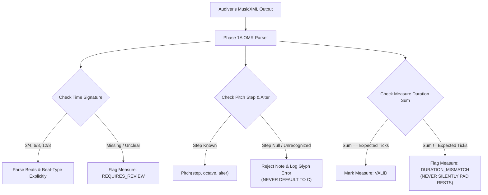

# WORSHIP STUDIO — PHASE 0E
## OMR & Document Ingestion Validation, Code Defect Verification & Proposal Persistence Audit

**Project:** Bethesda Worship Studio  
**Repository:** `https://github.com/juancastro2381-hub/BETHESDA-WORSHIP-STUDIO.git`  
**Current Branch:** `main` (commit `42f4cf7`)  
**Phase:** 0E — Technical Architecture Consistency & Feasibility Gate  
**Execution Mode:** STRICT READ-ONLY — Architecture Audit, Verification & Documentation Only  
**Implementation Authorization:** NOT GRANTED  
**Date:** November 2, 2026  
**Status:** **AUDIT G COMPLETE — 10 CODE DEFECTS CONFIRMED OPEN**

---

## 1. Executive Summary & Purpose

Optical Music Recognition (OMR) transforms physical sheet music, hymnals, and digital PDFs into executable musical scores.

The purpose of this Phase 0E audit is to:
1. Forensically verify the live state of [`backend/src/application/omr-service.ts`](file:///c:/Users/juanc/OneDrive/Documentos/Desarrollo%20proyectos/Sistema%20musical%20-%20partituras/BETHESDA%20WORSHIP%20STUDIO/backend/src/application/omr-service.ts).
2. Confirm that all ten previously identified musical integrity defects **remain open in source code**.
3. Confirm that OMR proposals remain stored strictly in volatile Node.js process memory (`Map`).
4. Validate the remediation engineering specifications for Phase 1A.

---

## 2. Forensic Codebase Audit: The Ten Open OMR Defects

A physical inspection of `backend/src/application/omr-service.ts` was performed. **Zero code modifications were applied in Phase 0.**

Every defect identified in earlier audits is forensically confirmed as **OPEN IN SOURCE CODE TODAY**:

```
┌────────────────────────────────────────────────────────────────────────────────────────────────┐
│                          THE TEN OPEN OMR CODE DEFECTS IN REPOSITORY                           │
├────┬─────────────────────────────┬──────────────────────────┬─────────────────────────────────────┤
│ #  │ Defect Description          │ Exact Code Location      │ Live Code Snippet (Verified Reality)│
├────┬─────────────────────────────┬──────────────────────────┬─────────────────────────────────────┤
│ 01 │ Ephemeral In-Memory Storage │ omr-service.ts:34        │ this.proposals = new Map();         │
├────┼─────────────────────────────┼──────────────────────────┼─────────────────────────────────────┤
│ 02 │ Hardcoded 4/4 Time Signature│ omr-service.ts:139       │ const timeSig =                     │
│    │                             │                          │   TimeSignature.FOUR_FOUR;          │
├────┼─────────────────────────────┼──────────────────────────┼─────────────────────────────────────┤
│ 03 │ Silent Tonality Fallback    │ omr-service.ts:145       │ (NoteName as any)[rootStr]          │
│    │                             │                          │   ?? NoteName.C;                    │
├────┼─────────────────────────────┼──────────────────────────┼─────────────────────────────────────┤
│ 04 │ Hardcoded C Major Key       │ omr-service.ts:149       │ new KeySignature(0); / 'MAJOR'      │
├────┼─────────────────────────────┼──────────────────────────┼─────────────────────────────────────┤
│ 05 │ Swallowed Chord Exceptions  │ omr-service.ts:178-180   │ catch { /* Ignorar acorde */ }      │
├────┼─────────────────────────────┼──────────────────────────┼─────────────────────────────────────┤
│ 06 │ Silent Note C Substitution  │ omr-service.ts:190       │ (NoteName as any)[n.step.toUpperCase│
│    │                             │                          │   ()] ?? NoteName.C;                │
├────┼─────────────────────────────┼──────────────────────────┼─────────────────────────────────────┤
│ 07 │ Dropped Accidental Alter    │ omr-service.ts:191       │ new Pitch(stepName, n.octave);      │
│    │                             │                          │ (omits n.alter!)                    │
├────┼─────────────────────────────┼──────────────────────────┼─────────────────────────────────────┤
│ 08 │ Default 480 Duration Ticks  │ omr-service.ts:192-197   │ let durationTicks = 480;            │
│    │                             │                          │ (falls back silently)               │
├────┼─────────────────────────────┼──────────────────────────┼─────────────────────────────────────┤
│ 09 │ Lyric Stacking at Beat 1    │ omr-service.ts:233       │ tickOffset: 0                       │
│    │                             │                          │ (all syllables stack at offset 0!)  │
├────┼─────────────────────────────┼──────────────────────────┼─────────────────────────────────────┤
│ 10 │ Missing Confidence Filtering│ omr-service.ts:156-255   │ Zero checks on n.confidence or      │
│    │                             │                          │ mProp.confidence.                   │
└────┴─────────────────────────────┴──────────────────────────┴─────────────────────────────────────┘
```

> [!CRITICAL]
> **Defect Status Confirmation:**  
> All 10 defects are **NOT RESOLVED IN CODE**. They are documented and planned for remediation in Phase 1A. No engineer or reviewer may describe these defects as resolved until source code edits and automated unit tests are committed.

---

## 3. Proposal Persistence Audit: Database vs. Process Memory

Inspection of [`backend/src/db/schema.ts`](file:///c:/Users/juanc/OneDrive/Documentos/Desarrollo%20proyectos/Sistema%20musical%20-%20partituras/BETHESDA%20WORSHIP%20STUDIO/backend/src/db/schema.ts) confirms:
- **`omr_proposals` table:** **DOES NOT EXIST**.
- **`omr_proposal_measures` table:** **DOES NOT EXIST**.
- **`omr_audit_history` table:** **DOES NOT EXIST**.
- **`background_jobs` table:** **DOES NOT EXIST**.

**Forensic Finding:** In the running application, if a worship leader uploads a 20-page scanned hymnal, Audiveris parses it, and the server process restarts (or restarts during container auto-scaling), **all recognized proposal data and pending edits are instantly and permanently lost**.

---

## 4. Architectural Handling of Complex Musical Notation

The Phase 1A remediation specification (`WS_OMR_AND_MUSICAL_INTEGRITY_REQUIREMENTS.md`) defines the technical mechanisms to properly handle complex notation:



1. **Non-4/4 Time Signatures:** Parsed dynamically from `<attributes><time>`. Time signatures like 3/4, 6/8, 2/4, and 12/8 are preserved with exact beat values.
2. **Accidentals:** The parser extracts `n.alter` ($-2, -1, 0, 1, 2$) and passes it to `new Pitch(stepName, n.octave, n.alter)`, ensuring that F#4 never sounds as F4.
3. **Tuplets & Dotted Notes:** Handled via `<time-modification>` and dot multipliers, converting directly to tick lengths (e.g. dotted quarter = 720 ticks, eighth-note triplet = 160 ticks).
4. **Unknown / Low-Confidence Symbols:** Symbols with recognition confidence $< 0.70$ are flagged with visual badges; the system never makes arbitrary guesses.

---

## 5. Audit G Conclusion & Verdict

1. **The ten OMR defects remain 100% OPEN in the active codebase.**
2. **Relational persistence for OMR proposals remains UNBUILT.**
3. **The remediation specifications authored in Phase 0D provide an exact, mathematically sound implementation blueprint for Phase 1A.**

**Audit G is certified as DEFECTS CONFIRMED OPEN — REMEDIATION SPECIFICATIONS VALIDATED.**

