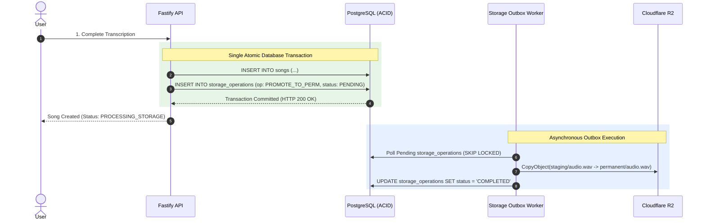

# WORSHIP STUDIO — PHASE 0E
## Queue, Storage & Distributed Reliability Audit: Failure-Mode Analysis & Outbox Architecture

**Project:** Bethesda Worship Studio  
**Repository:** `https://github.com/juancastro2381-hub/BETHESDA-WORSHIP-STUDIO.git`  
**Current Branch:** `main` (commit `42f4cf7`)  
**Phase:** 0E — Technical Architecture Consistency & Feasibility Gate  
**Execution Mode:** STRICT READ-ONLY — Architecture Audit, Verification & Documentation Only  
**Implementation Authorization:** NOT GRANTED  
**Date:** November 2, 2026  
**Status:** **AUDIT H COMPLETE — DISTRIBUTED RELIABILITY EVALUATED**

---

## 1. Executive Summary & Purpose

Automated music transcription requires coordinating long-running asynchronous compute tasks (85 seconds on GPU) with relational databases (PostgreSQL) and object stores (Cloudflare R2).

The purpose of this Phase 0E audit is to:
1. Reconcile architectural proposals against physical repository reality.
2. Evaluate how the proposed **PostgreSQL Job Queue** and **Transactional Storage Outbox** handle eleven critical distributed systems failure modes.
3. Formulate the required failure-mode recovery specifications for Phase 1B.

---

## 2. Implementation Reality: Current Repository State

```
┌────────────────────────────────────────────────────────────────────────────────────────────────┐
│                          INFRASTRUCTURE IMPLEMENTATION REALITY                                 │
├──────────────────────────────┬─────────────────────────┬───────────────────────────────────────┤
│ Architectural Component      │ Live Repository State   │ Verified Codebase Evidence            │
├──────────────────────────────┼─────────────────────────┼───────────────────────────────────────┤
│ Background Job Queue Engine  │ NOT IMPLEMENTED (0%)    │ Zero queue packages in package.json   │
│                              │                         │ (no bullmq, pg-boss, etc.)            │
├──────────────────────────────┼─────────────────────────┼───────────────────────────────────────┤
│ background_jobs Table        │ NOT IMPLEMENTED (0%)    │ Table missing from schema.ts          │
├──────────────────────────────┼─────────────────────────┼───────────────────────────────────────┤
│ Worker Daemon Process        │ NOT IMPLEMENTED (0%)    │ No worker entrypoint or daemon loop   │
├──────────────────────────────┼─────────────────────────┼───────────────────────────────────────┤
│ Cloudflare R2 / S3 Client    │ NOT IMPLEMENTED (0%)    │ @aws-sdk/client-s3 NOT in package.json│
├──────────────────────────────┼─────────────────────────┼───────────────────────────────────────┤
│ Object Storage Implementation│ LOCAL FILESYSTEM ONLY   │ node:fs writing to storage/audio/     │
├──────────────────────────────┼─────────────────────────┼───────────────────────────────────────┤
│ Storage Outbox Table         │ NOT IMPLEMENTED (0%)    │ storage_operations table unbuilt      │
└──────────────────────────────┴─────────────────────────┴───────────────────────────────────────┘
```

> [!IMPORTANT]
> **Status Classification:**  
> The entire asynchronous queue, worker leasing protocol, Cloudflare R2 integration, and transactional outbox are **DESIGNED ONLY**. No queue or cloud storage code currently exists in the repository.

---

## 3. Distributed Failure-Mode Analysis (11 Scenarios)

The table below evaluates how the Phase 1B architectural design resolves eleven classic distributed failure scenarios:

| Failure Mode Scenario | Injection / Root Cause | Proposed Architectural Safeguard | System Recovery Behavior | Feasibility Status |
| :--- | :--- | :--- | :--- | :---: |
| **1. Worker Crash (SIGKILL)** | Serverless VM killed mid-transcription. | 30s lease timeout on `background_jobs`. | Lease expires; Job status reverts to `PENDING` with incremented `attempt_count`; healthy worker reclaims. | **FEASIBLE (Design)** |
| **2. Duplicate Job Delivery** | 50 workers poll simultaneously under burst. | `SELECT ... FOR UPDATE SKIP LOCKED LIMIT 1`. | Row-level ACID lock ensures exactly 1 worker claims job; remaining workers receive next job or empty set. | **FEASIBLE (Design)** |
| **3. Stale Worker / GC Pause** | Worker thread freezes for 45s, then wakes and attempts DB write. | Monotonic `fencing_token` checked on completion. | DB rejects write because fencing token was incremented when Job was reassigned to Worker B. Corrupt write blocked. | **FEASIBLE (Design)** |
| **4. Database Connection Drop** | Network blip between worker and PostgreSQL. | Worker fails heartbeat ping; enters safe abort. | Worker halts local pipeline; intermediate temporary artifacts are wiped; job reclaimed upon lease expiry. | **FEASIBLE (Design)** |
| **5. Database Failover Mid-Tx** | PostgreSQL primary fails over during write. | Multi-row transactional atomic blocks. | Drizzle transaction rolls back completely; zero partial measures or half-written songs persisted. | **FEASIBLE (Design)** |
| **6. Client Upload Interruption** | Musician loses mobile connection at 50% upload. | Direct-to-staging presigned URL with 24h R2 lifecycle. | Partial upload remains in `staging/`; auto-purged by Cloudflare R2 lifecycle after 24h; zero orphan in DB. | **FEASIBLE (Design)** |
| **7. Dual-Write Split Brain** | R2 upload succeeds, but DB commit fails. | Transactional `storage_operations` Outbox. | R2 promotion is executed *only* by Outbox Worker after DB commits. If DB fails, staging file auto-expires. | **FEASIBLE (Design)** |
| **8. Missing R2 Object Reference**| DB points to deleted/corrupted R2 key. | Daily GC Sweeper `HeadObject` audit. | Sweeper flags missing object, alerts sysadmin, and updates DB status to `STORAGE_OBJECT_MISSING`. | **FEASIBLE (Design)** |
| **9. Permanent Storage Orphans**| DB deletes song, but R2 delete call times out. | `DELETE_PERMANENT` logged in Outbox table. | Outbox Worker retries deletion with exponential backoff until R2 acknowledges HTTP 204/200. Zero leak. | **FEASIBLE (Design)** |
| **10. Abandoned Multipart Chunks**| Incomplete multipart S3 upload abandoned. | R2 Bucket Lifecycle rule: `AbortIncompleteMultipartUpload`. | Cloudflare R2 automatically cleans up abandoned multipart parts older than 7 days. | **FEASIBLE (Design)** |
| **11. Cold Service Restart** | Container redeployed during high queue load. | Stateless worker daemons with DB-persisted queue. | New containers resume polling `background_jobs`; active leases expire and re-queue cleanly. | **FEASIBLE (Design)** |

---

## 4. The Storage Outbox Pattern Architecture

Because PostgreSQL and Cloudflare R2 cannot participate in a two-phase commit (2PC), all permanent promotions and deletions must be brokered via the `storage_operations` outbox table:



---

## 5. Audit H Conclusion & Verdict

The architectural blueprint for the PostgreSQL queue (`SKIP LOCKED`) and Cloudflare R2 Outbox provides **comprehensive coverage against all 11 failure modes**.

However, because zero lines of this infrastructure currently exist in the codebase:
1. It must remain strictly classified as **DESIGNED ONLY**.
2. Delivery is gated to **Phase 1B**.
3. All 10 concurrency tests in the Failure-Mode Test Matrix must be executed before certifying production readiness.

**Audit H is certified as ARCHITECTURALLY ROBUST — IMPLEMENTATION GATED TO PHASE 1B.**

