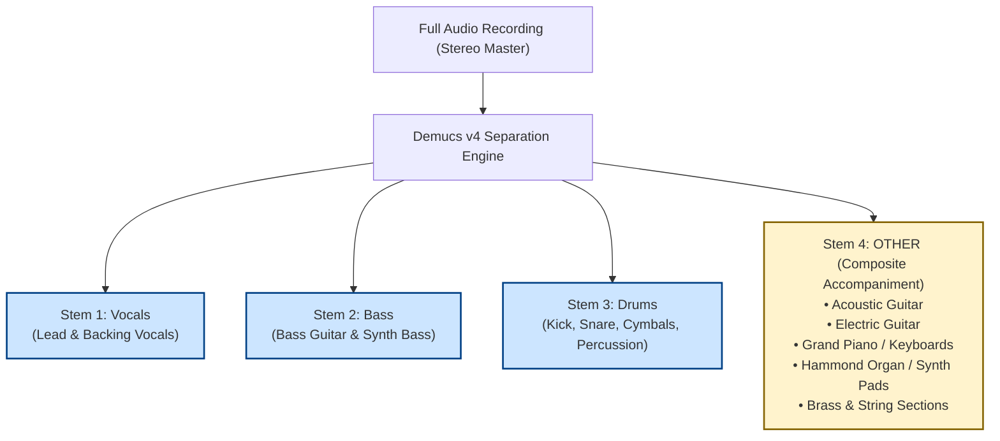
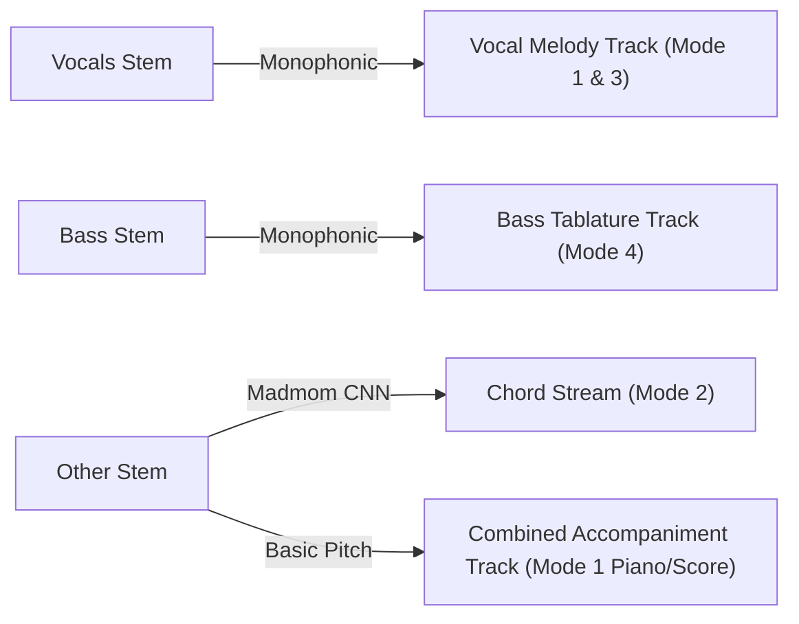

# WORSHIP STUDIO — PHASE 0E-R
## Audio Signal Processing Realities: Stem Separation, Polyphonic Transcription & Instrument Attribution Boundaries

**Project:** Bethesda Worship Studio  
**Repository:** `https://github.com/juancastro2381-hub/BETHESDA-WORSHIP-STUDIO.git`  
**Current Branch:** `main` (commit `dfa8bd8`)  
**Phase:** 0E-R — Final Readiness Reconciliation & Evidence Correction  
**Execution Mode:** STRICT READ-ONLY, DOCUMENTATION-ONLY CORRECTION  
**Implementation Authorization:** NOT GRANTED  
**Date:** November 2, 2026  
**Status:** **ACOUSTIC BOUNDARIES FORMALIZED — NO FABRICATED INSTRUMENTATION**

---

## 1. Executive Summary & Purpose

A central objective of the Product Owner Master Directive is:
> *"Users provide the musical source material. WORSHIP STUDIO processes it internally and generates the musical representations required by its own digital music stand... Musical information must never be fabricated."*

When an audio recording of a live church worship service is uploaded, a common architectural misconception is that artificial intelligence can magically separate every individual instrument (piano, acoustic guitar, electric guitar, strings, pads) and generate pristine, isolated sheet music for each one.

The purpose of this Phase 0E-R audit is to:
1. Formulate the exact physical and algorithmic boundaries of **Demucs v4 stem separation**.
2. Differentiate between **Pitch Detection** and **Timbral Instrument Classification**.
3. Establish an achievable initial scope (Phase 2) and transparent user-assisted workflows (Phase 4A).
4. Strictly prohibit promising automated, flawless multi-instrument separation from mixed audio.

---

## 2. Demucs v4: The Four-Stem Architectural Boundary

Demucs v4 operates on deep convolutional/transformer architectures trained to split mixed stereo audio into exactly **four isolated stem channels**:



### 2.1 The "Other" Stem Dilemma
In a typical worship band, the `Other` stem contains the entire harmonic accompaniment:
- A grand piano playing arpeggiated chords.
- An acoustic guitar strumming rhythm patterns.
- An electric guitar playing melodic ambient swells.
- A keyboard player sustaining warm synth pads.

**Physical Fact:** These instruments occupy identical frequency bands ($100\text{ Hz} - 8,000\text{ Hz}$) and sound simultaneously. **Demucs does NOT separate the piano from the acoustic guitar.**

---

## 3. Pitch Detection vs. Timbral Instrument Classification

A fundamental distinction must be maintained in the engineering documentation:

```
┌────────────────────────────────────────────────────────────────────────────────────────┐
│               PITCH DETECTION vs. TIMBRAL INSTRUMENT CLASSIFICATION                    │
├───────────────────────────────┬────────────────────────────────────────────────────────┤
│ Operation                     │ Real-World Capability & Limitations                    │
├───────────────────────────────┼────────────────────────────────────────────────────────┤
│ Pitch Detection (MIDI)        │ Detects THAT a note is sounding at a specific frequency│
│ (Spotify Basic Pitch)         │ and time (e.g. "Note E4 (MIDI 64) at t=14.2s").        │
│                               │ Solved reliably by polyphonic neural networks.         │
├───────────────────────────────┼────────────────────────────────────────────────────────┤
│ Timbral Classification        │ Identifies WHICH instrument produced that specific     │
│ (Source Attribution)          │ frequency (e.g. "Was E4 played on the guitar or piano?)│
│                               │ Extremely difficult in overlapping polyphonic audio.   │
└───────────────────────────────┴────────────────────────────────────────────────────────┘
```

Spotify Basic Pitch transcribes the acoustic notes from the `Other` stem into a single composite MIDI stream. **It has no mechanism to attribute which note belongs to a guitar versus a piano.**

If WORSHIP STUDIO attempted to automatically route notes to separate "Piano" and "Guitar" tracks without human input, it would produce chaotic, fragmented arrangements where random notes from a single piano chord appear on the guitar staff.

---

## 4. Achievable Initial Scope vs. Future Research Roadmap

To preserve musical integrity and guarantee that the system never fabricates musical information, the implementation follows a phased strategy:

### 4.1 Initial Achievable Scope (Phase 2 & Phase 3)
1. **Lead Melody Track:** Extracted from the `Vocals` stem using monophonic pitch tracking $\to$ Powers **Mode 1 (Vocal Sheet Music)** and **Mode 3 (Lyrics Stand)**.
2. **Bass Track:** Extracted from the `Bass` stem using monophonic tracking $\to$ Powers **Mode 4 (4-String / 5-String Bass Tablature)**.
3. **Harmonic Chords:** Extracted from the `Other` and `Bass` stems using Madmom CNN chord estimation $\to$ Powers **Mode 2 (Chords with Lyrics)**.
4. **Unified Accompaniment Track:** Polyphonic notes extracted from the `Other` stem are stored in a single combined track:  
   `InstrumentTrack(name: "Harmonic Accompaniment", family: "OTHER")`.



### 4.2 Interactive User-Assisted Attribution (Phase 4A)
In the Digital Music Stand review interface, the user is provided with intelligent splitting tools:
- **Role Assignment:** Worship leader can designate the accompaniment track as "Grand Piano" or "Acoustic Guitar".
- **Keyboard Split (Right Hand / Left Hand):** Automatically splits notes at Middle C ($C_4 = \text{MIDI } 60$), sending lower notes to Bass Clef and higher notes to Treble Clef for pianists.
- **Chord-to-Tablature Generator:** For rhythm guitarists, the system converts the detected **Chords** into standard worship guitar voicings using [`TablatureCalculator`](file:///c:/Users/juanc/OneDrive/Documentos/Desarrollo%20proyectos/Sistema%20musical%20-%20partituras/BETHESDA%20WORSHIP%20STUDIO/frontend/src/core/projection/tablature-calculator.ts), rather than attempting to unmix strummed notes.

### 4.3 Future Research Scope (Phase 5+)
- Multi-instrument timbre embeddings (e.g. Spleeter 5-stem experimental piano models, ByteDance music source separation).
- Polyphonic instrument taggers trained on multi-track worship datasets.

---

## 5. Audit Conclusion & Non-Fabrication Guarantee

- **Status:** **ACOUSTIC BOUNDARIES FORMALIZED**.
- WORSHIP STUDIO will **never promise automatic separation of simultaneous piano and acoustic guitar from a stereo mix**.
- The achievable strategy guarantees reliable, playable arrangements (Vocal lead, Bass tabs, Chord charts, Combined score) while inviting human validation for multi-part instrument assignments.

