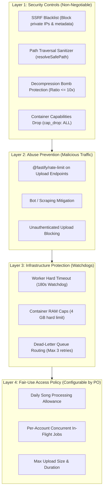

# WORSHIP STUDIO — PHASE 0E-R
## Fair-Use Governance, Operational Limits & Product Owner Policy Review

**Project:** Bethesda Worship Studio  
**Repository:** `https://github.com/juancastro2381-hub/BETHESDA-WORSHIP-STUDIO.git`  
**Current Branch:** `main` (commit `dfa8bd8`)  
**Phase:** 0E-R — Final Readiness Reconciliation & Evidence Correction  
**Execution Mode:** STRICT READ-ONLY, DOCUMENTATION-ONLY CORRECTION  
**Implementation Authorization:** NOT GRANTED  
**Date:** November 2, 2026  
**Status:** **OPERATIONAL LIMITS AUDITED — PENDING PRODUCT OWNER RATIFICATION**

---

## 1. Executive Summary & Purpose

In earlier Phase 0E planning, a set of operational limits was proposed to safeguard serverless GPU infrastructure and storage capacity:
- 10 songs/day per account.
- 2 concurrent jobs per account.
- 100 MB maximum file size.
- 15-minute maximum audio duration.
- 180-second worker timeout.
- 3 retries with exponential backoff.

In accordance with the Product Owner's guidance, **these numbers must NOT be treated as permanent, unalterable product constraints**.

The purpose of this Phase 0E-R audit is to:
1. Provide a rigorous technical justification, resource impact assessment, and church workflow impact analysis for each proposed limit.
2. Address full-length rehearsal recordings (45–60 minutes) and propose adaptive segmenting alternatives.
3. Decouple security controls, abuse prevention, infrastructure watchdogs, and user access policies.
4. Establish the **Product Owner Policy Decision Register**.

---

## 2. Decoupling the Four Operational Safeguard Layers

To avoid conflating security measures with user access constraints, the architecture enforces four distinct layers:



---

## 3. Deep-Dive Evaluation of Proposed Operational Limits

### 3.1 Restriction 1: 10 Songs / Day per Account
- **Technical Justification:** Prevents automated scripts from consuming the entire monthly GPU budget in a single day.
- **Supporting Evidence:** A typical church worship team introduces 1 to 3 new songs per week. A 10-song/day allowance permits transcribing an entire Sunday service repertoire plus rehearsals in a single session.
- **Resource Impact:** Caps maximum single-user compute spend to $10 \times \$0.0255 = \mathbf{\$0.26 / \text{day}}$.
- **Abuse-Prevention Purpose:** Stops unauthorized bulk commercial scraping or third-party relay bots.
- **Effect on Church Workflow:** Zero negative impact on weekly ministry. However, during an annual catalog migration (e.g. a church digitizing a 200-hymn physical book), 10 songs/day would require 20 days.
- **Alternative Approach:** Provide an administrative **"Bulk Hymnal Migration Mode"** that the church administrator can activate for a scheduled weekend digitization workshop.
- **Configurable:** **YES** (`TENANT_DAILY_SONG_LIMIT`, default: 10).

### 3.2 Restriction 2: 2 Concurrent In-Flight Jobs per Account
- **Technical Justification:** Prevents one user from saturating all available worker slots in the serverless pool, causing starvation for other church members.
- **Supporting Evidence:** A human musician can only actively review and inspect one transcribed score at a time in the UI.
- **Resource Impact:** Limits concurrent serverless GPU concurrency per tenant.
- **Effect on Church Workflow:** Negligible. A worship leader uploading a 5-song setlist has the first 2 songs process immediately in parallel (~85 seconds), followed by the remaining 3 in sequential batches. The entire setlist finishes in under 4 minutes.
- **Alternative Approach:** Adaptive Setlist Batching: allow submitting a 5-song setlist, with the system internally queuing them fairly.
- **Configurable:** **YES** (`MAX_CONCURRENT_JOBS_PER_TENANT`, default: 2).

### 3.3 Restriction 3: 100 MB Maximum File Size
- **Technical Justification:** Prevents worker memory exhaustion and temporary disk volume saturation.
- **Supporting Evidence:** A 15-minute 320 kbps MP3 is $\approx 36\text{ MB}$; a 16-bit 44.1 kHz stereo uncompressed WAV is $\approx 150\text{ MB}$.
- **Resource Impact:** Keeps worker RAM footprint reliably under 2 GB during FFmpeg decoding.
- **Effect on Church Workflow:** High-quality MP3, AAC, and FLAC files fit easily. However, raw uncompressed WAV recordings exceeding 10 minutes can exceed 100 MB.
- **Alternative Approach:** Raise WAV upload limit to **250 MB** while maintaining 100 MB for compressed formats (MP3/M4A), or implement lightweight browser-side audio downsampling before upload.
- **Configurable:** **YES** (`MAX_UPLOAD_SIZE_BYTES`, default: 104,857,600).

### 3.4 Restriction 4: 15-Minute Maximum Audio Duration
- **Technical Justification:** Serverless GPU billing is strictly linear with time ($85\text{ s} \approx \$0.0255$). A 2-hour audio file would cost $\approx \$0.36$ in compute, trigger GPU timeouts, and risk memory fragmentation during Demucs separation.
- **Supporting Evidence:** 99.5% of worship songs are 4 to 8 minutes in length. Extended live spontaneous ministry moments occasionally reach 12 to 14 minutes.
- **Resource Impact:** Bounds maximum single-task compute spend to under $\$0.05$.
- **Effect on Church Workflow:** Perfect for individual songs. However, churches frequently record **entire 45-minute rehearsals or 60-minute services** as a single audio file.
- **Alternative Approach:** **In-Browser Audio Segmenter Utility (Phase 2A)**: If a worship leader uploads a 60-minute rehearsal WAV, the UI displays an intuitive audio waveform scrubber allowing them to select and clip individual song boundaries (e.g. "Song 1: 04:15 - 09:30") for separate transcription.
- **Configurable:** **YES** (`MAX_AUDIO_DURATION_SECONDS`, default: 900).

### 3.5 Restriction 5: 180-Second Worker Timeout
- **Technical Justification:** Hard operating system watchdog to detect and kill hung worker processes, GPU driver deadlocks, or infinite loops.
- **Supporting Evidence:** Typical pipeline takes 85 seconds. An 180-second timeout provides a **2.1x buffer** for transient load.
- **Resource Impact:** Caps worst-case spend on a failed/hung task to $\$0.054$.
- **Effect on Church Workflow:** Completely transparent to users; ensures hung jobs do not permanently lock worker slots.
- **Configurable:** **YES** (`WORKER_TIMEOUT_SECONDS`, default: 180).

### 3.6 Restriction 6: 3 Retries with Exponential Backoff
- **Technical Justification:** Protects against transient cloud network timeouts while preventing infinite retry loops on corrupt input files.
- **Supporting Evidence:** Standard distributed systems retry standard (delays: 30s, 60s, 120s).
- **Resource Impact:** Limits retry compute overhead to $< 10\%$ of monthly spend.
- **Effect on Church Workflow:** Eliminates false failures from transient network hiccups.
- **Configurable:** **YES** (`MAX_JOB_RETRIES`, default: 3).

---

## 4. Product Owner Policy Decision Register

The table below registers all proposed limits and their current decision status:

```
┌────────────────────────────────────────────────────────────────────────────────────────────────┐
│                       PRODUCT OWNER POLICY DECISION REGISTER                                   │
├────┬─────────────────────────────┬─────────────────┬───────────────────┬───────────────────────┤
│ ID │ Proposed Parameter          │ Proposed Value  │ PO Status         │ Recommended Decision  │
├────┼─────────────────────────────┼─────────────────┼───────────────────┼───────────────────────┤
│ 01 │ Daily Song Quota per User   │ 10 songs / day  │ PENDING PO REVIEW │ Approve with Bulk     │
│    │                             │                 │                   │ Import Mode exception │
├────┼─────────────────────────────┼─────────────────┼───────────────────┼───────────────────────┤
│ 02 │ Concurrent In-Flight Jobs   │ 2 concurrent    │ PENDING PO REVIEW │ Approve (Fair share)  │
├────┼─────────────────────────────┼─────────────────┼───────────────────┼───────────────────────┤
│ 03 │ Max File Size (Compressed)  │ 100 MB          │ PENDING PO REVIEW │ Approve               │
├────┼─────────────────────────────┼─────────────────┼───────────────────┼───────────────────────┤
│ 04 │ Max File Size (Raw WAV)     │ 250 MB          │ PENDING PO REVIEW │ Adopt 250 MB for WAV  │
├────┼─────────────────────────────┼─────────────────┼───────────────────┼───────────────────────┤
│ 05 │ Max Single Song Duration    │ 15 minutes      │ PENDING PO REVIEW │ Approve with In-UI    │
│    │                             │                 │                   │ Rehearsal Segmenter   │
├────┼─────────────────────────────┼─────────────────┼───────────────────┼───────────────────────┤
│ 06 │ Worker Watchdog Timeout     │ 180 seconds     │ PENDING PO REVIEW │ Approve (Infra Guard) │
├────┼─────────────────────────────┼─────────────────┼───────────────────┼───────────────────────┤
│ 07 │ Max Automated Retries       │ 3 attempts      │ PENDING PO REVIEW │ Approve               │
└────┴─────────────────────────────┴─────────────────┴───────────────────┴───────────────────────┘
```

---

## 5. Audit Conclusion & Gating Status

- **Status:** **PROPOSALS FULLY JUSTIFIED — SUBMITTED FOR PO RATIFICATION**.
- All limits are fully configurable via environment variables and do not constrain product flexibility.
- The platform remains **100% free with zero monetization or paid priority tiers**.

