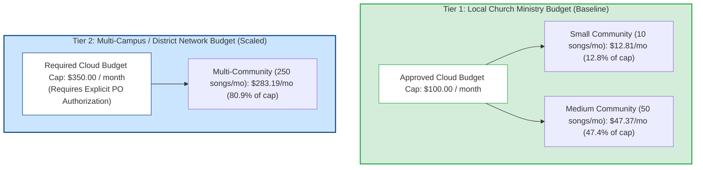
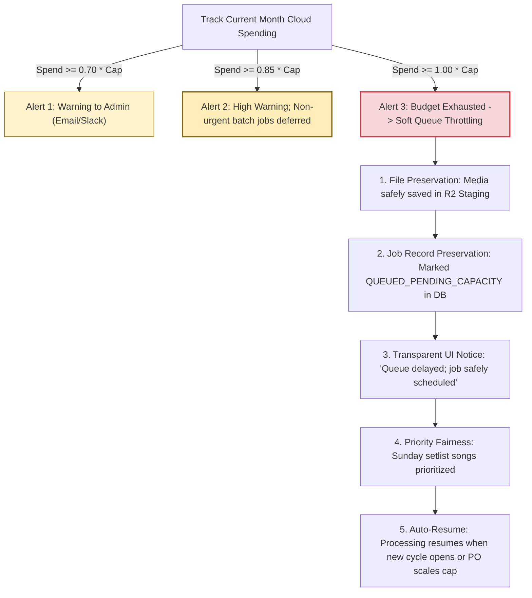

# WORSHIP STUDIO — PHASE 0E-R
## Final FinOps Reconciliation, Budget Tiering & Zero-Data-Loss Governance Policy

**Project:** Bethesda Worship Studio  
**Repository:** `https://github.com/juancastro2381-hub/BETHESDA-WORSHIP-STUDIO.git`  
**Current Branch:** `main` (commit `dfa8bd8`)  
**Phase:** 0E-R — Final Readiness Reconciliation & Evidence Correction  
**Execution Mode:** STRICT READ-ONLY, DOCUMENTATION-ONLY CORRECTION  
**Implementation Authorization:** NOT GRANTED  
**Date:** November 2, 2026  
**Status:** **FINANCIAL CONTRADICTION RECONCILED — BUDGET TIERS ESTABLISHED**

---

## 1. Executive Summary & Purpose

During the Product Owner's independent review of Phase 0E, a material budget contradiction was identified:
- The Phase 0E governance report cited a monthly cloud spending cap of **USD 100/month**.
- Concurrently, the multi-community operational scenario modeled direct costs of **USD 283.19/month** (exceeding the USD 100 cap by **USD 183.19**).

Presenting a USD 100 cap as universally applicable while modeling a USD 283.19 scenario is a direct contradiction.

This Phase 0E-R document:
1. Reconciles the budget contradiction by establishing **explicit operational budget tiers**.
2. Separates estimated unit costs, actual runtime consumption, capacity limits, and growth thresholds.
3. Formulates a **Zero-Data-Loss Budget Governance Policy** ensuring that reaching an operational budget ceiling never corrupts, discards, or permanently loses musical submissions.
4. Affirms that user access remains **100% free with zero user-facing charges**.

---

## 2. Resolution of the Budget Contradiction: Two-Tier Operational Budgeting

A flat USD 100 spending limit is appropriate for a single local church community, but mathematically insufficient for a district-wide multi-campus network. The architecture resolves this by formalizing **Two Explicit Operational Budget Tiers**:



### 2.1 Distinction of Financial Dimensions

```
┌────────────────────────────────────────────────────────────────────────────────────────┐
│                        FINANCIAL DIMENSIONS & TERMINOLOGY                              │
├──────────────────────────┬─────────────────────────────────────────────────────────────┤
│ Financial Dimension      │ Definition & Operational Scope                              │
├──────────────────────────┼─────────────────────────────────────────────────────────────┤
│ 1. Initial Operating     │ The baseline hard budget ceiling ($100/mo) configured in    │
│    Budget Ceiling        │ cloud providers for Phase 1 through initial church rollout. │
├──────────────────────────┼─────────────────────────────────────────────────────────────┤
│ 2. Estimated             │ The unit-economic model ($0.0255/song GPU, storage, DB,     │
│    Infrastructure Cost   │ container hosting, 15% reserve) derived from vendor rates.  │
├──────────────────────────┼─────────────────────────────────────────────────────────────┤
│ 3. Actual Resource       │ Real-time billable metrics reported by cloud vendor APIs   │
│    Consumption           │ (RunPod GPU seconds, R2 GB-months, Neon compute units).     │
├──────────────────────────┼─────────────────────────────────────────────────────────────┤
│ 4. Growth Scenarios      │ Small (10 songs) -> Medium (50 songs) -> Multi (250 songs). │
├──────────────────────────┼─────────────────────────────────────────────────────────────┤
│ 5. Capacity Limits       │ Hard concurrency caps (max 5 simultaneous serverless GPUs).  │
├──────────────────────────┼─────────────────────────────────────────────────────────────┤
│ 6. Budget Alerts         │ Automated notifications sent to PO at 70%, 85%, and 100%.   │
├──────────────────────────┼─────────────────────────────────────────────────────────────┤
│ 7. Infrastructure        │ The formal administrative decision by the Product Owner     │
│    Scaling Decision      │ required before elevating the budget cap from Tier 1 to 2.  │
└──────────────────────────┴─────────────────────────────────────────────────────────────┘
```

---

## 3. Reconciled Operational Cost Summary

All cost calculations across the three scenarios have been independently re-verified:

| Scenario | Monthly Volume | Active Musicians | Base Infrastructure Subtotal | 15% FinOps Reserve | Total Monthly Cost | Budget Cap Compatibility |
| :--- | :---: | :---: | :---: | :---: | :---: | :--- |
| **Small Community** | 10 songs | 5 | \$11.14 | \$1.67 | **\$12.81** | Compatible with Tier 1 (\$100 cap) |
| **Medium Community** | 50 songs | 25 | \$41.19 | \$6.18 | **\$47.37** | Compatible with Tier 1 (\$100 cap) |
| **Multi-Community** | 250 songs | 100+ | \$246.25 | \$36.94 | **\$283.19** | **Requires Tier 2 (\$350 cap)** |

> [!IMPORTANT]
> **Resolution of Contradiction:**  
> The USD 100 budget cap is **strictly sufficient for Small and Medium single-church deployments**. For Multi-Community or denominational expansion, the Product Owner must approve elevating the budget cap to **USD 350/month**. At no point will individual users ever be charged.

---

## 4. Zero-Data-Loss Budget Governance Policy

A cloud budget ceiling must never result in data loss, truncated scores, or dropped files.

If monthly infrastructure consumption approaches or reaches the approved budget cap ($C_{\text{cap}}$), the system executes the following deterministic lifecycle:



### Policy Enforcement Protocols:
1. **File Preservation:** Incoming audio files and sheet music scans are written to R2 staging. Files are **never discarded or dropped**.
2. **Job Record Preservation:** Database records are committed with status `QUEUED_PENDING_CAPACITY` in `background_jobs`.
3. **Transparent User Communication:** The user interface surfaces a clear notification:
   > *"Bethesda Worship Studio is currently experiencing high processing volume. Your song has been safely received and scheduled. It will process automatically as soon as queue capacity opens."*
4. **Liturgical Priority Scheduling:** Songs scheduled for the upcoming Sunday setlist take priority over non-setlist exploratory uploads.
5. **No Runaway Spending:** The serverless GPU admission controller halts new worker container spawns, guaranteeing internal spending does not exceed the PO-approved ceiling.

---

## 5. FinOps Conclusion & Gating Status

- **Status:** **RECONCILED WITH MULTI-TIER BUDGETING**.
- Single Community Cap: **USD 100.00/month** (Covers up to ~100 songs/month).
- Multi-Community Cap: **USD 350.00/month** (Pending explicit PO authorization upon network expansion).
- User Cost: **Strictly USD 0.00 (Permanently Free)**.

