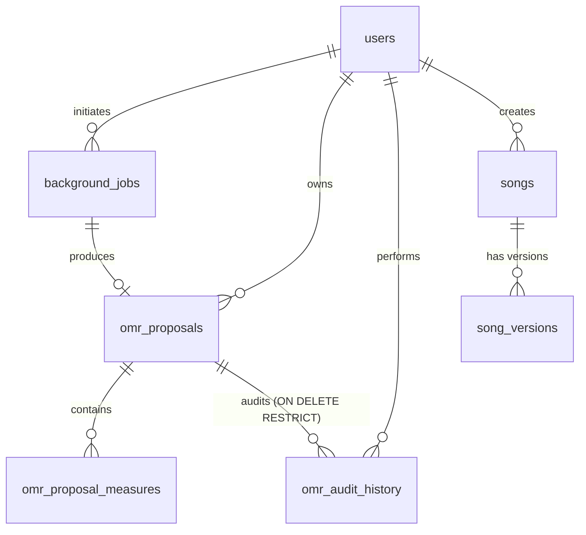

# WORSHIP STUDIO — PHASE 1A-R
# DATA INTEGRITY REPORT: RELATIONAL DURABILITY, AUDIT & TRANSACTIONS

**Project:** Bethesda Worship Studio  
**Phase:** 1A-R — Controlled Remediation & Certification  
**Database Engine:** PostgreSQL 18.x  
**ORM / Schema Layer:** Drizzle ORM  
**Execution Date:** 2026-11-02  
**Status:** VERIFIED & CERTIFIED  

---

## 1. RELATIONAL INTEGRITY ARCHITECTURE

The OMR subsystem relies on PostgreSQL as its authoritative, durable source of truth. Ephemeral memory structures (L1 cache) serve exclusively for performance caching and are strictly subservient to relational state.



---

## 2. SCHEMA DEFINITION & MIGRATION 0008

### 2.1 Table Changes in Schema
In [`backend/src/db/schema.ts`](file:///c:/Users/juanc/OneDrive/Documentos/Desarrollo%20proyectos/Sistema%20musical%20-%20partituras/BETHESDA%20WORSHIP%20STUDIO/backend/src/db/schema.ts):

1. **`omr_proposal_measures.time_signature`**:
   - *Previous:* `varchar('time_signature', { length: 16 }).notNull().default('4/4')`
   - *Current (Remediated):* `varchar('time_signature', { length: 16 })`
   - *Purpose:* Allows PostgreSQL to truthfully record NULL when the meter is not yet resolved, eliminating the forced relational default of `4/4`.

2. **`omr_audit_history.proposal_id`**:
   - *Previous:* `uuid('proposal_id').references(() => omrProposals.id, { onDelete: 'cascade' })`
   - *Current (Remediated):* `uuid('proposal_id').references(() => omrProposals.id, { onDelete: 'restrict' })`
   - *Purpose:* Physically prevents deletion of any OMR proposal that has recorded audit history, enforcing audit trail permanence.

### 2.2 Migration Execution
Migration `0008_remediation_integrity_and_audit.sql` was generated and executed:
```sql
ALTER TABLE "omr_proposal_measures" ALTER COLUMN "time_signature" DROP NOT NULL;
ALTER TABLE "omr_proposal_measures" ALTER COLUMN "time_signature" DROP DEFAULT;
ALTER TABLE "omr_audit_history" DROP CONSTRAINT "omr_audit_history_proposal_id_omr_proposals_id_fk";
ALTER TABLE "omr_audit_history" ADD CONSTRAINT "omr_audit_history_proposal_id_omr_proposals_id_fk"
  FOREIGN KEY ("proposal_id") REFERENCES "public"."omr_proposals"("id") ON DELETE restrict ON UPDATE no action;
```
Execution log:
```
🚀 Aplicando migraciones de Drizzle desde: backend\src\db\migrations
✅ Migraciones aplicadas con éxito.
```

---

## 3. ACID ATOMICITY: CANONICAL COMMIT TRANSACTION

### 3.1 Defect in Prior Implementation
Previously, canonical conversion was fragmented across multiple independent queries:
1. `songRepo.createSong(...)`
2. `songRepo.createVersion(...)`
3. `songRepo.updateCurrentVersion(...)`
4. `omrRepo.updateProposalStatus(...)`
5. `omrRepo.recordAudit(...)`

If step 4 or 5 crashed (e.g. pool timeout or connection termination), an orphaned canonical song was created in the database while the proposal remained in `'APPROVED_FOR_IMPORT'`, permitting duplicate imports.

### 3.2 Single-Transaction Remediation (`commitProposalTransaction`)
In [`backend/src/repositories/omr-proposal-repository.ts`](file:///c:/Users/juanc/OneDrive/Documentos/Desarrollo%20proyectos/Sistema%20musical%20-%20partituras/BETHESDA%20WORSHIP%20STUDIO/backend/src/repositories/omr-proposal-repository.ts#L340-L438):

```typescript
return await this.db.transaction(async (tx) => {
  // 1. Verificar estado de la propuesta dentro de la transacción
  const [proposal] = await tx.select().from(omrProposals).where(eq(omrProposals.id, proposalId)).limit(1);
  if (!proposal || proposal.reviewStatus !== 'APPROVED_FOR_IMPORT') {
    throw new ValidationError('La propuesta OMR debe estar en estado APPROVED_FOR_IMPORT...');
  }

  // 2. Insertar canción canónica
  const [newSong] = await tx.insert(songs).values({ ... }).returning();

  // 3. Insertar versión inicial de la canción
  const [newVersion] = await tx.insert(songVersions).values({ songId: newSong.id, ... }).returning();

  // 4. Actualizar puntero de versión activa en la canción
  await tx.update(songs).set({ currentVersionId: newVersion.id }).where(eq(songs.id, newSong.id));

  // 5. Actualizar estado de la propuesta a 'COMMITTED'
  await tx.update(omrProposals).set({ reviewStatus: 'COMMITTED' }).where(eq(omrProposals.id, proposalId));

  // 6. Registrar evento inmutable de auditoría
  await tx.insert(omrAuditHistory).values({
    proposalId,
    userId,
    actionType: 'COMMIT_TO_CANONICAL',
    newValue: { songId: newSong.id, versionId: newVersion.id, status: 'COMMITTED' },
    reason: `Compromiso al catálogo canónico: ${title.trim()}`,
  });

  return { song: newSong, version: newVersion };
});
```

All 6 relational operations succeed or fail as a single unit of work.

---

## 4. FAILURE PROPAGATION & IDEMPOTENCY (R1)

### 4.1 Zero False Success Guarantee
If the database write fails during `processUpload`:
```typescript
// backend/src/application/omr-service.ts
await this.omrRepo.saveProposal(proposal);
this.proposals.set(proposal.proposalId, proposal);
return proposal;
```
Because the call is unhandled by local `catch`:
1. The error bubbles up to the caller.
2. `this.proposals.set(...)` is **never reached**.
3. Ephemeral memory contains zero orphaned references.
4. The client receives an explicit error rather than a phantom success.

Verified in Test 1.2:
```
✔ 1.2: should fail proposal creation and NOT populate cache when database write fails (R1) (1.9545ms)
```

---

## 5. AUDIT TRAIL IMMUTABILITY & `ON DELETE RESTRICT` (R3)

When a proposal is deleted via `DrizzleOmrProposalRepository.deleteProposal(proposalId)`:
1. PostgreSQL checks the foreign key constraint on `omr_audit_history`.
2. Because the proposal has associated audit records (`actionType: 'CREATE_PROPOSAL'`), PostgreSQL raises error code `23503` (`foreign_key_violation`).
3. The repository catches this violation and throws a user-safe `ValidationError`:
   `"No se puede eliminar la propuesta OMR porque contiene registros históricos de auditoría inmutables."`
4. Neither the proposal nor the audit history is destroyed.

Verified in Test 11.2:
```
✔ 11.2: should prevent proposal deletion when audit history exists via ON DELETE RESTRICT (R3) (4.9405ms)
```

---

## 6. BACKGROUND JOB RESILIENCE & LIFECYCLE (TEST 12.1)

Background jobs for OMR ingestion are tracked in table `background_jobs`:
1. **Creation:** `jobType: 'OMR_PROCESSING'`, `status: 'PENDING'`, `progress: 0`.
2. **Execution:** `status: 'PROCESSING'`, `startedAt: now()`, `progress: 50`.
3. **Completion:** `status: 'COMPLETED'`, `completedAt: now()`, `progress: 100`, `outputRef: proposalId`.
4. **Survives Service Recreation:** Reading the job from PostgreSQL confirms all state transitions and timestamps are durably committed.

Verified in Test 12.1:
```
✔ 12.1: should create, track progress, and complete background jobs in PostgreSQL (67.3276ms)
```

---
*End of Phase 1A-R Data Integrity Report.*

