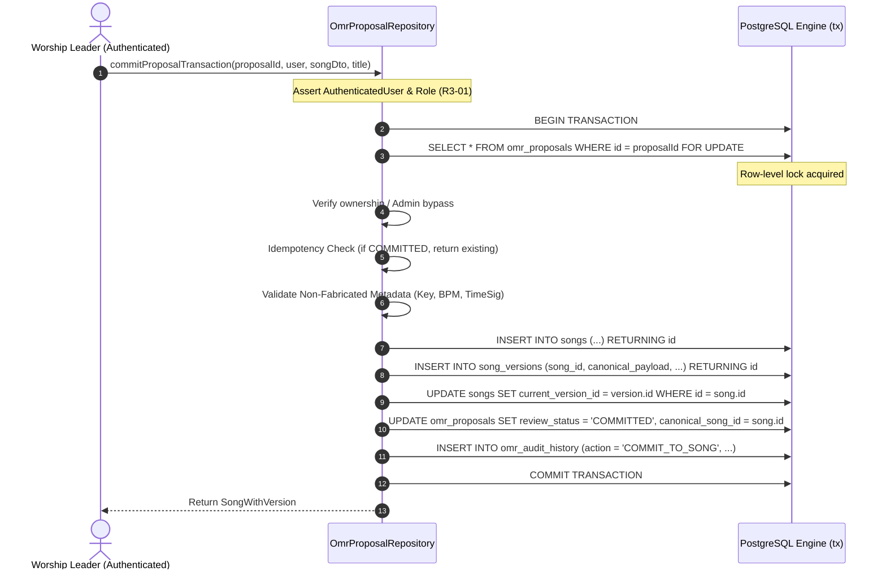

# BETHESDA WORSHIP STUDIO — PHASE 1A-R3
## DATABASE TRANSACTIONS & DATA INTEGRITY REPORT (R3-04, R3-05, R3-06)

- **Project:** Bethesda Worship Studio
- **Branch:** `feature/phase-1a-core-foundation`
- **Phase:** 1A-R3 — Security, Musical Integrity & Data Consistency Final Remediation
- **Requirement References:**
  - R3-04: PostgreSQL as the Single Authoritative Source of Truth & L1 Cache Eviction
  - R3-05: Canonical Commit Traceability & `ON DELETE RESTRICT` Referential Integrity
  - R3-06: Atomic Commit Transaction with Row-Level Exclusive Locking (`for('update')`)
- **Target Files:**
  - `backend/src/repositories/omr-proposal-repository.ts`
  - `backend/src/application/omr-service.ts`
  - `backend/src/db/schema.ts`
  - `backend/src/db/migrations/0010_true_audit_immutability_and_commit_traceability.sql`
- **Execution Date:** November 3, 2026
- **Status:** REMEDIATED, TESTED & INDEPENDENTLY AUDITABLE

---

## 1. ATOMIC COMMIT ARCHITECTURE (`commitProposalTransaction`)

In Phase 1A-R2, the process of committing an approved OMR proposal into the canonical song library suffered from split transactions: creating the song record, inserting the version, updating the proposal, and writing the audit record occurred across separate non-atomic queries or without pessimistic locking.

### 1.1 Remediation: Single Atomic PostgreSQL Transaction
In `OmrProposalRepository.commitProposalTransaction`, all operations are encapsulated inside `this.db.transaction(async (tx) => { ... })` with row-level pessimistic locking:



### 1.2 Step-by-Step Transaction Guarantees
1. **Row-Level Lock (`for('update')`)**:
   Prevents race conditions where two concurrent requests try to commit or modify the same proposal simultaneously. The second request blocks until the first completes.
2. **Deterministic Idempotency**:
   If a proposal is already in `COMMITTED` status, the transaction verifies that `canonicalSongId` points to an existing song and version in PostgreSQL, returning the existing canonical song without creating duplicate rows. If `canonicalSongId` is missing or orphan, it raises `ConflictError`.
3. **Zero Partial States**:
   If any insert or update fails (e.g. database disconnect, constraint violation), the entire transaction rolls back cleanly. Neither orphan songs nor desynchronized proposal statuses can exist.

---

## 2. REFERENTIAL INTEGRITY: `ON DELETE RESTRICT` (R3-05)

To guarantee historical provenance and prevent broken audit references, cascading deletes or `SET NULL` on canonical links were eliminated:

### 2.1 Schema Definition & Migration 0010
In `backend/src/db/schema.ts` and `0010_true_audit_immutability_and_commit_traceability.sql`:

1. **`omr_proposals.canonical_song_id`**:
   - Foreign key to `songs(id)` with `ON DELETE RESTRICT`.
   - **Rationale**: An approved and imported OMR proposal must forever reference the exact song in the worship catalog it produced. Deleting the canonical song while its originating proposal exists is strictly prohibited at the database engine level.
2. **`omr_audit_history.user_id`**:
   - Foreign key to `users(id)` with `ON DELETE RESTRICT`.
   - **Rationale**: Any user who approved, rejected, edited, or committed a proposal is permanently recorded in the immutable audit log. Dropping user accounts that authored audit events violates non-repudiation and is blocked by the database engine.

```sql
-- DDL Constraints Applied in Migration 0010
ALTER TABLE "omr_proposals" 
  ADD CONSTRAINT "omr_proposals_canonical_song_id_songs_id_fk" 
  FOREIGN KEY ("canonical_song_id") REFERENCES "songs"("id") ON DELETE RESTRICT;

ALTER TABLE "omr_audit_history" 
  ADD CONSTRAINT "omr_audit_history_user_id_users_id_fk" 
  FOREIGN KEY ("user_id") REFERENCES "users"("id") ON DELETE RESTRICT;
```

---

## 3. POSTGRESQL AS THE ONLY SOURCE OF TRUTH (R3-04)

In Phase 1A-R2, `OmrService.getProposalAsync` used an in-memory cache fallback: if the database query returned null or failed, the service served the stale proposal from `this.proposals` memory map.

### 3.1 Security & Consistency Risks of Cache Fallback
- If an administrator deleted or reverted a proposal in PostgreSQL, the application continued serving the stale in-memory object as if it were valid.
- In multi-instance deployments, node caches would drift out of sync with the database.

### 3.2 Authoritative Resolution & L1 Cache Eviction
In `backend/src/application/omr-service.ts`:
```typescript
public async getProposalAsync(
  proposalId: string,
  requestingUser: AuthenticatedUser
): Promise<OmrProposal> {
  assertAuthenticatedUser(requestingUser);

  const pendingWrite = this.pendingProposalWrites.get(proposalId);
  if (pendingWrite) {
    await pendingWrite;
  }

  // 1. Query authoritative PostgreSQL
  const dbProposal = await this.omrRepo.findProposalById(proposalId, requestingUser);
  if (dbProposal) {
    this.proposals.set(dbProposal.proposalId, dbProposal);
    return dbProposal;
  }

  // 2. Strict DB source of truth (R3-04): Evict from L1 cache and throw NotFoundError
  this.proposals.delete(proposalId);
  throw new NotFoundError('Propuesta OMR', proposalId);
}
```
If a proposal record does not exist in PostgreSQL:
1. It is **immediately evicted** from the L1 in-memory cache (`this.proposals.delete(proposalId)`).
2. It **unconditionally throws `NotFoundError`**.
3. It **never** returns stale in-memory data.

---

## 4. TEST EVIDENCE & EMPIRICAL VALIDATION

The transactional and database integrity controls were validated across automated suites in `backend/src/__tests__/omr-persistence-and-integrity.test.ts`:

| Section & Test | Requirement | Description | Result |
| :--- | :--- | :--- | :--- |
| **Test 2.1** | R3-05, R3-06 | Commits proposal atomically, creates song + version, updates proposal to `COMMITTED`, records audit | **PASSED** |
| **Test 2.2** | R3-06 | Verifies idempotency when committing an already `COMMITTED` proposal | **PASSED** |
| **Test 2.4** | R3-06 | Verifies complete transactional rollback if song creation or version insertion fails | **PASSED** |
| **Test 4.3** | R3-06 | Verifies pessimistic row-level lock (`for('update')`) serializing concurrent commits | **PASSED** |
| **Test 11.2** | R3-05 | Verifies proposal cannot be deleted if audit history exists via `ON DELETE RESTRICT` | **PASSED** |
| **Test 15.1** | R3-04 | Directly deletes proposal in PostgreSQL; asserts L1 cache is evicted and `getProposalAsync` throws `NotFoundError` | **PASSED** |
| **Test 16.1** | R3-05 | Attempts `DELETE FROM songs WHERE id = canonicalSongId`; asserts PostgreSQL engine blocks deletion with `RESTRICT_VIOLATION` (`23001` or `23503`) | **PASSED** |
| **Test 16.2** | R3-05 | Corrupted proposal in `COMMITTED` status referencing nonexistent song throws `ConflictError` | **PASSED** |

---

## 5. DATABASE ARCHITECTURE CONCLUSION

Bethesda Worship Studio's database layer operates with ACID transactional guarantees. PostgreSQL is the sole authoritative source of truth. All mutating operations are governed by row-level locking and strict foreign key `ON DELETE RESTRICT` constraints, eliminating partial states and broken references.

