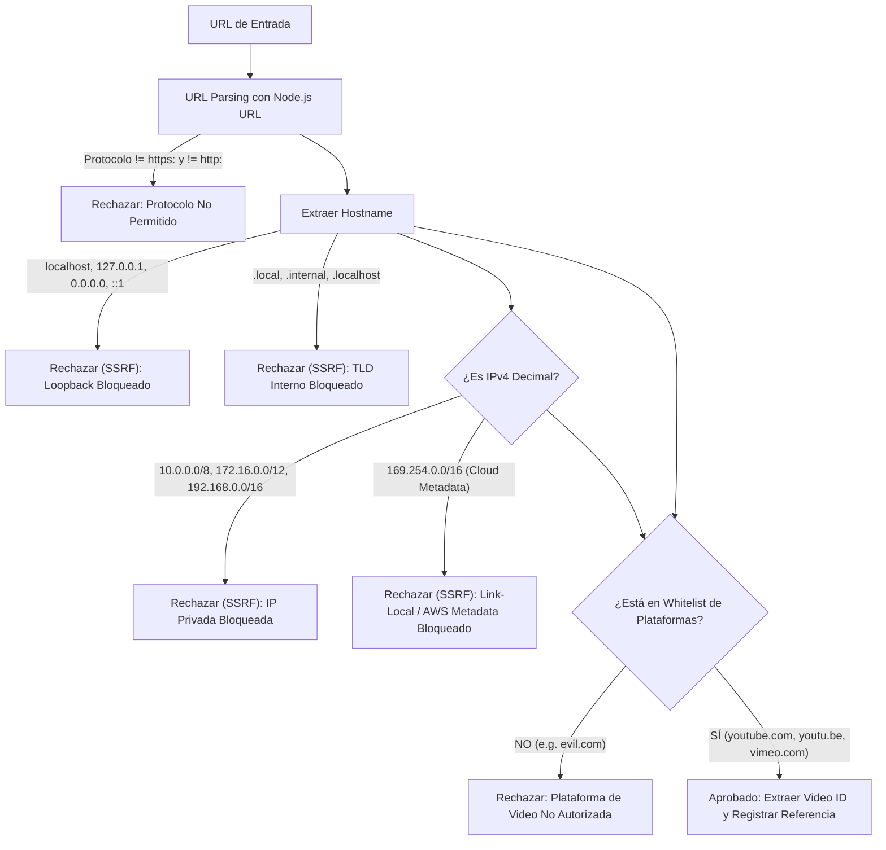

# WORSHIP STUDIO — PHASE 1B-R
## SECURITY, MULTI-TENANT BOUNDARIES & IDOR PREVENTION REPORT

**Project:** Bethesda Worship Studio  
**Working Branch:** `feature/phase-1a-core-foundation`  
**Phase:** 1B-R — Remediation Only  
**Workstream:** Workstreams D & E — Security & Multi-Tenancy  
**Author:** Antigravity (Application Security Engineer & Software Architect)  
**Date:** 2026-11-05  

---

## 1. EXECUTIVE SUMMARY

The independent audit of Phase 1B revealed an acute multi-tenant vulnerability: global idempotency lookup without `user_id` scoping. When User B uploaded a file having the same SHA-256 hash or filename as User A, User B was returned User A's private song record, leaking intellectual property and violating tenant isolation.

In Phase 1B-R, rigorous multi-tenant boundaries have been instituted across all layers:
1. **Scoped Idempotency:** Duplicate matching is strictly isolated per tenant (`userId = $1 AND checksumSha256 = $2`).
2. **IDOR Neutralization:** All source metadata, raw source downloads, and background job polling endpoints enforce ownership checks (`resource.userId === currentUser.id || isPrivileged`), returning `403 Forbidden` on unauthorized access.
3. **SSRF Hardening:** Strict host whitelisting and CIDR filtering protect against loopback, intranet scanning, and cloud metadata theft.
4. **Content-Based Magic Byte Validation:** File MIME types are verified against actual binary headers, preventing executable/script masquerading.
5. **Path Traversal Defenses:** Storage key resolution strictly normalizes paths and forbids directory traversal (`..`).

---

## 2. MULTI-TENANT ISOLATION & IDOR PREVENTION

### 2.1 The Vulnerability in Phase 1B
In Phase 1B, `UniversalIngestionService.ingest` executed:
```typescript
// DEFECTIVE (Phase 1B): Global search without user filtering!
const existingSource = await this.database
  .select({ songId: songSources.songId, versionId: songSources.versionId })
  .from(songSources)
  .where(or(eq(songSources.filename, input.filename), eq(songSources.rawContent, sourceHash)))
  .limit(1);
```
Under this defect, if User A uploaded an unreleased worship arrangement, and User B subsequently uploaded the same file or a file with an identical filename/hash, User B gained immediate access to User A's song ID, title, and canonical score.

### 2.2 The Remediation in Phase 1B-R
The query is now bounded strictly to the authenticated user's ID:
```typescript
// REMEDIATED (Phase 1B-R): Strictly scoped by authenticated user ID
const existingSource = await this.database
  .select({
    id: songSources.id,
    songId: songSources.songId,
    versionId: songSources.versionId,
    sourceType: songSources.sourceType,
    filename: songSources.filename,
    storagePath: songSources.storagePath,
    mimeType: songSources.mimeType,
  })
  .from(songSources)
  .where(
    and(
      eq(songSources.userId, user.id),
      eq(songSources.checksumSha256, sourceHash)
    )
  )
  .limit(1);
```
- If User B uploads the same file as User A, `songSources.userId == userB.id` returns 0 rows.
- User B receives their **own** independent song record, version record, and `song_sources` record.
- If User A re-uploads their own file, idempotency is cleanly applied for User A only.
- Verified by automated test `E1.1`.

### 2.3 IDOR Boundary Checks on Endpoints
In `UniversalIngestionService`:
```typescript
public async getSource(sourceId: string, user: AuthenticatedUser) {
  const [source] = await this.database
    .select()
    .from(songSources)
    .where(eq(songSources.id, sourceId))
    .limit(1);

  if (!source) {
    throw new NotFoundError('Fuente musical', sourceId);
  }

  const isOwner = source.userId === user.id;
  const isPrivileged = user.role === 'ADMIN' || user.role === 'SUPER_ADMIN';

  if (!isOwner && !isPrivileged) {
    throw new ForbiddenError('No tiene autorización para acceder a esta fuente musical.');
  }

  return source;
}
```
All endpoints invoking `getSource()`, `getSourceFile()`, and `getJobStatus()` enforce this authorization check:
- `GET /api/v1/ingestion/sources/:sourceId` -> `403 Forbidden` if not owner/admin (Test `E1.2`).
- `GET /api/v1/ingestion/sources/:sourceId/file` -> `403 Forbidden` if not owner/admin (Test `E1.3`).
- `GET /api/v1/ingestion/jobs/:jobId` -> `403 Forbidden` if not owner/admin (Test `H1.4`).
- Privileged access (`ADMIN`, `SUPER_ADMIN`) is permitted for system auditing (Test `E1.4`).

---

## 3. SERVER-SIDE REQUEST FORGERY (SSRF) HARDENING

`VideoUrlIngestionAdapter.validateVideoUrl()` enforces multi-layered defenses:



Verified by automated tests `D1.3` and `D1.4`.

---

## 4. SERVER-SIDE BINARY VALIDATION ("MAGIC BYTES")

Bethesda Worship Studio never trusts the `Content-Type` header supplied by the browser or client SDK:
1. **Audio Validation (`AudioIngestionAdapter`):**
   - Inspects the first 12 bytes of the buffer.
   - Requires valid `RIFF....WAVE` (WAV), `ID3` or `0xFF 0xFB/F3/F2` (MP3), `fLaC` (FLAC), or `ftypM4A / ftypmp42` (M4A).
   - Executable binaries (starting with `0x4D 0x5A` / `MZ`), shell scripts (`#!`), and HTML files (`<html`) are rejected with `ValidationError` even if the client declares `mimeType: "audio/wav"` (Test `D1.1`).
2. **Visual Score Validation (`VisualScoreIngestionAdapter`):**
   - Requires `%PDF-` for PDF documents.
   - Requires `0x89 0x50 0x4E 0x47` for PNG.
   - Requires `0xFF 0xD8 0xFF` for JPEG.
   - Spoofed files (such as an HTML script named `sheet.pdf`) are rejected with `ValidationError` (Test `C1.3`).

---

## 5. PATH TRAVERSAL DEFENSES

`LocalFileSystemSourceStorageProvider.resolveSafePath()` protects physical storage:
1. Rejects any key containing `..` or leading slashes.
2. Strips directory paths using `path.basename()`.
3. Verifies that the resolved path starts strictly with `this.baseDir`.
Any violation throws a `ValidationError` and prevents disk access.

