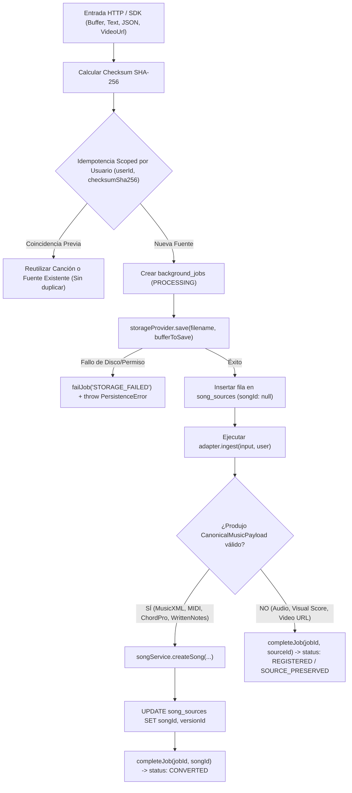

# WORSHIP STUDIO — PHASE 1B-R
## UNIVERSAL SOURCE PRESERVATION ARCHITECTURE & IMPLEMENTATION REPORT

**Project:** Bethesda Worship Studio  
**Working Branch:** `feature/phase-1a-core-foundation`  
**Phase:** 1B-R — Remediation Only  
**Workstream:** Workstream A — Universal Source Preservation  
**Author:** Antigravity (Principal Software Engineer & Quality Auditor)  
**Date:** 2026-11-05  

---

## 1. EXECUTIVE SUMMARY

During the Phase 1B audit, an architectural vulnerability was identified: only visual scores (PDF/images) and audio tracks were being persisted to the physical file storage provider (`SourceStorageProvider`), while structured formats (MusicXML, MIDI, ChordPro, Written Notes, Video URLs) were processed purely in memory. Furthermore, `song_sources` records were only inserted if a canonical song was created, bypassing durable storage whenever an unparseable or registration-only source was supplied.

In Phase 1B-R, **Universal Source Preservation** has been established as an absolute pre-condition across all ingestion channels. Every source input without exception is validated, hashed (SHA-256), persisted to disk/storage, and recorded in the database `song_sources` table **prior** to any musical parsing.

---

## 2. DATABASE FOUNDATION & SCHEMA EVOLUTION (MIGRATION 0012)

Migration `0012_source_preservation_and_ownership.sql` was applied to decouple source preservation from song creation:

```sql
-- 1. Desacoplar song_sources de la creación obligatoria e inmediata de una canción
ALTER TABLE "song_sources" ALTER COLUMN "song_id" DROP NOT NULL;
ALTER TABLE "song_sources" ALTER COLUMN "version_id" DROP NOT NULL;

-- 2. Incorporar trazabilidad multi-inquilino, almacenamiento físico y verificación criptográfica
ALTER TABLE "song_sources" ADD COLUMN "user_id" uuid REFERENCES "users"("id") ON DELETE RESTRICT;
ALTER TABLE "song_sources" ADD COLUMN "storage_path" varchar(512);
ALTER TABLE "song_sources" ADD COLUMN "mime_type" varchar(100);
ALTER TABLE "song_sources" ADD COLUMN "file_size_bytes" integer;
ALTER TABLE "song_sources" ADD COLUMN "checksum_sha256" varchar(64);
ALTER TABLE "song_sources" ADD COLUMN "job_id" uuid REFERENCES "background_jobs"("id") ON DELETE SET NULL;

-- 3. Índices de rendimiento e integridad
CREATE INDEX IF NOT EXISTS "idx_song_sources_user_id" ON "song_sources" ("user_id");
CREATE INDEX IF NOT EXISTS "idx_song_sources_checksum_sha256" ON "song_sources" ("checksum_sha256");
CREATE INDEX IF NOT EXISTS "idx_song_sources_job_id" ON "song_sources" ("job_id");
```

### 2.1 Preserved Record Columns

| Column | Type | Constraints | Description |
| :--- | :--- | :--- | :--- |
| `id` | UUID | PRIMARY KEY, default `gen_random_uuid()` | Identificador universal de la fuente |
| `song_id` | UUID | NULLABLE, FK `songs.id` | Enlace a la canción canónica (si fue convertida) |
| `version_id` | UUID | NULLABLE, FK `song_versions.id` | Enlace a la versión canónica específica |
| `user_id` | UUID | NULLABLE, FK `users.id` ON DELETE RESTRICT | Propietario de la fuente importada |
| `source_type` | VARCHAR | NOT NULL (`SongSourceFormat`) | Formato original (`MUSIC_XML`, `MIDI`, `CHORD_PRO`, `INTERNAL`, `PDF`, `IMAGE`, `AUDIO`, `VIDEO_URL`) |
| `filename` | VARCHAR(255) | NULLABLE | Nombre de archivo original o sintético |
| `storage_path` | VARCHAR(512) | NULLABLE | Clave de almacenamiento en `SourceStorageProvider` |
| `mime_type` | VARCHAR(100) | NULLABLE | Tipo MIME real verificado por firma mágica binaria |
| `file_size_bytes` | INTEGER | NULLABLE | Tamaño en bytes del archivo fuente preservado |
| `checksum_sha256` | VARCHAR(64) | NULLABLE | Digest SHA-256 computado a partir de los bytes originales |
| `job_id` | UUID | NULLABLE, FK `background_jobs.id` | Tarea de orquestación en segundo plano |
| `raw_content` | TEXT | NULLABLE | Contenido textual directo o digest hash |
| `importer_name` | VARCHAR(100) | NULLABLE | Nombre del adaptador que ejecutó la preservación |
| `importer_version`| VARCHAR(50) | NULLABLE | Versión del adaptador |
| `imported_at` | TIMESTAMP | NOT NULL, default `NOW()` | Timestamp inmutable de importación |

---

## 3. FAIL-SAFE PRESERVATION PRE-CONDITION PIPELINE

In `UniversalIngestionService.ingest()`, source preservation occurs sequentially **before** invoking any format parser:



### Invariant:
If physical writing to `storageProvider` fails (e.g., storage disk full, path traversal violation, or permission denied), **ingestion terminates immediately**. The background job is marked `FAILED` with code `'STORAGE_FAILED'`, and a `PersistenceError` is propagated. Under no circumstance does musical parsing proceed without durable physical source preservation.

---

## 4. UNIVERSAL RETRIEVAL ENDPOINTS & CRYPTOGRAPHIC VERIFICATION

Two RESTful endpoints were implemented in `backend/src/interfaces/http/routes/ingestion.routes.ts`:

### 4.1 Metadata Retrieval: `GET /api/v1/ingestion/sources/:sourceId`
- **Authentication:** Mandatory (`Bearer JWT`).
- **Authorization:** Owner (`source.userId === requestingUser.id`) or Administrative privilege (`ADMIN`, `SUPER_ADMIN`).
- **Response Status:** `200 OK`.
- **Response Payload:** Complete provenance metadata including `storagePath`, `mimeType`, `fileSizeBytes`, `checksumSha256`, `jobId`, `importerName`, `importerVersion`, and `importedAt`.

### 4.2 Raw Binary Streaming: `GET /api/v1/ingestion/sources/:sourceId/file`
- **Authentication:** Mandatory (`Bearer JWT`).
- **Authorization:** Multi-tenant boundary check. IDOR attempts by non-owners return `403 Forbidden`.
- **Response Status:** `200 OK`.
- **Response Headers:**
  - `Content-Type`: Exact MIME type detected at ingestion (e.g. `application/vnd.recordare.musicxml+xml`, `audio/midi`, `text/x-chordpro`).
  - `Content-Disposition`: `attachment; filename="<original_filename>"`
  - `X-Checksum-SHA256`: 64-character hexadecimal SHA-256 digest.
  - `Content-Length`: Exact byte count.

### 4.3 Automated Verification Evidence (Test A1.2)
The test `A1.2: should stream original file bytes byte-for-byte with correct headers via GET /sources/:id/file` verified that the streamed payload matches the original input byte-for-byte and that the `X-Checksum-SHA256` header strictly matches `crypto.createHash('sha256').update(rawText).digest('hex')`.

