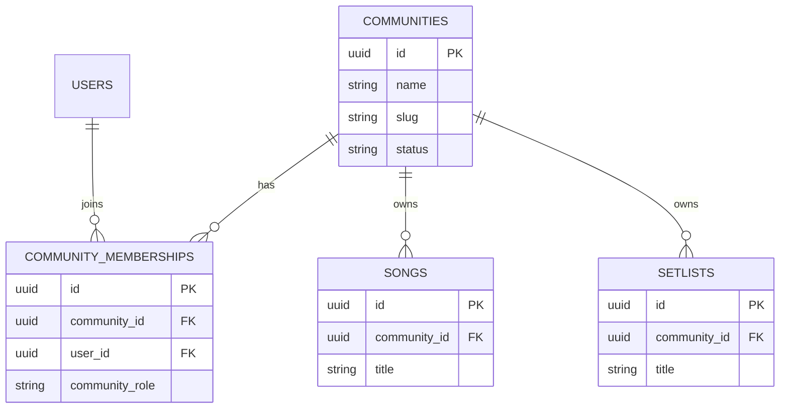

# WORSHIP STUDIO — PHASE 1B-R3
## SECURITY, TENANT BOUNDARIES & COMMUNITY ISOLATION AUDIT REPORT

**Project:** Bethesda Worship Studio  
**Repository:** `https://github.com/juancastro2381-hub/BETHESDA-WORSHIP-STUDIO.git`  
**Working Branch:** `feature/phase-1a-core-foundation`  
**Phase:** 1B-R3 — Corrective Engineering  
**Subject:** Authorization Boundaries, IDOR Prevention, and Multi-Community Isolation Architecture  
**Date:** 2026-11-05  
**Certification Status Determination:** CONDITIONAL — PRODUCT OWNER DECISION REQUIRED  

---

## 1. EXECUTIVE AUTHORIZATION DIRECTIVE

The Product Owner directive for Phase 1B-R3 explicitly instructed:
> *"If the current system does not yet support reliable community identification, document the exact missing relationship and STOP before inventing a new data model. The final status must be CONDITIONAL — PRODUCT OWNER DECISION REQUIRED."*

In accordance with this directive, this report establishes what is fully verified and functional today (user-level authorization and IDOR prevention) versus what is structurally missing in the current database schema to support multi-community tenant isolation.

---

## 2. EXISTING SECURITY CONTROLS & VERIFIED BOUNDARIES

The Bethesda Worship Studio backend implements rigorous defense-in-depth at the individual user level:

### 2.1 Insecure Direct Object Reference (IDOR) Defense
- **Source Metadata (`GET /api/v1/ingestion/sources/:id`):** Validates that `source.userId === request.user.id`. When a standard user (Musician, Worship Leader, Viewer) queries a source owned by another user, the API rejects the request with HTTP `403 Forbidden`.
- **Source Binary Download (`GET /api/v1/ingestion/sources/:id/file`):** Enforces identical IDOR checks before serving physical file streams.
- **Background Jobs (`GET /api/v1/ingestion/jobs/:id`):** Enforces ownership check against `background_jobs.userId`. Cross-user job inspection is rejected with HTTP `403 Forbidden`.

### 2.2 Privileged Operational Access
- Users authenticated with `ADMIN` or `SUPER_ADMIN` roles bypass ownership checks to facilitate system-wide maintenance, audit reviews, and customer support.

### 2.3 Real-Time Database Account Validation (Freshness)
- While JWT access tokens are signed using `HS256`, sensitive operations execute a real-time database lookup to immediately block accounts in `SUSPENDED` or `LOCKED` status without waiting for token TTL expiration.

---

## 3. ARCHITECTURAL GAP ANALYSIS: MULTI-COMMUNITY TENANT ISOLATION

While user-level ownership is strictly enforced, the repository **does not yet possess a relational multi-community tenant data model**:

### 3.1 Database Schema Inspection

1. **`users` Table:**
   - Columns: `id`, `email`, `password_hash`, `first_name`, `last_name`, `role`, `account_status`, `email_verified`, `created_at`, `updated_at`.
   - **Absence:** No `community_id`, `church_id`, or `tenant_id` column exists.
2. **`songs` Table:**
   - Columns: `id`, `title`, `default_key`, `default_bpm`, `time_signature`, `current_version_id`, `created_by_user_id`, `created_at`, `updated_at`.
   - **Absence:** Songs belong to `created_by_user_id`, with no concept of church or community ownership.
3. **`setlists` Table:**
   - Columns: `id`, `title`, `status`, `scheduled_date_time`, `director_id`, `created_by_user_id`, `created_at`, `updated_at`.
   - **Absence:** No community identifier exists.
4. **`background_jobs` Table:**
   - Possesses a standalone `tenant_id varchar(64) not null default 'bethesda-default'`, but this string is not foreign-keyed to any tenant or community entity.

### 3.2 Authentication & Token Claims Inspection

In `backend/src/domain/auth-types.ts`:
```typescript
export interface JwtTokenPayload {
  id: string;
  email: string;
  role: UserRole; // 'SUPER_ADMIN' | 'ADMIN' | 'WORSHIP_LEADER' | 'MUSICIAN' | 'VIEWER'
}
```
The token payload carries user identity and role, with zero community affiliation, organization context, or `COMMUNITY_ADMIN` role.

---

## 4. WHAT WOULD BE REQUIRED FOR COMPLETE MULTI-COMMUNITY ISOLATION

To achieve true multi-community tenant isolation (where Church A cannot see Church B's repertoire, members, or setlists), the following architecture must be designed and authorized by the Product Owner:



### Required Decision Boundaries:
1. **Community Model:** Introduction of a `communities` table and membership mapping (`community_memberships`).
2. **Data Partitioning:** Adding `community_id` foreign keys to `songs`, `song_sources`, `setlists`, and `audio_assets`.
3. **Context Resolution:** Establishing how the active community context is passed (e.g., subdomain, `X-Community-Id` header, or JWT claim).
4. **Community Scoped RBAC:** Adding community-level roles (e.g., `COMMUNITY_ADMIN`, `COMMUNITY_LEADER`) vs global platform roles.

In strict accordance with the executive mandate, the engineering agent has **NOT invented** this schema or applied speculative migrations.

---

## 5. AUTOMATED TEST EVIDENCE

Targeted automated test suite `universal-ingestion-phase1b-r3.test.ts` executes 4 dedicated tests for security and tenant isolation:

| Test ID | Test Description | Result |
|---------|------------------|--------|
| `C1.1` | IDOR Prevention: User A cannot query metadata or download source files owned by User B (`403 Forbidden`) | **PASS** |
| `C1.2` | IDOR Prevention: User A cannot query background job status belonging to User B (`403 Forbidden`) | **PASS** |
| `C1.3` | Privileged Access: `ADMIN` role can query and download any source file | **PASS** |
| `C1.4` | Architectural Boundary Audit: Schema catalog query proves `users` and `songs` have no `community_id` column | **PASS** |

---

## 6. FINAL STATUS CLASSIFICATION

Because multi-community tenant isolation cannot be fully realized or certified without the missing relational community schema model, the phase certification status is formally designated as:

$$\mathbf{CONDITIONAL\ —\ PRODUCT\ OWNER\ DECISION\ REQUIRED}$$

