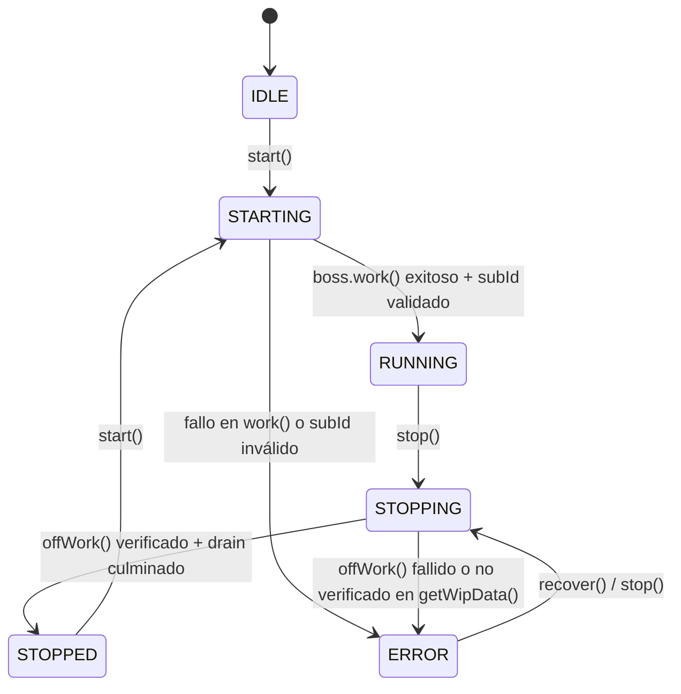

# Bethesda Worship Studio — Phase 2A-R2.2.1-R3.2
## Report 05: Lifecycle Recovery, Invariants & Concurrency Management

**Módulo:** `backend/src/application/conversion-worker.ts`  
**Objetivo de Certificación (Blocker R32-03):** Establecer invariantes estrictas de ciclo de vida, protección contra callbacks tardíos desfasados (`lifecycleGeneration`) y coordinación determinista de concurrencia.

---

### 1. Invariantes de Ciclo de Vida y Transiciones Bloqueadas

En el diseño remediado de la Fase R3.2, los estados de ciclo de vida garantizan transiciones atómicas y seguras:



#### Reglas de Invariante Estricta:
1. **Bloqueo Total en STOPPING:**  
   Si una operación previa de apagado se encuentra en curso (estado `STOPPING`), cualquier invocación concurrente de `start()` es rechazada de inmediato con `WorkerLifecycleError`:
   ```typescript
   if (this.lifecycleState === 'STOPPING') {
     throw new WorkerLifecycleError(
       'No se puede iniciar el worker: una operación previa de detención (stop) aún se encuentra en curso en estado STOPPING.'
     );
   }
   ```
2. **Bloqueo Total en ERROR:**  
   Si el worker se encuentra en estado `ERROR` por fallo o timeout de desuscripción previa, `start()` prohíbe el arranque para evitar duplicidad de suscripciones fantasma. Exige invocar `recover()` o `stop()` para sanear el ciclo de vida.
3. **Bloqueo por Desuscripción Pendiente:**  
   Si existe una promesa de desuscripción aún en vuelo en segundo plano (`pendingUnsubscribePromise !== null`), `start()` y `resetLifecycle()` rechazan cualquier transición hasta que la operación se asiente.

---

### 2. Protección Contra Callbacks Tardíos vía Tokens de Generación (`lifecycleGeneration`)

Cuando una llamada a `worker.stop(timeoutMs)` agota su plazo de espera antes de que `pg-boss.offWork()` culmine, la tarea de desuscripción continúa ejecutándose en segundo plano (`pendingUnsubscribePromise`).

Para evitar condiciones de carrera donde un callback tardío o una resolución asíncrona diferida sobrescriba un estado más nuevo:
1. Al instanciar cada tarea atómica de desuscripción, se incrementa y captura el token de generación:
   ```typescript
   const taskGen = ++this.lifecycleGeneration;
   ```
2. Al culminar la tarea asíncrona (sea con éxito o con error), se verifica la generación:
   ```typescript
   if (this.lifecycleGeneration !== taskGen) {
     // Operación desfasada por una nueva fase o ciclo: descartar mutación
     return;
   }
   ```
3. Esto garantiza que:
   - Si la operación tardía tiene éxito pero fue sustituida por otra generación, no alterará el estado.
   - Si la operación tardía falla con error, no transicionará indebidamente un worker restablecido o en estado posterior.

Las pruebas **2.16 (WS-R31-08 / R32-Late-Success)** y **2.17 (R32-Late-Failure)** verifican deterministamente esta protección.

---

### 3. Coordinación Concurrente y Compartición de Operaciones ("Single Flight")

Para prevenir tormentas de arranque o detención ante ráfagas concurrentes:
- **Arranques Concurrentes (WS-R31-06):** Invocaciones simultáneas de `start()` comparten la misma promesa `startingPromise`. Se garantiza que `boss.work()` sea invocado exactamente una vez.
- **Detenciones Concurrentes (WS-R31-07):** Invocaciones simultáneas de `stop()` comparten la misma promesa `stoppingPromise`. Ambos llamadores reciben el mismo `WorkerStopResult`.
- **Sincronización Start Awaiting Stop (2.24):** Si `start()` se ejecuta mientras `stop()` está finalizando su periodo de drenaje, `start()` aguarda pacientemente a que la detención concluya antes de evaluar la transición.

---

### 4. Drenaje Acotado de Trabajos Activos (Graceful Drain)

El proceso de detención acota estrictamente el tiempo que concede a los trabajos en ejecución:
- Si todos los trabajos activos finalizan dentro del deadline asignado, el apagado reporta `activeJobsDrained: true`.
- Si los trabajos exceden el deadline, el worker interrumpe la espera sin colgar el hilo de ejecución Node.js (`activeJobsDrained: false`, `timedOut: true`).
- Los trabajos no finalizados permanecen en estado `PROCESSING` en base de datos; al expirar su arrendamiento (`lease_expires_at`), el ciclo periódico de recuperación o un nuevo worker los recuperará de forma segura sin corrupción ni duplicación (WS-02 Escenario 2.21).

