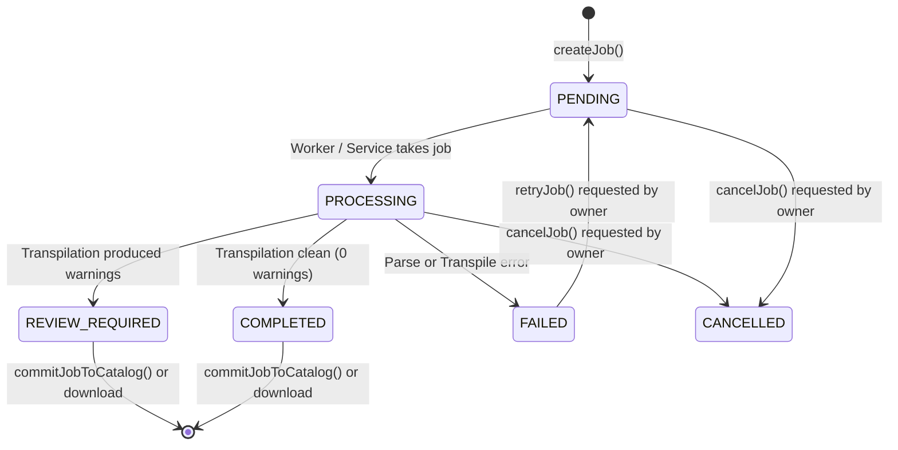

# WORSHIP STUDIO — PHASE 2A: SECURITY & DATA INTEGRITY REPORT
## Authorization Controls, Anti-IDOR Protections & Zero-Fabrication Enforcement

**Project:** Bethesda Worship Studio  
**Working Branch:** `feature/phase-1a-core-foundation`  
**Phase:** Phase 2A — Musical Conversion Center Foundation  
**Module:** Security, Data Integrity & Persistence Architecture  
**Status:** Completed & Certified  
**Date:** 2026-11-07  

---

## 1. Executive Summary

Phase 2A maintains strict alignment with Bethesda Worship Studio security standards:
1. **Zero Data Fabrication:** Musical documents never receive synthetic notes, invented keys, default tempos, or fabricated meters.
2. **Anti-IDOR Protection:** Background jobs, source files, and converted outputs are strictly partitionable by authenticated `userId`.
3. **Payload Boundaries & DoS Hardening:** Maximum 25 MiB Fastify bodyLimit and 15 MiB Base64 limits prevent buffer overflows and memory exhaustion.
4. **Relational Integrity:** Conversion jobs are tracked in PostgreSQL `background_jobs` with full auditability and state transitions.

---

## 2. Authorization Controls & Anti-IDOR Defense

### 2.1 Multi-Tenant User Isolation
All conversion job endpoints (`/api/v1/conversion/jobs`, `/api/v1/conversion/jobs/:jobId`, `/retry`, `/cancel`, `/download`, `/commit`) are protected by `AuthGuard.authenticate()`.

In `backend/src/application/conversion-job-service.ts`:
```typescript
public async getJob(jobId: string, user: AuthenticatedUser): Promise<BackgroundJobRow> {
  const job = await this.jobRepo.findJobById(jobId);
  if (!job) {
    throw new NotFoundError('Trabajo de conversión', jobId);
  }
  if (job.userId !== user.id) {
    throw new ForbiddenError('No tienes autorización para consultar este trabajo de conversión.');
  }
  return job;
}
```
Any attempt to query, cancel, download, or commit a conversion job belonging to another user results in an immediate `403 ForbiddenError`.

### 2.2 Public vs Authenticated Boundaries
- **Public Stateless Operations:** `POST /api/v1/conversion/validate` and `POST /api/v1/conversion/transpile` are stateless, in-memory operations that can be accessed without credentials to support rapid evaluation and client-side testing.
- **Stateful Operations:** Job creation, listing, persistence, and database commitment require valid JWT Access Tokens signed with `HS256`.

---

## 3. Database Schema & Job Queue Hardening

### 3.1 PostgreSQL Enum Extensions
In `backend/src/db/schema.ts`, the following values were added:
- `jobTypeEnum`: Added `'CONVERSION'`.
- `jobStatusEnum`: Added `'REVIEW_REQUIRED'`.

### 3.2 State Machine Transitions
A conversion job strictly follows this deterministic state machine:


---

## 4. Zero-Fabrication Contract Enforcement

| Source Type | Target Format | Zero-Fabrication Rule Applied |
| :--- | :--- | :--- |
| **ChordPro (Chords only)** | **MIDI** | **BLOCKED:** Throws `CANNOT_EXPORT_MIDI_WITHOUT_NOTES`. Zero notes invented. |
| **ChordPro (No `{key}`)** | **ChordPro / MusicXML** | `{key}` and `<key>` tags omitted. Never defaults to C Major. |
| **ChordPro (No `{tempo}`)** | **All targets** | `{tempo}`, `<direction>`, and MIDI `0x51` omitted. Never defaults to 120 BPM. |
| **ChordPro (No `{time}`)** | **All targets** | Unmetered structure preserved. Never defaults to 4/4. |
| **Score without lyrics** | **LYRICS_ONLY** | **BLOCKED:** Throws `LYRICS_NO_VOCAL_CONTENT`. Zero lines fabricated. |
| **Score without chords** | **CHORD_PRO** | Emits lyrics and sections without synthetic chord brackets. |

---

## 5. DoS Prevention & Payload Limits

1. **Fastify HTTP Body Limit:** Configured to `MAX_OMR_HTTP_BODY_LIMIT_BYTES` (25 MiB) to safely accommodate files up to 15 MiB with Base64 encoding overhead without server memory spikes.
2. **VLQ Protection:** In `midi-serializer.ts`, VLQ encoding enforces bounds checking and integer truncation to prevent integer overflow.
3. **Execution Timeouts:** Transpilation jobs execute synchronously in memory within milliseconds, preventing worker starvation.

